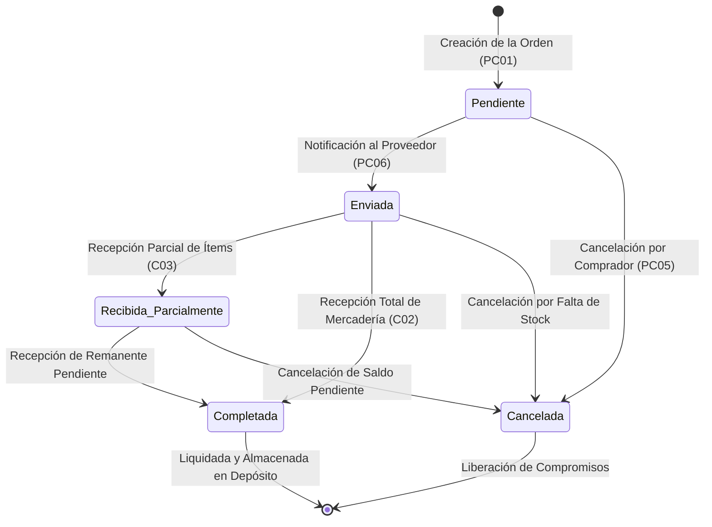
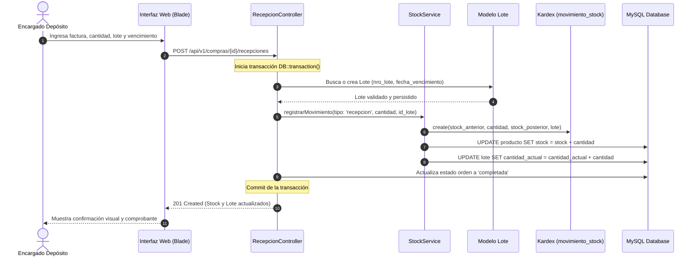
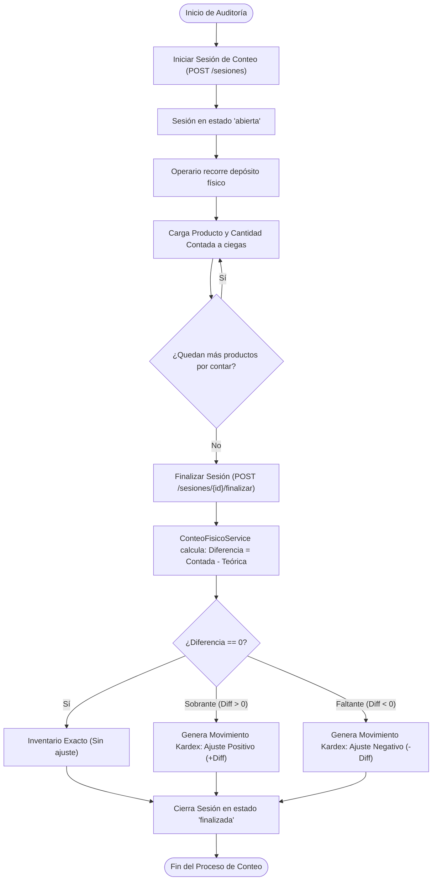
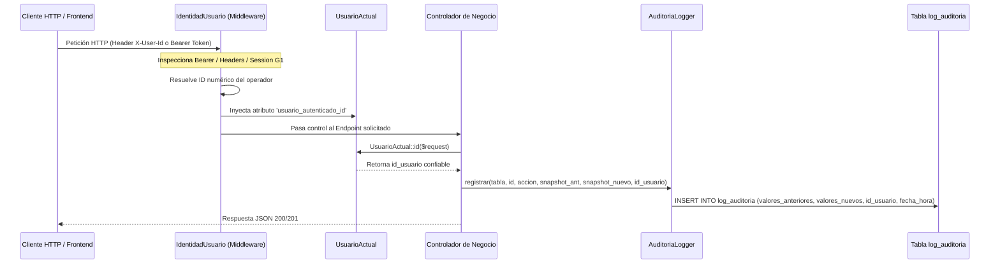

# Diagramas de Arquitectura, Flujo y Secuencia — ERP Juan23

Este documento contiene los diagramas técnicos modelados en formato **Mermaid**, renderizables directamente de forma nativa en GitHub o en cualquier visor de Markdown.

---

## 1. Diagrama de Estados: Ciclo de Vida de la Orden de Compra (PC06)

Representa la máquina de estados por la que transita una orden de compra desde su emisión hasta su liquidación física:

---

## 2. Diagrama de Secuencia: Circuito de Abastecimiento e Impacto en Kardex

Muestra la interacción entre los diferentes componentes al recibir una compra con lote y vencimiento:

---

## 3. Diagrama de Flujo: Sesión de Conteo Físico a Ciegas (S13)

Describe el proceso de auditoría y ajuste automático de inventario para eliminar discrepancias:

---

## 4. Diagrama de Secuencia: Arquitectura de Seguridad e Identidad

Muestra cómo el middleware desacopla y resuelve la identidad del usuario para la auditoría:

