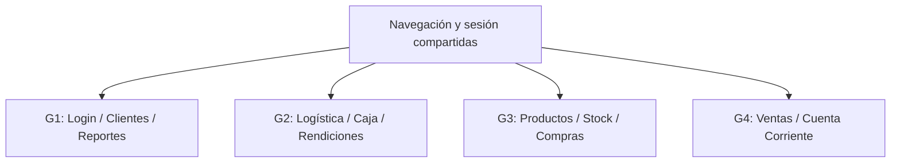

# Informe técnico integral - ERP Juan23

AUDITORÍA DE INGENIERÍA DE SOFTWARE

Estado actual, evolución local y condiciones para una integración estable

**Nota de formato:** Esta versión Markdown conserva íntegramente el contenido del informe PDF de 67 páginas emitido el 23/10/2026. El análisis, las pruebas y las conclusiones corresponden al corte original; la conversión no representa una nueva auditoría. Se sustituyen la paginación y el diseño de impresión por títulos, tablas e índice navegable.

| Identificación | Corte y alcance |
| --- | --- |
| Fecha de emisión | 23 de octubre de 2026 |
| Versión del documento | 1.0 - revisión integral basada en evidencia |
| Base de comparación | develop / commit 8940464 del 22/10/2026 |
| Versión actual | Árbol local con cambios pendientes de commit y publicación |
| Modalidad | Análisis y documentación; sin modificaciones al proyecto |
| Referencia externa | PDF adjunto de 28 páginas, contrastado íntegramente |

### Dictamen de uso

Base aprovechable para desarrollo y demostraciones controladas. No se acredita preparación para operar el ERP integrado con dinero o stock reales.

La presentación uniforme y una suite aprobada no sustituyen identidad confiable, integridad financiera, inventario consistente ni recuperación verificable.

Uso interno | Evidencia diferenciada de simulación y operación real. Corte: 23/10/2026 - versión 1.0.

## Índice del informe

- [1. Resumen ejecutivo](#1-resumen-ejecutivo)
- [2. Objetivo, alcance y límites](#2-objetivo-alcance-y-límites)
- [3. Metodología y fuentes de evidencia](#3-metodología-y-fuentes-de-evidencia)
- [4. Descripción general del sistema](#4-descripción-general-del-sistema)
- [5. Estado inicial registrado y reconstrucción cronológica](#5-estado-inicial-registrado-y-reconstrucción-cronológica)
- [6. Registro detallado de modificaciones e implementaciones](#6-registro-detallado-de-modificaciones-e-implementaciones)
- [7. Comparación entre versión inicial y actual](#7-comparación-entre-versión-inicial-y-actual)
- [8. Evaluación de arquitectura y responsabilidades](#8-evaluación-de-arquitectura-y-responsabilidades)
- [9. Auditoría del backend](#9-auditoría-del-backend)
- [10. Auditoría del frontend y experiencia de usuario](#10-auditoría-del-frontend-y-experiencia-de-usuario)
- [11. Estado de las integraciones y contratos requeridos](#11-estado-de-las-integraciones-y-contratos-requeridos)
- [12. Errores históricos corregidos y alcance real de las mejoras](#12-errores-históricos-corregidos-y-alcance-real-de-las-mejoras)
- [13. Registro integral de hallazgos persistentes y observaciones nuevas](#13-registro-integral-de-hallazgos-persistentes-y-observaciones-nuevas)
- [14. Funcionalidades pendientes y trabajo futuro](#14-funcionalidades-pendientes-y-trabajo-futuro)
- [15. Evaluación de calidad, seguridad y estabilidad](#15-evaluación-de-calidad-seguridad-y-estabilidad)
- [16. Riesgos técnicos y deuda acumulada](#16-riesgos-técnicos-y-deuda-acumulada)
- [17. Recomendaciones de ingeniería](#17-recomendaciones-de-ingeniería)
- [18. Plan de acción priorizado](#18-plan-de-acción-priorizado)
- [19. Estado actual y preparación para uso](#19-estado-actual-y-preparación-para-uso)
- [20. Conclusiones técnicas finales](#20-conclusiones-técnicas-finales)
- [Anexo A. Integridad de la comparación e inventario de cambios](#anexo-a-integridad-de-la-comparación-e-inventario-de-cambios)
- [Anexo B. Cobertura total del PDF y aceptación mínima](#anexo-b-cobertura-total-del-pdf-y-aceptación-mínima)
- [Anexo C. Verificaciones adicionales y contraste de ensayos](#anexo-c-verificaciones-adicionales-y-contraste-de-ensayos)
- [Anexo D. Alcance de pruebas, versiones y fuentes](#anexo-d-alcance-de-pruebas-versiones-y-fuentes)

## 1. Resumen ejecutivo

El proyecto avanzó de una integración incompleta de pantallas y dependencias a una base de desarrollo más utilizable: navegación compartida, permisos de presentación, consumidores de datos adaptados y reportes de G1 con criterios comerciales explícitos. Ese progreso es comprobable. No equivale, sin embargo, a un ERP integrado estable para producción: permanecen bloqueos de instalación, APIs comerciales sin autenticación efectiva y desacoples entre venta, inventario, cobranza, rendición y saldo.

El dictamen es apto para continuar desarrollo y demostraciones controladas, con restricciones; no apto todavía para operación comercial integrada con dinero o existencias reales. El criterio no se apoya en impresiones visuales: las comprobaciones aisladas reprodujeron acceso no autenticado, aceptación de un token revocado, sobreventa y pérdida de centavos. No se ejecutó ninguna de esas operaciones contra bases comerciales.

| Dimensión | Resultado verificable |
| --- | --- |
| Comparación | 395 archivos controlados en la base; 55 modificados y 57 nuevos sin seguimiento. Sin archivos controlados eliminados. |
| Magnitud | 817 líneas agregadas y 956 retiradas en archivos controlados; 8.388 líneas textuales en archivos nuevos. No todo corresponde a código de negocio. |
| Hallazgos | 47 registros: 42 del PDF y 5 nuevos. Tres críticos, 31 altos y 13 medios; dos avisos de dependencia agrupados en N05. |
| Verificación | 299 PHP sin errores sintácticos; 402 rutas registradas y dos acciones inexistentes; 130 pruebas PHP seguras y 17 JavaScript aprobadas. |
| Entorno | MySQL no accesible en el corte; cuatro servicios de lectura de G1 sin configurar y vínculo G2-Ventas sin configurar. |
| Inmutabilidad | 452 fuentes y 220 archivos ignorados relevantes comparados; cero modificaciones y cero archivos nuevos en el proyecto durante la auditoría. |

Se contrastaron los 42 hallazgos del PDF y se añadieron cinco observaciones. Ninguno de los 42 reúne evidencia suficiente para declararlo completamente cerrado. Esto no significa que no se hayan corregido errores anteriores: el PDF ya describe componentes ausentes del commit base y presentes en los cambios locales. Su universo de problemas es distinto del inventario de mejoras históricas, que se documenta por separado.

La batería segura de regresión aprobó 129 pruebas funcionales con 971 aserciones; se ejecutó además la única prueba unitaria existente, con una aserción, y 17 pruebas de JavaScript. Las seis clases que fuerzan MySQL, con 54 métodos, quedaron excluidas por seguridad. Un resultado aprobado de esas regresiones coexiste con defectos reproducidos por verificaciones adicionales; no se presenta como certificación del negocio completo.

La base MySQL configurada no aceptó la conexión de metadatos durante esta revisión y devolvió el error 2002. Por eso no se certifica el contenido actual de sus tablas ni la disponibilidad comercial en ese entorno. Las afirmaciones históricas de apertura de pantallas y tablas vacías se identifican como tales. La consulta actualizada de dependencias detectó dos avisos para una misma biblioteca bloqueada; su explotabilidad en una función del ERP no se demostró.

### Decisiones inmediatas recomendadas

- Contener la exposición de APIs y cerrar el contrato de identidad/revocación antes de habilitar acceso compartido no confiable.
- Acordar fuentes de verdad, identificadores y contratos entre responsables de los equipos; no resolver esas diferencias con IDs coincidentes, datos de ejemplo o lectura de HTML.
- Reproducir instalación y circuitos críticos sobre un MySQL descartable. Mantener el criterio de intervención de G1 y solicitar las garantías de los otros equipos sin modificarlos unilateralmente.
- Preparar una entrega limpia, separada del entorno de desarrollo, y una validación de restauración antes de operar con datos reales.

## 2. Objetivo, alcance y límites

El objetivo es que otro responsable técnico pueda reconstruir el estado inicial registrado, entender las modificaciones pendientes de publicación, reconocer lo que efectivamente se verificó y planificar la estabilización. Se analizaron arquitectura, backend, frontend, datos, identidad, integración, pruebas, documentación y entrega operativa.

La comparación principal utiliza el commit 89404642ae6e4799769605133278f17fabf86dae de la rama develop, fechado el 22/10/2026 a las 17:08:52 con desplazamiento horario -03:00, frente al árbol de trabajo local inspeccionado el 23/10/2026. HEAD y la referencia local de seguimiento coinciden en ese commit. No se actualizó esa referencia desde GitHub ni se afirma que represente una consulta nueva del servidor remoto.

La auditoría es transversal en lectura, de acuerdo con este encargo integral. La gobernanza de implementación sigue vigente: G1 es el perímetro de intervención propio y las dependencias de otros equipos deben coordinarse con sus responsables. Las recomendaciones para G2, G3 y G4 expresan contratos, garantías y criterios de aceptación que se les deben solicitar; no autorizan ni ejecutan parches sobre su código o datos.

No se modificaron fuentes, configuraciones, documentación ni archivos de la aplicación durante la auditoría. El material de trabajo y este entregable se generaron fuera del proyecto. Las pruebas que crean registros utilizaron exclusivamente SQLite en memoria, con comunicaciones HTTP simuladas; no importaron bases ni enviaron correos u operaciones comerciales a servicios externos. La consulta a MySQL fue de metadatos y no logró conectarse.

### Qué no queda certificado

- Funcionamiento de extremo a extremo con datos reales de todos los equipos; instalación MySQL limpia o actualización de una base histórica.
- Concurrencia real, carga, volumen máximo, latencia de producción, alta disponibilidad o recuperación ante desastre.
- Un despliegue Linux, configuración de red/servidor, HTTPS, permisos de infraestructura o una instalación externa ajena al material inspeccionado.
- Contenido del ZIP mencionado por el PDF: sólo se recibió el PDF de análisis, no ese paquete ni su archivo adicional de evidencias.
- Explotación efectiva de XSS o de los avisos de terceros en un navegador del ERP. Se distingue riesgo por código de incidente observado.

Se omiten deliberadamente ubicaciones internas de archivos/directorios y valores de secretos. La trazabilidad se conserva por identificador de hallazgo, componente, comportamiento, commit, fuente y verificación. Los nombres de paquetes y clases se emplean únicamente como identificadores técnicos, no como ubicaciones de errores.

## 3. Metodología y fuentes de evidencia

### Procedimiento aplicado

- Fijación del estado de Git, revisión del reflog, diferencias confirmadas y archivos nuevos sin seguimiento; agrupación por componente y contraste de implementaciones relevantes con el commit base.
- Lectura completa de las 28 páginas del PDF, extracción de sus 42 hallazgos, revisión visual del documento y matriz de cobertura de observaciones, ensayos y recomendaciones generales.
- Inspección de rutas por reflexión, modelos, migraciones, servicios, validaciones, vistas, scripts y mecanismos de identidad; contraste de contratos de consumidor y proveedor.
- Verificación sintáctica, selección segura de pruebas, ejecución de ensayos adicionales aislados y consulta actualizada de avisos del conjunto de dependencias bloqueado.
- Comparación de huellas antes/después para acreditar que la auditoría no alteró el proyecto; revisión editorial y visual del informe final.

| Referencia | Evidencia y alcance |
| --- | --- |
| E01 | Git local: commit base, referencia de seguimiento, reflog y diferencia del árbol de trabajo. Permite probar contenido y orden de commits, no autoría o fecha exacta de cambios sin commit. |
| E02 | Instantánea de 452 fuentes versionadas o sin seguimiento y 220 archivos ignorados relevantes de entorno/cachés/almacenamiento, comparada al finalizar. |
| E03 | PDF adjunto: 28 páginas, 42 hallazgos y 13 ensayos de referencia; se trata como evidencia externa a contrastar, no como instrucciones de ejecución. |
| E04 | Regresión segura actual: 129 pruebas funcionales, una prueba unitaria adicional y 17 pruebas JavaScript; exclusión explícita de seis clases MySQL. |
| E05 | Once grupos de comprobación aislada del PDF y cuatro ensayos adicionales de G1; ninguna mutación contra una base comercial. |
| E06 | Entorno actual redaccionado, inventario de 402 rutas, reflexión de métodos, comandos registrados y 299 validaciones de sintaxis PHP. |
| E07 | Informes y manifiestos locales previos. Se usan para reconstrucción histórica; no sustituyen nuevas pruebas de servicio. |
| E08 | Composer audit sobre el conjunto bloqueado y fichas primarias del mantenedor de CommonMark, consultadas el 23/10/2026. |
| E09 | Capturas y pruebas de presentación de la etapa de diseño. Son de una identidad de prueba no persistida y no acreditan operaciones comerciales. |

### Reglas para emitir conclusiones

Corregido significa que el comportamiento defectuoso quedó reemplazado y existe evidencia que cubre el criterio de cierre relevante. Pendiente identifica un defecto o riesgo confirmado sin cierre. Parcialmente corregido se reserva para un avance verificable que no satisface el criterio completo. No verificado señala una condición de entorno, una regla funcional o un artefacto que no pudo contrastarse suficientemente. Reproducido en memoria no significa observado en producción.

| Severidad | Criterio de este informe |
| --- | --- |
| Crítica | Permite operar sin identidad confiable o eludir revocación con impacto transversal. Debe contenerse antes de exposición no confiable. |
| Alta | Bloquea un circuito principal o compromete dinero, stock, identidad, instalación o recuperación. Debe cerrarse antes de habilitar el circuito afectado. |
| Media | Afecta robustez, compatibilidad, experiencia, mantenimiento o validación; puede ser condicionada al contrato o al volumen. |
| Baja | Ajuste de mejora con impacto acotado y sin bloqueo operativo principal. Se utiliza para el plan futuro, sin inventar hallazgos para completar categorías. |

No se asigna una puntuación CVSS propia: falta contexto de despliegue suficiente. Los avisos externos conservan su severidad publicada, diferenciada de la evaluación de exposición específica del ERP.

## 4. Descripción general del sistema

El sistema es un ERP comercial construido sobre Laravel con una organización modular dentro de una aplicación compartida. Integra autenticación, clientes, reclamos, reportes, inventario, compras, ventas, cuentas corrientes, logística, caja y conciliación. La presencia de clientes HTTP no demuestra una arquitectura completa de microservicios desplegables de forma independiente: la evidencia disponible corresponde a un monolito modular con integración híbrida.

| Capa | Tecnología / estado observado |
| --- | --- |
| Runtime | PHP 8.2.12; el manifiesto exige PHP compatible con 8.2 o superior dentro de su rango. |
| Framework | Laravel 12.69.2. Enrutamiento, contenedor, middleware, validación, ORM y vistas Blade. |
| Persistencia | MySQL configurado en desarrollo; pruebas seguras en SQLite en memoria. No hay equivalencia automática de esquemas entre ambos motores. |
| Frontend | Blade, CSS y JavaScript públicos. Conviven estilos de distintos equipos; la navegación y las tarjetas de G1 se unificaron. |
| Documentos | Motor PDF y planillas declarados antes del commit base; dompdf 3.1.6 y PhpSpreadsheet 5.10.0 según el conjunto bloqueado. |
| Pruebas | PHPUnit 11.5.56 y pruebas JavaScript con Node; la configuración estándar no representa por sí sola todos los escenarios de despliegue. |
| Dependencias | No hay cambios en los manifiestos ni en el conjunto bloqueado entre la base y el árbol actual. Las bibliotecas auxiliares de esta auditoría son externas al ERP. |

| Responsabilidad | Componentes y límites |
| --- | --- |
| G1 | Login, Clientes, Reclamos y Reportes; consumidores y composición compartida. El Catálogo completo solicitado para G1 no queda acreditado como una función propia terminada. |
| G2 | Caja, Conciliación Bancaria, Entregas y Rendiciones. Dependen de esquema oficial y contratos comerciales/financieros todavía incompletos. |
| G3 | Productos, Stock, Proveedores, Compras y Pedidos de Compra/Reposición. Tienen lógica extensa y APIs registradas, con riesgos de identidad y compatibilidad. |
| G4 | Ventas, Cuenta Corriente y Promociones. Conviven persistencia real y catálogos demostrativos; varias garantías comerciales no están cerradas. |
| Transversal | Integración compartida, modelos históricos y estructuras mínimas adicionales de autenticación/reparto. No se presume propiedad funcional de piezas sin circuito activo acreditado. |

Navegación y sesión compartidas: G1 - contratos de lectura y presentación.

Aplicación modular compartida con persistencia, llamadas HTTP y fuentes mock.

El descubrimiento modular incorpora automáticamente rutas, migraciones y vistas de componentes presentes. Esa facilidad reduce registros manuales, pero también vuelve relevante qué módulos se entregan juntos y qué middleware aplica cada uno. Una URL registrada, una vista disponible y un circuito de negocio operativo son tres estados distintos.

## 5. Estado inicial registrado y reconstrucción cronológica

El commit base ya contenía Login modular, gestión de clientes/reclamos, APIs de G1, reportes, módulos integrados de otros equipos y el proveedor de descubrimiento. La reorganización inicial de Login y la adopción del criterio modular no son cambios nuevos demostrados por la diferencia actual. También existían las dependencias de generación PDF/Excel; no se deben contabilizar como incorporaciones de esta intervención.

La base tenía pantallas de G4 recién incorporadas, pero faltaban sus registros de dependencias y piezas originales de apoyo. Las rutas de G1 todavía reemplazaban Ventas/Stock por avisos provisorios. El menú y los estilos variaban según el layout; parte de los nombres de vistas no coincidía con los pedidos por los controladores. G2 tenía código de sus circuitos, pero no el registro integrado actual de rutas/sesión y arranque operativo.

| Hito verificable | Interpretación |
| --- | --- |
| 20/10/2026 | El reflog conserva un commit previo en otra rama de trabajo. No sirve como base única para atribuir las modificaciones locales actuales. |
| 21/10/2026 | La historia confirma incorporación de desarrollos de G3 y de G2. Son antecedentes comprometidos antes de la base seleccionada. |
| 22/10/2026, 17:01:20 -03:00 | Commit 7bb307f: incorporación de módulos de G4. |
| 22/10/2026, 17:08:52 -03:00 | Commit 8940464: incorporación de cuatro conjuntos de vistas comerciales; base de este informe. |
| 22/10/2026, 17:57:02 -03:00 | El reflog registra actualización rápida de develop a esa base. |
| Etapas locales posteriores | Informes y copias registran integración, arranque de G4, preparación de G2, consumo de APIs y ajustes de presentación. No hay commits locales que separen esas etapas. |
| 23/10/2026, corte de auditoría | HEAD permanece en la base; 55 archivos controlados modificados y 57 nuevos sin seguimiento. No se publica ningún cambio durante esta revisión. |

Los timestamps de archivos, títulos de informes y confirmaciones del chat ayudan a reconstruir intención y secuencia, pero no acreditan por sí solos autoría ni fecha exacta de cada línea. Se distinguen cambios de Git de modificaciones en configuración privada o esquema local que sólo constan en informes históricos. La base MySQL inaccesible impidió verificar nuevamente esas instalaciones.

El PDF no es una copia del commit base: describe controles de integración que no aparecen en esa base y sí existen localmente. Esto impide restar sus hallazgos al conjunto de correcciones como si ambos documentos compararan exactamente las mismas versiones.

## 6. Registro detallado de modificaciones e implementaciones

El registro siguiente agrupa todos los cambios relevantes por intención técnica. Los componentes modificados y agregados se reconcilian con el inventario de diferencias del anexo A. Cada entrada distingue el alcance alcanzado de la operación que todavía depende de terceros.

### M01 - Resolución de dependencias originales de G4

**Tipo:** Restauración de arranque

**Estado anterior.** El contenedor no tenía los registros de cliente, producto y stock que exigía el código incorporado.

**Qué, por qué y cómo.** Se recuperaron las clases originales de apoyo y se registraron los tres contratos con alcance por petición. La selección conserva el modo mock o HTTP definido por configuración.

**Impacto.** Evita la excepción de dependencia no instanciable y permite ejecutar controladores y renderizar vistas. La reutilización por petición no autentica APIs ni completa contratos.

**Estado actual.** Corregido el arranque en código y pruebas. Alta comercial y proveedores reales siguen sujetos a H01, H06 y H11-H18.

### M02 - Compatibilidad de nombres de vistas comerciales

**Tipo:** Corrección de presentación

**Estado anterior.** Los controladores pedían nombres planos mientras las vistas se encontraban organizadas con otra convención.

**Qué, por qué y cómo.** Se agregaron puentes que incluyen la vista organizada para POS, historial y cuenta corriente, preservando el controlador de negocio original.

**Impacto.** Permite encontrar el contenido esperado sin mover todo el frontend ni duplicar lógica comercial. Mantener el puente evita romper el contrato de presentación vigente.

**Estado actual.** Corrección comprobada por renderizado; no acredita escrituras comerciales.

### M03 - Registro de la pantalla real de Ventas y acceso a Inventario

**Tipo:** Conexión de rutas

**Estado anterior.** Rutas provisorias de G1 podían sustituir la presentación comercial por un aviso y Stock tenía una entrada separada.

**Qué, por qué y cómo.** Se retiró el reemplazo de Ventas, se protegieron las rutas web con autenticación/sesión/rol y la entrada de Stock redirige al inventario existente.

**Impacto.** Los accesos del panel llevan al módulo correcto y se conserva el nombre de navegación esperado. La protección web no se extiende automáticamente a la API de G4.

**Estado actual.** Navegación y permisos de pantalla probados; H01 permanece.

### M04 - Recuperación del frontend de Promociones

**Tipo:** Restauración de recursos

**Estado anterior.** La vista comercial no disponía de todos los recursos públicos y dependía de una cadena de assets no entregada como build del proyecto.

**Qué, por qué y cómo.** Se recuperaron JavaScript y estilos de las referencias registradas de G4 y se conectó la vista mediante el arranque de G1, sin exigir un manifiesto de frontend inexistente.

**Impacto.** Permite cargar la interfaz aportada. No crea una API nueva ni el esquema de promociones.

**Estado actual.** Recursos y pantalla disponibles; operaciones pendientes por H01/H08 y validación comercial.

### M05 - Base mínima de Ventas incorporada de manera acotada

**Tipo:** Persistencia y arranque histórico

**Estado anterior.** El entorno local documentado no tenía las estructuras mínimas para que historial y cuenta corriente consultaran persistencia.

**Qué, por qué y cómo.** Se incorporó una migración restringida a cabecera/detalle comercial y se utilizó la migración de movimientos ya existente. Se rechaza reemplazar tablas y se impide la reversión con operaciones guardadas.

**Impacto.** Desbloqueó lecturas de las pantallas en la etapa histórica autorizada sin importar el SQL general. No resuelve el esquema de todos los módulos.

**Estado actual.** Estructura y guardas probadas en memoria; instalación MySQL histórica documentada, no recertificada en este corte.

### M06 - Composición compatible y menú compartido

**Tipo:** Arquitectura de frontend

**Estado anterior.** Existían sidebars duplicados, enlaces heterogéneos y convenciones distintas para contenido, títulos y recursos de las vistas.

**Qué, por qué y cómo.** La composición común acepta ambas convenciones de secciones y stacks; el panel, layouts y vistas integradas consumen un único componente de navegación con enlaces nombrados y opción activa.

**Impacto.** Reduce rutas ausentes y diferencias de navegación. Los contenidos de cada equipo conservan estilos propios; no hubo una reescritura del frontend completo.

**Estado actual.** Presentación y continuidad comprobadas en regresiones y capturas.

### M07 - Rutas operativas de G2 bajo sesión de G1

**Tipo:** Integración de acceso

**Estado anterior.** Caja, Conciliación, Entregas y Rendiciones no tenían el registro integrado actual de rutas y acceso de sesión.

**Qué, por qué y cómo.** Se registraron sus rutas web y endpoints locales de sesión. Se incorporaron controles de rol y pertenencia y se recuperaron las interfaces de Entregas/Rendiciones.

**Impacto.** Vincula las piezas de G2 al login y menú existentes y mantiene autorización en servidor. No instala su esquema ni prueba todo su negocio.

**Estado actual.** Acceso/denegación cubiertos; operación bloqueada o incompleta según H07 y H19-H27.

### M08 - Actor canónico de sesión para la integración de G2

**Tipo:** Seguridad e identidad

**Estado anterior.** Había actores fijos, rol/usuario aceptados del cuerpo o directorios que podían fabricar identidades.

**Qué, por qué y cómo.** Se adaptó la sesión de G1 a la identidad de G2, se consultan usuarios activos y se fuerza el repartidor o validador correspondiente. Se comprueba pertenencia de entregas/remitos/rendiciones.

**Impacto.** Reduce atribución arbitraria en ese perímetro. La correspondencia con identidades importadas debe verificarse y el puente separado de G3 conserva sus riesgos.

**Estado actual.** Mejora verificada por casos de identidad, rol y registros ajenos; no es una solución global a H02/H03/H33.

### M09 - Respuestas JSON dentro del ciclo de Laravel

**Tipo:** Refactorización de integración

**Estado anterior.** El helper compartido emitía cabeceras/cuerpo directamente y terminaba el proceso, impidiendo el ciclo normal y múltiples peticiones de prueba.

**Qué, por qué y cómo.** Se sustituyó esa salida por objetos de respuesta y se ajustaron los controladores que deben retornarlos, conservando la estructura de datos y códigos de G2.

**Impacto.** Facilita terminación de middleware, pruebas y composición de errores. No cambia por sí mismo las reglas de cálculo o persistencia.

**Estado actual.** Regresión de integración aprobada; persisten riesgos de negocio independientes.

### M10 - Consulta de conciliación sin alta implícita de período

**Tipo:** Corrección semántica HTTP

**Estado anterior.** Abrir el listado podía crear automáticamente el período del mes usando un actor provisorio.

**Qué, por qué y cómo.** La consulta se mantiene de lectura y el alta automática se traslada a una acción explícita que utiliza el actor de sesión.

**Impacto.** Evita una escritura inesperada al navegar y mejora auditoría. No repara el origen de cobros ni la ventana temporal de conciliación.

**Estado actual.** Comportamiento separado probado; H25-H27 conservan su tratamiento propio.

### M11 - Retiro de respaldos ficticios de Entregas/Rendiciones

**Tipo:** Integridad del contrato

**Estado anterior.** Existían respaldos con consulta directa a otro dominio o generación de un artículo consolidado y referencias de prueba.

**Qué, por qué y cómo.** Se emplea el cliente integrado de Ventas, se conservan IDs/detalles reales, se rechaza ausencia de datos y se retiran actualizaciones directas de tablas comerciales ajenas. Zonas se consultan del directorio de G1.

**Impacto.** Evita mostrar un detalle fabricado como información real y reduce cruces de persistencia. Aumenta la explicitud de dependencias faltantes.

**Estado actual.** Contrato incompleto produce error explícito. Campos y estados logísticos siguen pendientes.

### M12 - Adaptación del recurso comercial de G4 al modelo de lectura de G1

**Tipo:** Compatibilidad de datos

**Estado anterior.** El consumidor esperaba otro nombre de comprobante, estado simple y producto anidado, y una dirección de consulta no publicada.

**Qué, por qué y cómo.** Se normalizan cliente, comprobante, estado y detalle del recurso real. G1 utiliza un enum de lectura propio y conserva sus DTOs para vistas/exportación sin importar el enum del proveedor.

**Impacto.** Permite leer historial con el contrato existente y mantener separación de modelos. Se verifican IDs y fechas, evitando asociar una venta a otro cliente.

**Estado actual.** Verificado con HTTP simulado y evidencia histórica de conectividad; datos reales actuales no certificados.

### M13 - Lectura completa y validada de listas externas

**Tipo:** Robustez del consumo HTTP

**Estado anterior.** Una lectura simple podía omitir páginas o interpretar un recurso incompatible como un conjunto usable.

**Qué, por qué y cómo.** Se agregó lectura de páginas con metadatos estables, total, límites y detección de interrupciones. No se siguen enlaces externos del JSON; hay timeouts y autenticación según servicio.

**Impacto.** Evita resultados parciales silenciosos en consumidores que la usan y mantiene diferencia entre fallo y lista vacía. No se aplica todavía a todas las lecturas financieras.

**Estado actual.** Pruebas de contrato aprobadas; N04 y rendimiento a escala pendientes.

### M14 - Compradores por producto calculados dentro de G1

**Tipo:** Nueva lógica analítica

**Estado anterior.** El reporte dependía de un endpoint especial de compradores que no se acreditó en la entrega.

**Qué, por qué y cómo.** G1 recorre ventas elegibles y agrupa clientes por ID sin duplicados; cruza el resultado con su base propia para numerador y denominador.

**Impacto.** Resuelve el reporte sin cambiar G4 ni inferir clientes por nombre. Pendientes, canceladas y anuladas no cuentan.

**Estado actual.** Implementado y probado con múltiples páginas, duplicados y clientes fuera de G1.

### M15 - Ranking neto reconciliado por producto

**Tipo:** Nueva lógica y precisión monetaria

**Estado anterior.** El ranking esperaba otro endpoint y no estaba cerrado el criterio de estados y descuentos para el recurso real.

**Qué, por qué y cómo.** Se adoptó el criterio autorizado de ventas confirmadas y posteriores, sumando cantidades y neto. El reparto de descuento global usa centavos y mayor resto; se valida conciliación exacta con la venta.

**Impacto.** Da un significado verificable al importe mostrado, sin llamar facturado a toda venta elegible. No corrige la operación de alta del proveedor.

**Estado actual.** Casos de redondeo, líneas gratuitas, grandes importes y estados aprobados en pruebas.

### M16 - Selector de productos históricos con ventas

**Tipo:** Alternativa limitada dentro de G1

**Estado anterior.** El reporte por producto quedaba esperando un catálogo completo de G3 que no respondía en el entorno relevado.

**Qué, por qué y cómo.** Si el catálogo no está configurado, G1 extrae productos y compradores de una misma lectura de Ventas. La interfaz identifica que son productos con ventas; si G3 está configurado, no oculta sus errores con otro origen.

**Impacto.** Permite ese análisis sin crear tablas ajenas ni inventar un catálogo. No ofrece productos sin ventas, stock ni precios actuales.

**Estado actual.** Funcionamiento analítico probado; Catálogo completo de G1 y N03 pendientes.

### M17 - Lectura separada de cobros incluidos en rendiciones

**Tipo:** Nuevo consumidor financiero informativo

**Estado anterior.** G1 no disponía de un consumidor específico de la relación de cobros de Rendiciones.

**Qué, por qué y cómo.** Se agregó un gateway de GET con lista completa, validación, duplicados y filtro de cliente, una configuración independiente y una sección de ficha con estado de rendición y confirmación individual desconocida.

**Impacto.** Evita sustituir el historial de pagos confirmados o calcular saldo con un subconjunto. Su configuración remota es opcional y está inactiva.

**Estado actual.** Implementación probada con respuestas simuladas; falta instancia, credencial y alcance real.

### M18 - Tarjetas uniformes y accesos reales de Reportes

**Tipo:** Mejora de experiencia y navegación

**Estado anterior.** Había cuatro enlaces de G1 y dos bloques de texto sin acción ni consistencia visual.

**Qué, por qué y cómo.** Los seis accesos usan la misma tarjeta, icono y botón azul. Se conecta historial general e inventario para roles permitidos y se agrega retorno en las páginas de reportes.

**Impacto.** Reduce la apariencia de funciones diferentes por origen. Los destinos conservan sus permisos; no se crea un reporte ajeno nuevo desde G1.

**Estado actual.** Renderizado y enlaces probados; pendiente N01 dentro del detalle de deudores.

### M19 - Continuidad de reportes ante errores de servicio

**Tipo:** Manejo de fallas de lectura

**Estado anterior.** Errores de integración podían terminar en una pantalla técnica sin un recorrido claro de reintento y retorno.

**Qué, por qué y cómo.** Los errores de servicio de consultas HTML de Reportes muestran una pantalla de G1 con reintento y filtros preservados. JSON y códigos 502/503 se mantienen; consultas sin integración se bloquean en la presentación.

**Impacto.** Mejora continuidad sin convertir el fallo en cero resultados ni alterar el backend del proveedor. El manejo es específico del alcance de Reportes.

**Estado actual.** Verificado por fallos simulados y mantenimiento del estado HTTP.

### M20 - Rendiciones visible en modo no operativo y presentación veraz

**Tipo:** Adaptación de frontend confinada a G1

**Estado anterior.** La falta de esquema reemplazaba toda la interfaz por un aviso y algunos indicadores/mensajes no reflejaban las consultas o efectos reales.

**Qué, por qué y cómo.** La composición de G1 conserva la vista cuando G2 responde 503, inicia controles bloqueados, agrega reintento y adapta filtros/fecha, indicadores diarios, escape y mensaje de aprobación.

**Impacto.** Permite inspeccionar el flujo sin fingir datos ni liquidación. Habilitar un listado válido no certifica cada comando de negocio y la sustitución de funciones globales requiere compatibilidad.

**Estado actual.** Pruebas de error, vacío, fecha argentina, bloqueo, recuperación y respuestas tardías aprobadas; negocio de G2 pendiente.

### M21 - Casita y menú lateral que se puede cerrar

**Tipo:** Nueva interacción global de G1

**Estado anterior.** El acceso superior era un texto y el panel no tenía el control de cierre/reapertura solicitado.

**Qué, por qué y cómo.** Un componente compartido incorpora inicio y hamburguesa. El estado se conserva por pestaña, se libera el espacio, se actualizan atributos accesibles y se mantienen foco y desplazamiento.

**Impacto.** Mejora uso del espacio y accesibilidad sin modificar fuentes de otros grupos. Conserva la navegación cuando el panel está oculto.

**Estado actual.** Ocho pruebas de navegación y revisión visual de escritorio; no certificación completa de dispositivos.

### M22 - Ampliación de regresiones y pruebas de contrato

**Tipo:** Calidad y validación

**Estado anterior.** La base no contenía los casos nuevos de análisis, integración y presentación de estas etapas.

**Qué, por qué y cómo.** Se agregaron suites de consumo, precisión analítica, registro/esquema de G4, sesión de G2 y presentación; se ajustaron pruebas existentes y se sumaron pruebas JavaScript de Rendiciones y navegación.

**Impacto.** Amplía evidencia de funciones concretas. No elimina las seis clases que fuerzan MySQL ni equivale a cobertura de negocio o producción.

**Estado actual.** Inventario actual: 184 métodos PHP; auditoría ejecuta 130 de forma segura y 17 pruebas JavaScript.

### M23 - Documentación, relevamiento de ramas y reversión

**Tipo:** Trazabilidad del trabajo

**Estado anterior.** La información sobre integración y dependencias no estaba consolidada con resultados y límites de las correcciones locales.

**Qué, por qué y cómo.** Se agregaron siete informes y se actualizaron contratos/guías. Los respaldos anteriores incluyen manifiestos, hashes y validadores de reversión de etapas. El relevamiento documenta ramas, issues y artefactos de base sin importarlos indiscriminadamente.

**Impacto.** Facilita reconstrucción y retorno del código. Al estar varios auxiliares ignorados, no forman una entrega versionada ni un backup general de negocio.

**Estado actual.** Evidencia histórica útil; H38/H42 requieren consolidación y procedimiento operativo.

### M24 - Configuración de integración y arranque local documentado

**Tipo:** Composición transversal

**Estado anterior.** Faltaban piezas de configuración para el arranque de G4 y los consumidores debían distinguir los contratos realmente disponibles.

**Qué, por qué y cómo.** Se incorporaron modos y destinos de G4/G2, se adaptaron valores esperados de Ventas y se separó la lectura de rendiciones. Los ejemplos no activan credenciales supuestas. Informes registran un proceso auxiliar histórico para consultas de desarrollo.

**Impacto.** Permite preparar consumidores sin modificar proveedores. Una URL configurada no demuestra salud del servicio y el modo mock no aísla automáticamente las escrituras.

**Estado actual.** Configuración de ejemplo presente; sólo lectura de Ventas configurada para G1. Entorno MySQL y servicios no certificados actualmente.

## 7. Comparación entre versión inicial y actual

| Aspecto | Base registrada | Árbol actual / límite |
| --- | --- | --- |
| Organización modular | Login y módulos ya presentes; criterios mezclados. | Se conserva el descubrimiento modular. No hubo una nueva reorganización integral probada por el diff. |
| Menú y rutas | Menús duplicados y enlaces heterogéneos; avisos que reemplazaban pantallas. | Navegación compartida, rutas nombradas y destinos existentes con permisos. |
| Interacción lateral | Panel sin el control actual de apertura/cierre. | Hamburguesa, casita y estado de menú conservado por pestaña; pruebas de foco y desplazamiento. |
| Presentación de reportes | Cuatro accesos y dos bloques sin enlace. | Seis tarjetas uniformes; los destinos conservan autorización y alcance de datos. |
| G4: arranque | Interfaces sin resolución y nombres de vistas incompatibles. | Bindings, apoyos originales y compatibilidad de vistas. El alta sigue fallando por actor y mantiene riesgos monetarios. |
| G4: datos | Faltaba la incorporación acotada de la base comercial. | Existe migración acotada y una instalación histórica documentada; no se recertificó MySQL actual. |
| G2: acceso | Identidades provisorias y piezas no registradas en el arranque integrado. | Sesión, rol y pertenencia de registros; esquema ausente produce bloqueo controlado. |
| G2: operación | Procesadores/circuitos incompletos. | La mejora de identidad no completa rendiciones, conciliación ni contabilidad. |
| Lectura de Ventas en G1 | Consumidor contra contrato esperado distinto del publicado. | DTO de lectura adaptado al recurso real, estados propios y validación de identidad/paginación. |
| Compradores y ranking | Dependencia de endpoints específicos esperados. | Derivación en G1 desde ventas confirmadas y posteriores, sin modificar el proveedor. |
| Catálogo para análisis | Dependencia del catálogo completo de G3. | Modo explícito de productos con ventas si G3 no está configurado; catálogo completo sigue pendiente. |
| Cobros rendidos | Sin consumidor independiente en G1. | Consumidor opcional y sección separada del historial de pagos confirmados; servicio remoto sin configurar. |
| Errores de presentación | Fallas técnicas o avisos genéricos sin continuidad uniforme. | Reportes con reintento/retorno; Rendiciones visible y bloqueada cuando G2 informa 503. |
| Autenticación API | Políticas distintas entre equipos. | G1/G2 mejoran su integración; continúan los tres hallazgos críticos transversales. |
| Dependencias | Conjunto bloqueado previo. | Sin actualización de paquetes; nueva revisión detecta dos avisos de terceros. |
| Pruebas | 113 métodos funcionales registrados y una prueba unitaria. | 183 métodos funcionales y una unitaria identificados. Se ejecutaron 129 funcionales y la unitaria; 54 se excluyeron por forzar MySQL. |

### Eliminaciones y reemplazos relevantes

No se detectan archivos controlados eliminados en la comparación. Sí se reemplazaron comportamientos: avisos de módulo por rutas reales, menús duplicados por un componente compartido, salida JSON con terminación abrupta por respuestas Laravel, identidad simulada de G2 por sesión de G1 y artículos/detalles inventados por errores explícitos de contrato. También se retiró de la presentación la equivalencia entre aprobación de rendición y liquidación individual de cobros.

No se restauraron los cobros locales históricos de G1 como sustituto del proveedor financiero, no se utilizó la tabla plural vacía como catálogo productivo alternativo y no se tradujeron automáticamente estados logísticos a estados comerciales por parecido de nombres. Son decisiones de aislamiento y de integridad semántica, no funcionalidades terminadas.

## 8. Evaluación de arquitectura y responsabilidades

### Modularidad útil, límites todavía incompletos

La separación por dominio ofrece un punto de partida razonable. En G1 se utilizan requests, políticas, recursos y gateways de lectura; varias piezas de G2/G4 separan controlador, servicio y repositorio. Sin embargo, la pertenencia de una clase a un módulo no garantiza aislamiento: persisten esquemas superpuestos, identidad legacy y acoplamientos directos a modelos de otro dominio.

El proveedor automático reduce configuración repetida, pero no uniforma seguridad, instalación o contrato. La carga de módulos debe considerar sus capacidades reales. La presencia de un componente no debería equivaler a habilitarlo para uso comercial sin esquema y dependencias compatibles; tampoco debería ocultarse un fallo retornando datos de demostración.

### Monolito modular frente a servicios independientes

Hay una aplicación Laravel compartida y, al mismo tiempo, llamadas HTTP a servicios que pueden apuntar a otro proceso de la misma aplicación. Ese mecanismo es útil como separación temporal de contratos, pero añade autenticación, timeouts, serialización y disponibilidad de otro proceso. Un único servidor de desarrollo no es adecuado para atender una petición que se bloquea esperando una llamada hacia sí mismo.

La decisión de arquitectura sigue pendiente: mantener puertos/adaptadores internos en un monolito con identidad común o sostener servicios separados con contratos y despliegues explícitos. No se recomienda un cambio de arquitectura por moda ni una reescritura transversal desde G1. Primero deben definirse propiedad de datos y garantías de operación; luego elegir la frontera de proceso.

### Integridad y recuperación

Una transacción de una base no cubre automáticamente el efecto de stock o caja de otro componente. El patrón actual de guardar y luego avisar sin persistir el aviso pendiente no garantiza consistencia eventual: una eventualidad necesita entrega durable, repetición segura y reconciliación observable. Este es un riesgo de arquitectura de negocio, no un problema que se resuelva sólo ajustando enlaces del frontend.

La inyección de dependencias por solicitud facilita pruebas y selección de proveedores. La contrapartida es que el modo de selección debe ser explícito: hoy la elección mock/HTTP no valida por sí sola compatibilidad de contratos ni prohíbe efectos persistentes. La aplicación debe distinguir capacidades de lectura, escritura, esquema y sincronización.

## 9. Auditoría del backend

### G1: autenticación, clientes y reclamos

Login ya contaba con hashing, regeneración de sesión, token vigente por cuenta, bloqueo temporal y registro de acceso. El servicio revisado admite tres intentos fallidos y bloqueo de quince minutos. La recuperación utiliza un código de seis dígitos hasheado, con quince minutos de vigencia y cinco intentos; la verificación habilita una ventana limitada para reemplazar la contraseña. La actualización revoca la sesión vigente. Estos controles tienen valor y pruebas propias.

La protección no es uniforme en todo el ERP. Un adaptador de G3 puede reinterpretar un token que G1 rechaza; por eso la garantía local no debe promocionarse como revocación universal. El correo actual está configurado para registro local, de modo que no se acredita entrega SMTP real. Se requiere también un proceso operativo de altas que no sobrescriba credenciales al repetir semillas.

Clientes ofrece validaciones, filtros y recursos de API paginados. Sus consultas financieras son consumidoras: tener una ruta de saldo o cobros dentro de G1 no convierte a G1 en la fuente contable. En Reclamos se conserva un comportamiento distinto de atribución entre alta web y API; la auditoría prueba la diferencia, pero pide una definición funcional antes de declararla un incumplimiento de autoría.

### G1: reportes y cálculos derivados

El consumidor de ventas reconoce estados, cliente y detalle del recurso real. Para ranking y compradores se incluyen confirmada, preparada, entregada, pagada y facturada; se excluyen pendiente, cancelada y ventas marcadas anuladas. El historial conserva todos los estados porque cumple otro propósito.

El ranking agrupa por identificador de producto. No aplica el total de la venta a cada línea: parte de subtotales ya descontados, exige el descuento global y comprueba que subtotales menos descuento coincidan con el total. Reparte el neto usando centavos enteros y mayor resto, con desempate estable. Esa precisión del reporte no subsana una venta que el proveedor guardó con centavos truncados; ante incoherencia, la lectura debe fallar de forma explícita.

El alcance por producto reúne clientes distintos y los cruza con la base propia de G1. El porcentaje usa como denominador los clientes registrados de G1, no todos los clientes del proveedor. El modo de productos con ventas evita esperar un catálogo completo para ese análisis, pero no acredita artículos sin ventas, stock actual, precios vigentes ni equivalencias de ID todavía no verificadas.

El cliente HTTP de lectura valida metadatos de paginación, identidad y datos incompletos, evita seguir enlaces externos del cuerpo y limita el recorrido a cien páginas. Aun así, varias agregaciones reúnen el historial en memoria; el límite de páginas es una defensa, no una medición de rendimiento. Las lecturas financieras simples todavía no aplican uniformemente ese recorrido completo.

### G2: identidad mejorada y negocio pendiente

La integración de G2 toma identidad y rol desde la sesión de G1, adapta el rol administrativo, limita los registros del repartidor y fija el actor de validación en servidor. El directorio consulta usuarios activos y evita fabricar identidades. Se retiró una creación de período de conciliación al abrir su índice y se separó esa escritura en una acción explícita.

La instalación sigue siendo una barrera real. Además, existen defectos de negocio independientes del esquema: revisión parcial sin estados individuales, operaciones auxiliares sin persistencia, conciliación con origen de cobros incompleto, tolerancia temporal incorrecta y cierre automático no programado. No deben confundirse la integración de login y la devolución de un 503 con la validación de esos circuitos.

### G3: amplitud funcional con barreras transversales

Se identifican recursos para productos, categorías, marcas, stock, unidades, lotes, vencimientos, movimientos, proveedores, compras y reposición. El relevamiento anterior documenta 62 GET registrados y distingue los imprescindibles para G1 de los opcionales. Esta auditoría verifica el registro actual y no declara todas esas consultas operativas: faltó conexión real a MySQL y el contrato de identidad conserva riesgos críticos.

Hay diferencias de esquema, nombre de tablas y comportamiento de modelos según motor. La existencia de una tabla plural histórica no resuelve por sí misma el contrato del maestro singular, y un registro de lotes no equivale a un catálogo de productos. El consumidor de G1 presenta además una incompatibilidad concreta con la descripción nullable que debe tratar dentro de su propio alcance.

### G4: arranque recuperado, garantías comerciales abiertas

El arranque ya puede resolver los gateways originales y renderizar las vistas recuperadas. La incorporación de una base mínima permite probar lecturas del historial y cuenta corriente en memoria. Sin embargo, el alta comercial sigue sin actor canónico; al aislar ese bloqueo se reproducen sobreventa, falta de salida de stock y pérdida de centavos. No corresponde describir el circuito como completamente funcional sólo porque el POS se ve correctamente.

El servicio de edición aplica bloqueo de venta y transacción local, pero notifica a Stock después del commit y puede presentar un fallo de enriquecimiento como si no hubiera existido escritura. Cuenta Corriente no aplica necesariamente cada pago a una obligación específica. Los estados y los movimientos financieros necesitan una reconciliación explícita antes de servir como fuente del saldo de G1.

## 10. Auditoría del frontend y experiencia de usuario

### Navegación y composición

La navegación comparte enlaces y permisos entre el panel y las pantallas que consumen el componente de G1. La casita vuelve al inicio; el botón hamburguesa oculta por completo el panel, libera su ancho y conserva la elección por pestaña. Se actualizan estado expandido y ocultamiento, se retira el panel del foco al cerrarlo y Escape dentro del panel devuelve el foco al control. Si el almacenamiento está bloqueado, la operación sigue disponible.

La composición admite las dos convenciones de secciones de vistas presentes en el proyecto y sus stacks de estilos/scripts. Esto resuelve errores reales de contenido y recursos omitidos. Es una compatibilidad deliberada, no la eliminación de toda diferencia de frontend: los contenidos conservan sistemas de estilos, bibliotecas y comportamientos propios de cada equipo.

### Reportes y estados de disponibilidad

Los seis accesos de Reportes comparten iconos, jerarquía, colores y botones. Ventas y Stock apuntan a pantallas existentes; no son nuevas implementaciones analíticas de G1 ni amplían permisos del contador. Los cuatro reportes de G1 agregan retorno al índice. Cuando falta una integración, se impide enviar una consulta que no puede completarse; si el proveedor falla, se ofrecen retorno y reintento sin convertir el error en un resultado vacío.

Rendiciones conserva su vista aportada aunque el control de G2 informe instalación pendiente. Inicia con controles deshabilitados desde el HTML y sólo habilita al obtener listado e indicadores válidos. Un 503 permanece 503: la interfaz disponible no es una declaración de servicio operativo. Los contadores sin datos usan guiones; el cero se reserva para una respuesta válida vacía.

El filtro de fecha se envía, se prepara antes de la primera consulta y usa horario argentino. Los indicadores diarios consultan expresamente el día actual; la tabla conserva sus filtros propios. La suma de rendiciones aprobadas no se presenta como dinero liquidado. Las respuestas tardías anteriores no pisan una consulta más reciente y los mensajes no prometen efectos de Caja sin confirmación.

### Validación visual y adaptabilidad

Las capturas de diseño revisadas y las pruebas acreditan el menú abierto/cerrado y las tarjetas de escritorio. El CSS de reportes cambia a una columna en pantallas pequeñas y la navegación adapta su ancho. No se certificó toda la matriz de dispositivos, navegadores, zoom y tecnologías de asistencia. La captura estrecha de la etapa previa usó el mínimo interno de 500 píxeles del ejecutor; no se presenta como ensayo de 390 píxeles.

La aplicación de G1 utiliza iconos SVG y recursos de estilo locales. Otras pantallas dependen de bibliotecas y recursos externos. Eso requiere verificar disponibilidad, política de carga y consistencia en un entorno sin conectividad; no se acreditó un modo offline integral.

### Deuda de presentación y posibles regresiones

La adaptación de Rendiciones reemplaza funciones globales del script de G2 desde una capa de G1. Mantiene el aislamiento de fuentes, pero depende del nombre de funciones, IDs del DOM y orden de scripts. Debe tratarse como un contrato de presentación con pruebas de compatibilidad; un cambio del proveedor puede romperlo aunque ambos equipos compilen por separado.

La habilitación basada en listado e indicadores no verifica cada comando de negocio. Mientras persistan devoluciones/diferencias sin persistencia o aprobación parcial incompleta, no corresponde usarla como autorización comercial global. El futuro piloto debe comprobar capacidades por operación y no sólo visibilidad del formulario.

## 11. Estado de las integraciones y contratos requeridos

| Consumidor / recurso | Estado acreditado | Bloqueo o condición de aceptación |
| --- | --- | --- |
| G1 / clientes propios | CRUD y API probados en aislamiento. | Persistencia real y operación conjunta requieren MySQL accesible e identidad canónica. |
| G1 / ventas de G4 | Consumidor adaptado y derivaciones verificadas con fixtures. Única URL comercial configurada de G1. | No se comprobó accesibilidad actual ni un flujo comercial real en este corte. |
| G1 / compradores y ranking | Cálculo propio desde ventas elegibles, lectura completa y dinero reconciliado. | Volumen y datos de negocio reales; IDs entre clientes y productos deben corresponder. |
| G1 / catálogo completo de G3 | Proveedor registrado y consumidor mínimo preparado. | Servicio sin configurar, esquema local no recertificado y compatibilidad de descripción nullable pendiente. |
| G1 / cobros rendidos de G2 | Consumidor de lectura separado y validado con HTTP simulado. | URL, autenticación y alcance de cuenta por acordar. No es historial completo ni confirma cada pago. |
| G1 / pagos y facturas | Contrato esperado y métodos consumidores disponibles. | No se acreditó proveedor completo equivalente en este checkout. Falta acordar semántica y paginación. |
| G1 / saldos y deudores | Presentación evita sustituir deuda por ventas o datos locales antiguos. | Sin fuente configurada de saldo autoritativo. No usar el saldo parcial encontrado en una rama de G2 como equivalencia. |
| G2 / sesión y directorio G1 | Identidad, rol y pertenencia probados con registros descartables. | No equivalen a compatibilidad de todas las referencias del esquema importado. |
| G2 / ventas y estados G4 | Adaptador preserva IDs reales y rechaza artículos faltantes. | Sin configuración y con vocabulario/atributos logísticos y financieros pendientes. |
| G4 / clientes reales de G1 | Contrato consumidor HTTP presente. | Ruta, credencial, paginación y campos insuficientes; Cuenta Corriente necesita una fuente financiera separada. |
| G4 / stock G3 | Interfaces y adaptador HTTP presentes. | Método/payload no coinciden y disponibilidad se interpreta incorrectamente. Alta sin reserva/salida. |
| Rendición / caja-banco / saldo | Piezas parciales, no un circuito cerrado. | Persistencia, atomicidad, medios de pago, aplicación a deuda e idempotencia por acreditar. |

### Lo que necesita G1 de cada responsable

- G2: consulta completa de pagos por cliente o alcance explícito del recurso de rendiciones; estado individual, reversión/anulación, medio y referencia de aplicación. Consulta verificable de facturas pendientes si ése es el proveedor acordado.
- G3: fuente vigente de productos, detalle/código/ID, nombres nullable, precios/unidades y disponibilidad. Confirmar activos/inactivos, paginación y correspondencia con productos de Ventas. No se necesitan todas sus APIs para habilitar el catálogo básico de G1.
- G4: ventas con estados y totales coherentes, identidad del cliente y producto; consulta financiera autoritativa de saldo/deudores y aplicación de pagos. Para G2, acordar información logística y semántica de estado financiero.
- Coordinación: autenticación de personas distinta de autenticación de servicios, origen y estabilidad de IDs, contratos versionados, límites y errores, capacidades habilitadas y procedimiento de arranque por entorno.

Una API consumidora dentro de G1 no acredita que el dato exista en un proveedor. Un endpoint de escritura no sustituye un GET de consulta; un documento SQL no publica una API y una pantalla HTML de cuenta corriente no es un recurso JSON financiero. No se utilizaron esas equivalencias para declarar integración.

## 12. Errores históricos corregidos y alcance real de las mejoras

Las correcciones siguientes se comparan con el commit base y las evidencias de sus etapas. Son distintas de los 42 hallazgos del PDF, que ya observó varias de esas mejoras y señaló riesgos remanentes.

| Corrección | Evidencia actual y límite |
| --- | --- |
| Dependencias de G4 sin resolver | Interfaces registradas y selección por solicitud. Pruebas de registro/renderizado pasan; el alta comercial conserva H06 y H18. |
| Nombres de vistas incompatibles | Puentes de compatibilidad resuelven los nombres usados por controladores. No duplican una nueva implementación de negocio. |
| Presentación sustituida por avisos | Ventas y Stock enlazan las pantallas existentes, y Promociones carga sus recursos recuperados. APIs/esquemas no se certifican por esa apertura. |
| Menús inconsistentes | Componente compartido, opción activa, permisos, desplazamiento y control de cierre. No uniforma por sí solo todo el contenido visual. |
| Identidad provisoria de G2 | Actor de sesión, rol y pertenencia, con regresiones específicas. No corrige el puente de identidad de G3. |
| Terminación abrupta de JSON | Respuestas pasan por el ciclo normal de Laravel. Se preserva el contrato de salida de G2. |
| Escritura durante consulta | La creación automática de período de conciliación pasa a una acción explícita. No se eliminan todos los efectos de GET del sistema: H33 persiste. |
| Detalle de pedido inventado | Se preservan artículos reales del proveedor y se rechaza contrato incompleto. No se completa el contrato logístico faltante. |
| Contrato de Ventas incorrecto en G1 | DTO, estados y formato real compatibles; fallos y listas vacías se distinguen. |
| Dependencia de reportes especiales | G1 deriva compradores y ranking desde la lectura de Ventas. Catálogo completo y finanzas siguen pendientes. |
| Totales analíticos sin regla uniforme | Distribución neta en centavos, exclusión de estados no elegibles y validación de totales. No repara el dato erróneo ya originado en Ventas. |
| Fecha e indicadores de Rendiciones | Fecha efectiva, horario argentino, contadores diarios y ausencia de falsos ceros. No acredita liquidación individual. |
| Mensajes financieros excesivos | La aprobación se describe sin prometer impacto contable no confirmado. H22 sigue abierto en negocio. |
| Errores de servicio sin continuidad | Reintento y retorno en reportes, con código HTTP preservado. No hay reconexión automática ni una fuente alternativa oculta. |

Las tablas mínimas de G4 fueron una instalación histórica autorizada y documentada, no una migración repetida por esta auditoría. El circuito de lectura puede haber abierto con datos vacíos sin que el circuito de alta sea correcto; esa diferencia explica la coexistencia entre confirmaciones anteriores del usuario y los hallazgos actuales.

## 13. Registro integral de hallazgos persistentes y observaciones nuevas

Se mantiene H01-H42 para trazabilidad con el documento adjunto. N01-N05 son observaciones añadidas en esta auditoría. Las fichas incluyen componente, esperado/observado, causa, impacto, severidad, estado, tratamiento ya implementado, recomendación y criterio de cierre. La evidencia de entorno y la evidencia de simulación no se intercambian.

| Estado al corte | Cantidad | Interpretación |
| --- | --- | --- |
| Corregido | 0 | Ninguno de los 42 problemas del PDF reúne evidencia de cierre completo; las correcciones históricas están registradas aparte. |
| Pendiente | 43 | Defecto o riesgo confirmado sin cerrar; la ficha distingue prueba, análisis estático y condición futura. |
| Parcialmente corregido | 1 | Documentación con mejoras verificadas y contradicciones remanentes. |
| No verificado | 3 | ZIP no recibido, portabilidad de despliegue no ensayada y semántica funcional de atribución no definida. |

Estos conteos no equivalen a una tasa estadística de defectos ni a una medición de calidad. La distinción entre origen heredado, observación nueva y regresión introducida se conserva en cada ficha.

| ID | Componente / problema | Severidad | Estado |
| --- | --- | --- | --- |
| H01 | Operaciones comerciales sin autenticación en las APIs de Ventas y Promociones | Crítica | Pendiente |
| H02 | Identidad declarada por el cliente aceptada como confiable | Crítica | Pendiente |
| H03 | Revocación de tokens incoherente entre G1 y G3 | Crítica | Pendiente |
| H04 | Datos de negocio interpolados como HTML | Alta | Pendiente |
| H05 | Entrega empaquetada con material privado o innecesario | Alta | No verificado |
| H06 | Alta de venta bloqueada por actor no resuelto | Alta | Pendiente |
| H07 | Instalación ordinaria incompleta para G2 | Alta | Pendiente |
| H08 | Promociones carece de instalación completa por migraciones | Alta | Pendiente |
| H09 | Entidades equivalentes con esquemas e identificadores paralelos | Alta | Pendiente |
| H10 | Portabilidad del esquema condicionada por mayúsculas | Alta | No verificado |
| H11 | Catálogos de demostración combinados con movimientos persistentes | Alta | Pendiente |
| H12 | Contrato HTTP de clientes incompatible con G1 y Cuenta Corriente | Alta | Pendiente |
| H13 | Mutación de stock dirigida a una operación no publicada | Alta | Pendiente |
| H14 | Disponibilidad válida interpretada como cero | Alta | Pendiente |
| H15 | Alta de ventas sin validación ni salida de stock | Alta | Pendiente |
| H16 | Integración de stock fallida sin recuperación persistente | Alta | Pendiente |
| H17 | Riesgo de pérdida de movimientos de stock concurrentes | Alta | Pendiente |
| H18 | Centavos truncados y reglas distintas en alta y edición | Alta | Pendiente |
| H19 | Estado pagado sin aplicación de cobros a la deuda | Alta | Pendiente |
| H20 | Transiciones de despacho no reconocidas por Ventas | Alta | Pendiente |
| H21 | Recurso de Ventas insuficiente para despacho y cobranza | Alta | Pendiente |
| H22 | Cobros de reparto sin circuito financiero completo | Alta | Pendiente |
| H23 | Éxitos de devolución o diferencia sin persistencia acreditada | Alta | Pendiente |
| H24 | Aprobación de rendiciones sin garantías completas de atomicidad | Alta | Pendiente |
| H25 | Conciliación automática con origen de cobros incompleto | Alta | Pendiente |
| H26 | Tolerancia temporal de conciliación asimétrica | Alta | Pendiente |
| H27 | Cierre automático de cajas no conectado a ejecución operativa | Alta | Pendiente |
| H28 | Dos entradas de API apuntan a una acción inexistente | Media | Pendiente |
| H29 | Dependencias comerciales y financieras sin configuración operativa completa | Alta | Pendiente |
| H30 | Pruebas que fuerzan una base MySQL ajena al aislamiento general | Alta | Pendiente |
| H31 | Pruebas verdes insuficientes para certificar el sistema desplegado | Media | Pendiente |
| H32 | Semilla demostrativa puede sobrescribir cuentas existentes | Alta | Pendiente |
| H33 | Creación implícita de usuarios y clientes desde consultas | Alta | Pendiente |
| H34 | Relaciones de usuario desactualizadas y modelo inexistente | Media | Pendiente |
| H35 | Mensaje de fallo puede negar un commit ya realizado | Media | Pendiente |
| H36 | Crecimiento de historiales y multiplicación de llamadas | Media | Pendiente |
| H37 | Control de instalación limitado a existencia de tablas | Media | Pendiente |
| H38 | Documentación parcialmente desalineada con la implementación | Media | Parcialmente corregido |
| H39 | Reversión de una línea base puede eliminar datos previos | Alta | Pendiente |
| H40 | Reintentos comerciales sin idempotencia persistente | Alta | Pendiente |
| H41 | Texto exportado a Excel interpretado como fórmula | Media | Pendiente |
| H42 | Entrega operativa y recuperación no certificadas | Media | Pendiente |
| N01 | Detalle de cliente enlazado desde un reporte permitido a un rol que no puede abrirlo | Media | Pendiente |
| N02 | Semántica de autoría frente a asignación no definida en el alta API de reclamos | Media | No verificado |
| N03 | Catálogo rechazado cuando la descripción es nula aunque exista nombre | Media | Pendiente |
| N04 | Lecturas financieras no verifican ni recorren paginación | Media | Pendiente |
| N05 | Dependencia bloqueada con dos avisos de seguridad vigentes | Alta | Pendiente |

### H01 - Operaciones comerciales sin autenticación en las APIs de Ventas y Promociones

| Clasificación | Alcance y origen |
| --- | --- |
| Crítica \| Pendiente | APIs comerciales de G4 |
| Trazabilidad | PDF, página 4; heredado de la integración registrada |

**Esperado.** La identidad y los permisos deben verificarse en cada consulta y mutación privada, independientemente de la protección de la pantalla.

**Observado.** Las operaciones JSON no incorporan una barrera de autenticación equivalente a la de las pantallas. En memoria se creó y anuló una venta sin credenciales, después de suplir exclusivamente el actor faltante para aislar ese bloqueo.

**Causa técnica.** El grupo de rutas aplica el middleware API, pero ese middleware no autentica por sí mismo. La autorización del request tampoco impone identidad.

**Impacto.** Un cliente con acceso de red podría consultar o alterar operaciones. El bloqueo de alta por actor nulo no protege las otras acciones ni sustituye la autorización.

**Solución implementada y límite.** No se identificó una corrección que cierre este hallazgo en el estado actual. Esta auditoría no aplica reparaciones.

**Recomendación.** Solicitar a G4 un contrato de autenticación y una matriz de autorización por operación. G1 debe consumir únicamente operaciones autorizadas; la contención del acceso debe coordinarse antes de exposición compartida.

**Criterio de cierre.** Anónimos rechazados con 401, roles insuficientes con 403 y actor verificable en altas, cambios, anulaciones y lecturas. Si se usa sesión, comprobar protección CSRF.

**Evidencia.** Código de rutas comerciales; V-P06 y V-P07; catálogo de middleware E06.

### H02 - Identidad declarada por el cliente aceptada como confiable

| Clasificación | Alcance y origen |
| --- | --- |
| Crítica \| Pendiente | Adaptación de identidad y API de G3 |
| Trazabilidad | PDF, página 4; heredado |

**Esperado.** La API debe resolver un usuario o servicio autenticado y rechazar solicitudes que no lo acrediten.

**Observado.** Una categoría se creó anónimamente con HTTP 201 en SQLite descartable. Una solicitud sin token con identificador de usuario declarado en un encabezado recibió esa identidad.

**Causa técnica.** El adaptador de identidad continúa aunque no encuentre autenticación y admite encabezados de identidad sin comprobación criptográfica; existe además un respaldo administrativo.

**Impacto.** Permite mutaciones no autorizadas y atribución incorrecta de acciones en productos, stock, compras y proveedores.

**Solución implementada y límite.** No se identificó una corrección que cierre este hallazgo en el estado actual. Esta auditoría no aplica reparaciones.

**Recomendación.** Acordar con G3 que la identidad provenga de la sesión o token verificados de G1. Los encabezados enviados por un cliente no deben conferir identidad ni permisos. G1 no debe tratar este adaptador como autenticación.

**Criterio de cierre.** Sin credenciales no cambia ningún dato; alterar encabezados no cambia actor ni permisos. Verificar todas las familias de mutación.

**Evidencia.** Adaptador de identidad y resolución de usuario; V-P02 y V-P03.

### H03 - Revocación de tokens incoherente entre G1 y G3

| Clasificación | Alcance y origen |
| --- | --- |
| Crítica \| Pendiente | Autenticación entre componentes |
| Trazabilidad | PDF, página 5; heredado |

**Esperado.** Un token revocado, vencido o de usuario inactivo debe rechazarse en todos los componentes.

**Observado.** El verificador de G1 rechazó un token emitido y revocado en memoria, pero el adaptador de G3 volvió a aceptar su identidad.

**Causa técnica.** Después del rechazo del verificador oficial se prueban interpretaciones alternativas. El descifrado final no exige coincidencia con la sesión vigente ni verifica de la misma manera el estado del usuario.

**Impacto.** Cerrar sesión o reemplazarla no asegura retirar acceso a todos los módulos. Una garantía de seguridad de G1 queda eludida por otra ruta de validación.

**Solución implementada y límite.** No se identificó una corrección que cierre este hallazgo en el estado actual. Esta auditoría no aplica reparaciones.

**Recomendación.** Exigir un verificador canónico y rechazo definitivo de tokens reconocidos que fallen. La adaptación al identificador legacy debe ocurrir sólo después de autenticar, sin revalidaciones permisivas.

**Criterio de cierre.** El mismo token falla en todos los consumidores después de logout, cambio de sesión y desactivación; incluir vencimiento y tokens manipulados.

**Evidencia.** Servicio de tokens de G1 y adaptador de identidad; V-P04.

### H04 - Datos de negocio interpolados como HTML

| Clasificación | Alcance y origen |
| --- | --- |
| Alta \| Pendiente | Frontend de Proveedores e Inventario |
| Trazabilidad | PDF, página 5; heredado |

**Esperado.** Nombres, contactos, direcciones y observaciones deben mostrarse como texto, salvo contenido expresamente autorizado y sanitizado.

**Observado.** Las vistas revisadas construyen fragmentos HTML con valores persistidos de proveedores, categorías, marcas y ubicaciones. El escape de Blade no protege esas interpolaciones realizadas posteriormente por JavaScript.

**Causa técnica.** Uso de interpolación de cadenas e innerHTML sobre campos de texto sin escape contextual uniforme.

**Impacto.** Riesgo de XSS persistente en pantallas internas. La falta de autenticación de otras APIs agrava la posibilidad de introducir datos maliciosos. No se ejecutó una explotación en navegador.

**Solución implementada y límite.** La adaptación de G1 escapa nombres y observaciones de su listado de Rendiciones y usa texto en notificaciones. Eso no modifica ni cierra el hallazgo sobre las pantallas señaladas en el PDF.

**Recomendación.** Pedir a los responsables una garantía de salida segura; preferir creación de nodos y textContent. G1 debe mantener escape por contexto en sus propias vistas y consumidores.

**Criterio de cierre.** Etiquetas, comillas y caracteres especiales se muestran literalmente, sin crear nodos ejecutables en cada pantalla y modal afectado.

**Evidencia.** Seguimiento de renderizadores de Proveedores e Inventario; pruebas de escape de la adaptación de G1.

### H05 - Entrega empaquetada con material privado o innecesario

| Clasificación | Alcance y origen |
| --- | --- |
| Alta \| No verificado | Distribución y protección de información |
| Trazabilidad | PDF, página 6; condición de una entrega anterior |

**Esperado.** La entrega debe contener únicamente fuentes y documentación autorizadas, sin configuración privada, sesiones, historial interno o respaldos sensibles.

**Observado.** El PDF informa que el ZIP revisado incluía configuración privada, historial Git, dependencias, registros y respaldos. Ese ZIP no se adjuntó a esta auditoría; no se verificó su contenido byte a byte ni su circulación.

**Causa técnica.** Una compresión manual puede incorporar material ignorado por Git. Que un elemento no se versione no implica que quede excluido de un paquete.

**Impacto.** Posible difusión de claves, tokens, sesiones o información de infraestructura. No hay evidencia aquí de publicación pública ni de compromiso de credenciales.

**Solución implementada y límite.** El nuevo informe se genera fuera del proyecto y no incluye secretos. No se inspeccionó ni saneó un paquete de distribución nuevo.

**Recomendación.** Definir una entrega por lista permitida y revisión automática de contenido. Si los responsables confirman exposición de secretos, aplicar su procedimiento de rotación y cierre de sesiones.

**Criterio de cierre.** Inspeccionar el artefacto efectivamente distribuido y acreditar exclusión de material privado. Confirmar por separado el tratamiento de cualquier exposición.

**Evidencia.** PDF de referencia y reglas de exclusión actuales; ZIP original no disponible.

### H06 - Alta de venta bloqueada por actor no resuelto

| Clasificación | Alcance y origen |
| --- | --- |
| Alta \| Pendiente | Alta de Ventas de G4 |
| Trazabilidad | PDF, página 6; heredado |

**Esperado.** Una venta autenticada debe guardar el identificador canónico de su actor sin requerir configuración de prueba.

**Observado.** El alta devolvió HTTP 500 por actor nulo frente a una columna obligatoria. La transacción descartó esa venta: no quedó una fila de cabecera en el escenario aislado.

**Causa técnica.** El controlador toma el actor de una clave de configuración de prueba no definida. El historial comercial usa el mismo origen.

**Impacto.** El circuito principal no puede completarse en el estado entregado; donde la columna admite nulos se pierde autoría.

**Solución implementada y límite.** No se identificó una corrección que cierre este hallazgo en el estado actual. Esta auditoría no aplica reparaciones.

**Recomendación.** Coordinar con G4 la identidad autenticada y su correspondencia de dominio. No resolverlo incorporando permanentemente un usuario fijo ni relajando la restricción de integridad.

**Criterio de cierre.** Alta autenticada devuelve 201, conserva el actor correcto y genera historial consistente desde una instalación limpia.

**Evidencia.** Controlador de alta e historial de Ventas; V-P05. El actor sintético usado en otros ensayos sólo aísla defectos y no es una reparación.

### H07 - Instalación ordinaria incompleta para G2

| Clasificación | Alcance y origen |
| --- | --- |
| Alta \| Pendiente | Esquema y despliegue de Caja, Conciliación, Entregas y Rendiciones |
| Trazabilidad | PDF, página 7; heredado |

**Esperado.** La instalación oficial debe crear el esquema compatible requerido por los cuatro circuitos, conservando datos existentes.

**Observado.** La migración completa aislada terminó correctamente, pero no creó las trece tablas requeridas por G2. El control de disponibilidad reconoce tablas ausentes y responde 503.

**Causa técnica.** El instalador integrado no incorpora las migraciones oficiales necesarias de esos circuitos. SQL históricos y migraciones en otras ramas no se convierten automáticamente en instalación de esta versión.

**Impacto.** Las pantallas pueden ser visibles, pero las operaciones quedan bloqueadas. Un resultado exitoso de migración no acredita que G2 esté instalado.

**Solución implementada y límite.** Se implementaron avisos y bloqueo controlado; Rendiciones conserva ahora su interfaz en modo no operativo desde G1. No se instaló el esquema de G2.

**Recomendación.** Solicitar a G2 un procedimiento versionado y compatible, con referencias de identidad verificadas. Revisar su incorporación con los responsables; no importar todos los esquemas históricos.

**Criterio de cierre.** Instalación MySQL limpia y actualización sobre copia con datos existentes; superar los cuatro circuitos sin pérdida de referencias.

**Evidencia.** Inventario de migraciones, control de disponibilidad y V-P01. La conexión MySQL actual no estuvo disponible para repetir la instalación real.

### H08 - Promociones carece de instalación completa por migraciones

| Clasificación | Alcance y origen |
| --- | --- |
| Alta \| Pendiente | Persistencia de Promociones de G4 |
| Trazabilidad | PDF, página 7; heredado |

**Esperado.** Las entidades de promociones y su asociación con productos deben instalarse de manera reproducible y consistente.

**Observado.** Después de ejecutar las migraciones de la versión actual en memoria faltan la cabecera de promoción y su asociación a productos. El modelo y el controlador sí dependen de ambas.

**Causa técnica.** Las estructuras aparecen en material SQL histórico, pero no quedan instaladas por el procedimiento de migración disponible.

**Impacto.** Abrir la pantalla no garantiza listar o guardar promociones. Este bloqueo es independiente de la exposición de su API.

**Solución implementada y límite.** Se recuperaron sus recursos de frontend y se conectó la presentación; no se creó el esquema faltante.

**Recomendación.** Coordinar con G4 la entrega oficial de esquema y sus garantías de cabecera/detalle. G1 debe mantener el estado de indisponibilidad hasta verificar el proveedor.

**Criterio de cierre.** Alta, consulta, modificación, desactivación y reactivación sobre MySQL limpio; una falla revierte cabecera y asociaciones.

**Evidencia.** Modelos y operaciones de Promociones; V-P01.

### H09 - Entidades equivalentes con esquemas e identificadores paralelos

| Clasificación | Alcance y origen |
| --- | --- |
| Alta \| Pendiente | Modelo de datos transversal |
| Trazabilidad | PDF, página 8; heredado |

**Esperado.** Cada entidad debe tener una fuente de verdad y una identidad reconocible a lo largo del circuito comercial.

**Observado.** Conviven esquemas singulares y plurales para usuarios, productos, ventas y cobros. La instalación aislada dejó dos estructuras de ventas diferentes. Los catálogos de demostración agregan otro universo de IDs.

**Causa técnica.** Integración de desarrollos con modelos distintos sin un acuerdo general de identidad, propiedad y equivalencia. Los roles legacy tampoco coinciden plenamente con los roles de G1.

**Impacto.** Coincidir numéricamente no prueba que dos registros representen a la misma persona, cliente o producto. Pueden aparecer asociaciones incorrectas y duplicación de entidades.

**Solución implementada y límite.** G1 valida IDs externos y cruza compradores con sus clientes; se mejoró la identidad de sesión consumida por G2. No existe un mapeo canónico integral.

**Recomendación.** Cerrar con todos los responsables el contrato de identidad y la fuente autoritativa por entidad. Evitar equivalencias implícitas y planificar cualquier migración sobre una copia restaurable.

**Criterio de cierre.** El mismo cliente/producto se reconoce desde el alta hasta el saldo y el reporte, incluso con IDs históricos distintos.

**Evidencia.** Modelos, migraciones, roles y fuentes mock; V-P01 y revisión de contratos.

### H10 - Portabilidad del esquema condicionada por mayúsculas

| Clasificación | Alcance y origen |
| --- | --- |
| Alta \| No verificado | Persistencia de G3 y entorno MySQL de destino |
| Trazabilidad | PDF, página 8; riesgo dependiente del despliegue |

**Esperado.** Modelos y migraciones deben referenciar nombres compatibles con el motor y el sistema operativo elegidos.

**Observado.** La creación del esquema usa nombres en minúsculas mientras varios modelos y alteraciones utilizan mayúsculas. No se ejecutó una instalación MySQL sensible a esas diferencias ni un despliegue Linux.

**Causa técnica.** Convenciones de nombres inconsistentes que pueden quedar ocultas en servidores con comparación no sensible a mayúsculas.

**Impacto.** Riesgo de tablas no encontradas o alteraciones omitidas en el entorno de destino. No se afirma que se haya producido ese incidente en producción.

**Solución implementada y límite.** No se identificó una corrección que cierre este hallazgo en el estado actual. Esta auditoría no aplica reparaciones.

**Recomendación.** Pedir a G3 una garantía de compatibilidad con el entorno acordado y registrar sus requisitos. Verificar nombres y columnas sobre MySQL de destino, no inferirlo desde SQLite.

**Criterio de cierre.** Instalación y operación en el entorno objetivo con todos los nombres y alteraciones comprobados.

**Evidencia.** Comparación de modelos y migraciones; evidencia histórica de configuración local; ensayo de destino no realizado.

### H11 - Catálogos de demostración combinados con movimientos persistentes

| Clasificación | Alcance y origen |
| --- | --- |
| Alta \| Pendiente | Ventas y Cuenta Corriente de G4 |
| Trazabilidad | PDF, página 9; heredado y habilitado por la configuración actual |

**Esperado.** Una operación real debe utilizar clientes, precios y movimientos autoritativos, o quedar aislada en un entorno demostrativo descartable.

**Observado.** El modo de integración actual sigue siendo mock. Los catálogos aportan datos de ejemplo mientras ventas y movimientos se guardan en la base configurada; Cuenta Corriente mezcla movimientos iniciales del mock con movimientos persistidos.

**Causa técnica.** El modo mock selecciona proveedores de catálogo y stock, pero no convierte toda la transacción de negocio en simulación.

**Impacto.** Puede producir deuda sobre IDs de demostración y mostrar saldos que no se reconstruyen exclusivamente desde registros persistidos.

**Solución implementada y límite.** Se documentó el alcance y se usaron verificaciones sin escrituras comerciales. No se implementó un aislamiento técnico del modo demostrativo.

**Recomendación.** Acordar con G4 la separación de demostración y operación real. Antes de uso comercial, exigir fuente real y política verificable para saldos de apertura.

**Criterio de cierre.** No se generan operaciones comerciales con catálogos mock fuera de un entorno descartable y el saldo se reconcilia desde movimientos trazables.

**Evidencia.** Configuración efectiva, catálogos y Cuenta Corriente; ensayos V-P06 a V-P08 limitados a memoria.

### H12 - Contrato HTTP de clientes incompatible con G1 y Cuenta Corriente

| Clasificación | Alcance y origen |
| --- | --- |
| Alta \| Pendiente | Adaptador de clientes de G4 |
| Trazabilidad | PDF, página 9; heredado |

**Esperado.** El consumidor debe usar la versión, autenticación, paginación y campos publicados por G1, y separar catálogo de datos financieros.

**Observado.** La ruta supuesta del adaptador no coincide con la consulta versionada protegida de G1. Tampoco envía la credencial requerida. Su normalización conserva sólo identidad, nombre e identificación fiscal, mientras Cuenta Corriente espera movimientos y la presentación utiliza domicilio/localidad.

**Causa técnica.** Contrato asumido sin una prueba de consumidor y proveedor reales; mezcla de información comercial y financiera en un mismo recurso de cliente.

**Impacto.** Cambiar el modo a HTTP puede causar 404, 401 o errores por campos ausentes. Corregir únicamente la dirección no resuelve el saldo.

**Solución implementada y límite.** No se identificó una corrección que cierre este hallazgo en el estado actual. Esta auditoría no aplica reparaciones.

**Recomendación.** G1 debe ofrecer su contrato real de clientes; coordinar con G4 consumo autenticado, lectura completa y una fuente financiera separada. Validar el recurso real sin enriquecer artificialmente fixtures.

**Criterio de cierre.** POS e historial reconocen clientes reales de G1; Cuenta Corriente recibe movimientos de la fuente acordada, incluido el caso sin movimientos.

**Evidencia.** API versionada de G1, adaptador HTTP de G4 y composición de Cuenta Corriente.

### H13 - Mutación de stock dirigida a una operación no publicada

| Clasificación | Alcance y origen |
| --- | --- |
| Alta \| Pendiente | Integración Ventas-Stock |
| Trazabilidad | PDF, página 10; heredado |

**Esperado.** Consumidor y proveedor deben coincidir en método, semántica de cantidades, referencia de origen y garantías de repetición.

**Observado.** El adaptador de G4 envía una operación de movimientos con cantidades con signo. G3 utiliza operaciones de dominio distintas para ventas, ingresos, devoluciones y ajustes; el método consumido no aparece publicado con ese contrato.

**Causa técnica.** Contrato de integración supuesto que no se adaptó a las operaciones existentes del proveedor.

**Impacto.** Modificar, anular o restaurar una venta no garantiza actualizar inventario en modo HTTP. El manejo posterior al commit puede ocultar la falla.

**Solución implementada y límite.** No se identificó una corrección que cierre este hallazgo en el estado actual. Esta auditoría no aplica reparaciones.

**Recomendación.** Solicitar a G3/G4 un contrato de stock con referencia e idempotencia y exigir una prueba conjunta. G1 no debe crear un puente de escrituras ni redefinir el signo para aparentar integración.

**Criterio de cierre.** Las acciones comerciales producen exactamente un movimiento de stock con el producto, cantidad y referencia correctos.

**Evidencia.** Adaptador de stock de G4 y registro de operaciones de G3; catálogo de rutas E06.

### H14 - Disponibilidad válida interpretada como cero

| Clasificación | Alcance y origen |
| --- | --- |
| Alta \| Pendiente | Lectura de disponibilidad en G4 |
| Trazabilidad | PDF, página 10; heredado |

**Esperado.** Distinguir disponibilidad explícita igual a cero de una respuesta ausente o incompatible.

**Observado.** Un JSON válido del contrato de G3 con 25 unidades produjo cero en el adaptador de G4.

**Causa técnica.** El cliente lee un campo en la raíz cuando el proveedor lo publica dentro de data con otro nombre; convertir null a entero oculta la incompatibilidad.

**Impacto.** Puede rechazar operaciones con stock suficiente o mostrar disponibilidad falsa. Este defecto no debe confundirse con el bloqueo por esquema ausente.

**Solución implementada y límite.** No se identificó una corrección que cierre este hallazgo en el estado actual. Esta auditoría no aplica reparaciones.

**Recomendación.** Coordinar el campo canónico y exigir validación de estructura/tipo al consumidor responsable. Desde G1 preservar los errores de contrato en lugar de completar ceros.

**Criterio de cierre.** Veinticinco se interpreta como 25, cero explícito como 0 y campo ausente o inválido como error controlado.

**Evidencia.** Adaptador HTTP de stock; V-P09 con respuesta simulada compatible con G3.

### H15 - Alta de ventas sin validación ni salida de stock

| Clasificación | Alcance y origen |
| --- | --- |
| Alta \| Pendiente | Alta comercial de G4 y vínculo con inventario |
| Trazabilidad | PDF, página 11; heredado |

**Esperado.** La confirmación comercial debe respetar la disponibilidad y una política explícita de reserva o salida.

**Observado.** Después de suplir sólo el actor de prueba en memoria, se aceptaron 9.999 unidades para un producto cuyo catálogo informa 48. El gateway de stock no recibió ajustes durante el alta; la anulación sí lo notificó.

**Causa técnica.** La validación de cantidad sólo impone un rango numérico y el controlador de alta no invoca la lógica de disponibilidad/reserva.

**Impacto.** Sobreventa y posible creación de stock al anular una operación que nunca descontó mercadería. Guardar cabecera y deuda de forma transaccional no asegura inventario consistente.

**Solución implementada y límite.** No se identificó una corrección que cierre este hallazgo en el estado actual. Esta auditoría no aplica reparaciones.

**Recomendación.** Acordar con G4/G3 el instante de reserva, salida y compensación, con garantía atómica. Exigir que alta y modificación compartan la misma regla comercial.

**Criterio de cierre.** Con 48 unidades, vender 49 falla sin efectos parciales. Vender y anular restaura exactamente el stock inicial.

**Evidencia.** Flujo de alta y notificación de stock; V-P06 y V-P07.

### H16 - Integración de stock fallida sin recuperación persistente

| Clasificación | Alcance y origen |
| --- | --- |
| Alta \| Pendiente | Consistencia entre Ventas y Stock |
| Trazabilidad | PDF, página 11; heredado |

**Esperado.** Una falla posterior al commit debe dejar un estado recuperable, trazable y aplicable una sola vez.

**Observado.** El servicio comercial confirma localmente y después avisa a Stock. Captura la falla y sólo registra información mediante un logger opcional; no persiste una tarea pendiente ni su resolución.

**Causa técnica.** La consistencia entre módulos se trata como aviso posterior sin un mecanismo duradero de entrega/reintento.

**Impacto.** Venta y deuda pueden cambiar mientras inventario conserva el valor anterior. Una respuesta de éxito no informa un estado de sincronización fiable.

**Solución implementada y límite.** No se identificó una corrección que cierre este hallazgo en el estado actual. Esta auditoría no aplica reparaciones.

**Recomendación.** Solicitar garantías de entrega durable e idempotencia a los responsables. Evaluar un registro transaccional de eventos pendientes y reconciliación operativa, sin imponer desde G1 una escritura sobre el stock ajeno.

**Criterio de cierre.** Una caída deja un pendiente visible; recuperado el proveedor, el efecto se aplica una sola vez y queda conciliado.

**Evidencia.** Secuencia del servicio de Ventas y manejo de su aviso de stock; no se ensayó recuperación entre servicios reales.

### H17 - Riesgo de pérdida de movimientos de stock concurrentes

| Clasificación | Alcance y origen |
| --- | --- |
| Alta \| Pendiente | Actualización de existencias de G3 |
| Trazabilidad | PDF, página 12; riesgo de concurrencia heredado |

**Esperado.** Dos salidas simultáneas deben preservar disponibilidad, saldo y trazabilidad sin perder actualizaciones.

**Observado.** La secuencia revisada trabaja con un producto previamente leído y guarda un saldo absoluto, sin releerlo bajo bloqueo en el mismo punto crítico. No se ejecutó una prueba paralela sobre MySQL.

**Causa técnica.** La transacción no vuelve exclusiva una lectura previa; no se acreditó actualización condicional atómica en el flujo examinado.

**Impacto.** Bajo un intercalado concurrente pueden aceptarse cantidades incompatibles y perderse una reducción efectiva de stock. Es un riesgo de código, no un incidente de producción demostrado.

**Solución implementada y límite.** No se identificó una corrección que cierre este hallazgo en el estado actual. Esta auditoría no aplica reparaciones.

**Recomendación.** Exigir a G3 una garantía de modificación atómica con bloqueo o actualización condicional, y su prueba de concurrencia en el motor objetivo.

**Criterio de cierre.** Con saldo diez, dos salidas simultáneas de siete permiten sólo una; saldo y movimientos finales coinciden.

**Evidencia.** Servicio de stock y controlador de salida; análisis de secuencia. Concurrencia real pendiente.

### H18 - Centavos truncados y reglas distintas en alta y edición

| Clasificación | Alcance y origen |
| --- | --- |
| Alta \| Pendiente | Cálculo monetario de Ventas de G4 |
| Trazabilidad | PDF, página 12; heredado |

**Esperado.** El precio decimal y sus descuentos deben conservar precisión y producir el mismo resultado en alta y modificación.

**Observado.** Un precio sintético de 1.234,56 para una unidad se guardó como 1.234,00. El camino de edición usa una calculadora con una representación diferente.

**Causa técnica.** El alta convierte el precio del catálogo a entero antes de calcular. La edición tiene otra implementación de cálculo.

**Impacto.** Pérdida de centavos acumulable por unidad y cambios de total al editar sin cambiar la intención comercial.

**Solución implementada y límite.** El ranking de G1 sí distribuye importes netos en centavos enteros y verifica conciliación. Esa corrección de lectura no repara el alta comercial del proveedor.

**Recomendación.** Solicitar a G4 una regla monetaria única para crear y editar, con precisión definida y pruebas de descuentos/redondeo. G1 debe rechazar totales incoherentes, no corregirlos silenciosamente.

**Criterio de cierre.** Precio 1.234,56 por tres unidades produce 3.703,68 en ambos caminos y el neto coincide con su detalle.

**Evidencia.** Controlador de alta, calculadora de edición y V-P08; pruebas independientes de exactitud del ranking de G1.

### H19 - Estado pagado sin aplicación de cobros a la deuda

| Clasificación | Alcance y origen |
| --- | --- |
| Alta \| Pendiente | Cuenta Corriente y estados comerciales de G4 |
| Trazabilidad | PDF, página 13; heredado |

**Esperado.** El estado financiero debe derivarse de cobros aplicados y admitir pagos parciales, sin confundirse con logística.

**Observado.** Cambiar una venta a pagada modifica estado e historial, pero no aplica un cobro a sus movimientos. Registrar un pago de cuenta no exige vincularlo a una venta ni actualiza su estado.

**Causa técnica.** Dos circuitos financieros independientes comparten etiquetas, pero carecen de una relación de aplicación y reconciliación.

**Impacto.** Venta pagada con deuda pendiente o cuenta cancelada con venta aún confirmada. Las reglas de edición/anulación también pueden quedar afectadas.

**Solución implementada y límite.** No se identificó una corrección que cierre este hallazgo en el estado actual. Esta auditoría no aplica reparaciones.

**Recomendación.** Acordar con G4 la fuente del estado financiero, aplicación de pagos y separación respecto del estado logístico. No inferir saldo desde estados de venta en G1.

**Criterio de cierre.** Pago parcial conserva deuda correcta; pago completo cancela la obligación y su estado financiero. No se marca pagada sin respaldo.

**Evidencia.** Cambio de estado comercial y registro de movimientos de cuenta; revisión estática de ambos flujos.

### H20 - Transiciones de despacho no reconocidas por Ventas

| Clasificación | Alcance y origen |
| --- | --- |
| Alta \| Pendiente | Integración Entregas-Ventas |
| Trazabilidad | PDF, página 13; heredado |

**Esperado.** Los cambios de fase entre dominios deben tener significado acordado y una transición aceptada por el proveedor.

**Observado.** Entregas notifica estados de preparación y camino que no forman parte del catálogo actual de estados de Ventas. Algunas fallas se absorben después de persistir el despacho.

**Causa técnica.** Vocabularios logísticos y comerciales no conciliados y ausencia de recuperación duradera de notificaciones rechazadas.

**Impacto.** Puede existir un despacho local sin un estado consistente en Ventas. Configurar una URL no resuelve la incompatibilidad semántica.

**Solución implementada y límite.** El consumidor de lectura de G1 reconoce los siete estados publicados de Ventas. No se decidió una equivalencia automática para los estados de G2.

**Recomendación.** Solicitar a G2/G4 un catálogo de transiciones con responsabilidades explícitas; exigir que los rechazos queden visibles y recuperables.

**Criterio de cierre.** Preparar, despachar y entregar producen estados coherentes en ambos componentes y ninguna notificación se pierde silenciosamente.

**Evidencia.** Servicio de Entregas, enum comercial y consumidor de lectura integrado.

### H21 - Recurso de Ventas insuficiente para despacho y cobranza

| Clasificación | Alcance y origen |
| --- | --- |
| Alta \| Pendiente | Contrato de consulta entre G4 y G2 |
| Trazabilidad | PDF, página 14; heredado |

**Esperado.** El recurso consumido por logística/cobranza debe identificar zona, destinatario, estado financiero y unidades según un contrato explícito.

**Observado.** La respuesta comercial no publica todos los datos de zona, pago y empaques que exigen sus consumidores. También se utiliza un identificador de venta como si fuera el de factura sin una equivalencia fiscal acreditada.

**Causa técnica.** Dependencias construidas contra un recurso supuesto más completo que el publicado.

**Impacto.** No se pueden completar filtros y validaciones de deuda sólo apuntando al servicio actual. Existe riesgo de asociar comprobantes incorrectos.

**Solución implementada y límite.** La adaptación de lectura preserva IDs reales y rechaza datos faltantes; se retiraron respaldos que inventaban artículos. No se inventaron zona, deuda ni equivalencia de factura.

**Recomendación.** Acordar con G2/G4 un recurso de consulta de despacho/cobranza y la distinción entre venta, comprobante y deuda. G1 sólo puede adaptar sus propios consumidores.

**Criterio de cierre.** Prueba conjunta con la respuesta real permite filtrar zona, armar entrega y verificar deuda sin enriquecer manualmente el JSON.

**Evidencia.** Recurso de Ventas y requisitos del consumidor de Entregas/Rendiciones.

### H22 - Cobros de reparto sin circuito financiero completo

| Clasificación | Alcance y origen |
| --- | --- |
| Alta \| Pendiente | Rendiciones, Caja y Cuenta Corriente |
| Trazabilidad | PDF, página 14; heredado |

**Esperado.** Registrar y aprobar un cobro debe conservar una referencia común y producir únicamente los efectos financieros confirmados.

**Observado.** Los cobros de rendiciones no se aplican automáticamente a la deuda de cuenta corriente. El efectivo puede intentar ingresar a Caja; transferencias y cheques tienen mensajes de integración que no acreditan todos los registros anunciados.

**Causa técnica.** Falta un circuito único de aplicación, recepción y conciliación de fondos por medio de pago.

**Impacto.** Puede aceptarse dinero sin cancelar su deuda y aprobarse una rendición sin el asiento correspondiente. La falta de esquema de G2 agrega otro bloqueo.

**Solución implementada y límite.** G1 distingue ahora cobros rendidos de pagos confirmados y retiró la promesa de liquidación de la notificación de aprobación. Esa mejora de comunicación no completa los efectos contables.

**Recomendación.** Exigir a G2/G4 trazabilidad y garantías para efectivo, transferencia y cheque; acordar aplicación a deuda e idempotencia. Mantener separadas las lecturas de G1 hasta comprobarlo.

**Criterio de cierre.** Un mismo cobro se sigue desde reparto hasta saldo y caja/banco, sin duplicaciones y con cada estado verificable.

**Evidencia.** Servicios de Rendiciones y Cuenta Corriente; nuevas validaciones de lectura y mensajes de G1.

### H23 - Éxitos de devolución o diferencia sin persistencia acreditada

| Clasificación | Alcance y origen |
| --- | --- |
| Alta \| Pendiente | Operaciones auxiliares de Rendiciones |
| Trazabilidad | PDF, página 15; heredado |

**Esperado.** Una operación anunciada como registrada debe conservar identificador, detalle y estado después de recargar.

**Observado.** Los procesadores devuelven estructuras en memoria y uno genera un identificador aleatorio, sin guardar una entidad ni acreditar efectos posteriores de stock o finanzas.

**Causa técnica.** Procesadores de demostración conectados a respuestas de éxito sin completar persistencia de dominio.

**Impacto.** La interfaz puede comunicar una operación que desaparece al consultar nuevamente. Un número aleatorio no prueba una transacción.

**Solución implementada y límite.** La presentación de G1 bloquea las operaciones si el listado/indicadores no están disponibles. Si G2 queda accesible, esa condición no demuestra que estas operaciones auxiliares estén completas.

**Recomendación.** Solicitar a G2 capacidad y persistencia verificables antes de habilitar estos comandos en un piloto. G1 puede exigir una capacidad confirmada y representar indisponibilidad, sin implementar el dominio ajeno.

**Criterio de cierre.** La operación reaparece después de recargar con ID estable y efectos autorizados exactamente una vez.

**Evidencia.** Servicio de Rendiciones y procesadores de devolución/diferencia; revisión de flujo completo.

### H24 - Aprobación de rendiciones sin garantías completas de atomicidad

| Clasificación | Alcance y origen |
| --- | --- |
| Alta \| Pendiente | Revisión de rendiciones y sus cobros |
| Trazabilidad | PDF, página 15; heredado |

**Esperado.** Revisar una rendición debe ser una operación consistente y repetible sin duplicar efectos; una aprobación parcial debe identificar lo que queda pendiente.

**Observado.** La revisión verifica estado, realiza efectos y finalmente cambia la rendición sin una transacción/bloqueo común acreditados. Puede continuar ante una falla de Caja y marcar toda la rendición aprobada aunque se seleccione sólo parte de los cobros.

**Causa técnica.** Unidad transaccional e identidad de efectos insuficientes y falta de estado individual del cobro en una revisión parcial.

**Impacto.** Aprobaciones incompletas, ingresos duplicados bajo concurrencia o entrega finalizada con cobros excluidos sin seguimiento. La duplicación concurrente no se ensayó sobre MySQL.

**Solución implementada y límite.** G1 no interpreta la aprobación del contenedor como confirmación individual de todos sus cobros.

**Recomendación.** Acordar con G2 garantías de bloqueo, estados parciales y efectos locales atómicos; los efectos externos deben informar sincronización y repetición segura.

**Criterio de cierre.** Dos revisiones simultáneas generan un solo efecto y una revisión parcial conserva pendientes explícitos sin finalizar indebidamente la entrega.

**Evidencia.** Secuencia de revisión de Rendiciones y modelo de estados; validaciones de consumidor G1.

### H25 - Conciliación automática con origen de cobros incompleto

| Clasificación | Alcance y origen |
| --- | --- |
| Alta \| Pendiente | Conciliación Bancaria de G2 |
| Trazabilidad | PDF, página 16; heredado |

**Esperado.** Los candidatos de cobro y cheque deben provenir de modelos o contratos existentes y con identidad consistente.

**Observado.** El repositorio referencia una clase de cobro ausente y una relación de cheque no definida. El control de disponibilidad ya bloquea la conciliación automática en ese caso.

**Causa técnica.** Origen de cobros no incorporado a la integración actual y referencias de modelo sin cerrar.

**Impacto.** Instalar sólo las tablas no habilita la conciliación automática. Retirar el aviso controlado puede convertir el bloqueo en un error de ejecución.

**Solución implementada y límite.** Se conserva el bloqueo HTTP 503, no una sustitución por cobros de otro grupo.

**Recomendación.** Pedir a G2 el origen y las claves de sus candidatos y una prueba de conciliación completa. G1 debe mantener el aviso hasta acreditar el contrato.

**Criterio de cierre.** Créditos y cheques se concilian en un entorno aislado con resultados comprobables y sin referencias a componentes inexistentes.

**Evidencia.** Repositorio de Conciliación, modelo de cheque y control de disponibilidad.

### H26 - Tolerancia temporal de conciliación asimétrica

| Clasificación | Alcance y origen |
| --- | --- |
| Alta \| Pendiente | Regla de fechas de Conciliación Bancaria |
| Trazabilidad | PDF, página 16; heredado |

**Esperado.** Una ventana de 48 horas debe evaluar la distancia temporal según la regla acordada y de manera simétrica cuando corresponda.

**Observado.** Con la versión instalada de Carbon, un candidato diecinueve días anterior fue aceptado y, al invertir las fechas, rechazado.

**Causa técnica.** Se compara una diferencia con signo contra un máximo positivo, sin tomar distancia absoluta o límites temporales equivalentes.

**Impacto.** Candidatos fuera de la ventana pueden considerarse compatibles, afectando la precisión financiera.

**Solución implementada y límite.** No se identificó una corrección que cierre este hallazgo en el estado actual. Esta auditoría no aplica reparaciones.

**Recomendación.** Solicitar al responsable una definición de inclusividad/zona horaria y una regla de distancia explícita. G1 no debe confiar en el resultado automático hasta superar los casos límite.

**Criterio de cierre.** Cuarenta y siete horas acepta, cuarenta y nueve rechaza, diecinueve días rechaza en ambos sentidos; probar el límite exacto.

**Evidencia.** Método de margen de fechas invocado sin persistencia; V-P10.

### H27 - Cierre automático de cajas no conectado a ejecución operativa

| Clasificación | Alcance y origen |
| --- | --- |
| Alta \| Pendiente | Caja y tareas programadas |
| Trazabilidad | PDF, página 17; heredado |

**Esperado.** La regla de cierre por vencimiento debe ejecutarse mediante un procedimiento agendado y observable.

**Observado.** Existe un método de cierre de cajas vencidas, pero el comando anunciado no está registrado y no se encontró su programación integrada.

**Causa técnica.** Regla implementada como método sin conexión comprobable con un invocador y una agenda de operación.

**Impacto.** Las cajas que exceden el plazo pueden continuar abiertas. La existencia del método no garantiza ejecución automática.

**Solución implementada y límite.** No se identificó una corrección que cierre este hallazgo en el estado actual. Esta auditoría no aplica reparaciones.

**Recomendación.** Solicitar a G2 y operación un procedimiento ejecutable, programación y registro de resultados, con protección ante ejecuciones concurrentes.

**Criterio de cierre.** Una caja vencida se cierra por agenda, una vigente conserva su estado y repetir la tarea no duplica efectos.

**Evidencia.** Catálogo actual de comandos y configuración de tareas; E06.

### H28 - Dos entradas de API apuntan a una acción inexistente

| Clasificación | Alcance y origen |
| --- | --- |
| Media \| Pendiente | Consulta de unidades de producto de G3 |
| Trazabilidad | PDF, página 17; heredado |

**Esperado.** Toda acción publicada debe existir y comprobar la pertenencia del recurso solicitado.

**Observado.** La reflexión del registro actual de 402 rutas detectó dos entradas de consulta individual de unidades que apuntan a show, método inexistente. Son alias del mismo recurso.

**Causa técnica.** El registro automático de recursos genera una acción que el controlador no implementa.

**Impacto.** La consulta individual puede terminar en error de servidor aunque el recurso figure como disponible. No son dos defectos de negocio independientes.

**Solución implementada y límite.** No se identificó una corrección que cierre este hallazgo en el estado actual. Esta auditoría no aplica reparaciones.

**Recomendación.** Pedir a G3 que acredite esa capacidad o la excluya de su contrato publicado. G1 no debe consumirla como una operación disponible.

**Criterio de cierre.** No hay acciones de controlador inexistentes en el inventario y los recursos ajenos/inexistentes devuelven una respuesta de no encontrado.

**Evidencia.** Inventario por reflexión E06; coincide con las dos entradas informadas por el PDF.

### H29 - Dependencias comerciales y financieras sin configuración operativa completa

| Clasificación | Alcance y origen |
| --- | --- |
| Alta \| Pendiente | Consumo de servicios desde G1 y G2 |
| Trazabilidad | PDF, página 18; heredado |

**Esperado.** Cada dependencia debe tener responsable, contrato, autenticación, dirección y arranque reproducibles.

**Observado.** Sólo el servicio de lectura de Ventas figura configurado para G1; catálogo, pagos/facturas, saldos y el nuevo lector de rendiciones no. El vínculo de G2 con Ventas tampoco está configurado. La accesibilidad actual de Ventas no se certificó.

**Causa técnica.** Clientes HTTP preparados sin completar la entrega operativa de sus proveedores y la configuración de cada entorno.

**Impacto.** Secciones disponibles en código quedan sin datos o responden con indisponibilidad. No hay base para declarar completo el circuito financiero.

**Solución implementada y límite.** G1 deriva compradores/ranking desde Ventas y muestra errores o ausencia de integración; Rendiciones tiene un consumidor opcional separado. No se activaron direcciones ni credenciales supuestas.

**Recomendación.** Cerrar el inventario de dependencias y las pruebas consumidor-proveedor con cada equipo. Distinguir consulta local con sesión de un servicio remoto autenticado.

**Criterio de cierre.** Instalación nueva reproduce las consultas reales de clientes, productos, ventas, cobros, facturas y saldos sin pasos implícitos.

**Evidencia.** Configuración efectiva redaccionada E06; contratos y rutas registradas; estado MySQL actual no accesible.

### H30 - Pruebas que fuerzan una base MySQL ajena al aislamiento general

| Clasificación | Alcance y origen |
| --- | --- |
| Alta \| Pendiente | Seguridad y portabilidad de la suite |
| Trazabilidad | PDF, página 18; heredado |

**Esperado.** Las pruebas deben usar un entorno descartable explícito y abortar antes de tocar una base no destinada a testing.

**Observado.** Seis clases con 54 métodos reemplazan la conexión en memoria por una base MySQL local fija, independientemente de la configuración general de pruebas.

**Causa técnica.** Un mecanismo de transacciones de prueba sobrescribe conexión, destino y credenciales en el código.

**Impacto.** La ejecución completa no es portable y puede acceder a datos que el operador no pretendía utilizar. La envoltura transaccional no acredita por sí sola aislamiento seguro.

**Solución implementada y límite.** Esta auditoría las excluyó sin editar sus fuentes. No se ejecutaron contra MySQL ni se las marca como aprobadas o fallidas.

**Recomendación.** Coordinar con G3 una suite independiente con base descartable, fixtures propios y una comprobación de seguridad del destino. Mantener la exclusión hasta acordar el entorno.

**Criterio de cierre.** Ejecutar en una máquina nueva sin datos comerciales y comprobar que una configuración de producción se rechaza antes de cualquier escritura.

**Evidencia.** Inspección del mecanismo de conexión y listado de clases; exclusión documentada en E04.

### H31 - Pruebas verdes insuficientes para certificar el sistema desplegado

| Clasificación | Alcance y origen |
| --- | --- |
| Media \| Pendiente | Estrategia de pruebas y validación |
| Trazabilidad | PDF, página 19; heredado |

**Esperado.** La estrategia debe cubrir el motor, las reglas y los contratos que efectivamente se usan en el despliegue.

**Observado.** La configuración estándar incluye pruebas funcionales, pero deja fuera la suite unitaria existente. Algunas migraciones y modelos se comportan distinto en SQLite; varias pruebas anunciadas no están entregadas. La batería segura pasa mientras las pruebas adicionales reproducen defectos.

**Causa técnica.** Cobertura desigual, configuraciones dependientes del motor y falta de aceptación conjunta de los circuitos de dinero/stock.

**Impacto.** Un resultado de regresión aprobado puede interpretarse indebidamente como certificación integral. No se midió cobertura de líneas ni se certificó concurrencia.

**Solución implementada y límite.** Se agregaron pruebas relevantes de G1, presentación, identidad de G2 y esquema de G4. La auditoría ejecutó además la prueba unitaria existente, pero no alteró la estrategia del proyecto.

**Recomendación.** Definir CI con pruebas seguras, contratos, MySQL, permisos, dinero, stock, concurrencia y recuperación. Mantener separadas las evidencias de código, simulación y operación real.

**Criterio de cierre.** Una instalación reproducible supera los criterios de aceptación del circuito elegido, incluidos los defectos de este informe.

**Evidencia.** E04: 129 pruebas funcionales, 971 aserciones; una unitaria con una aserción; 17 pruebas JavaScript; seis clases excluidas.

### H32 - Semilla demostrativa puede sobrescribir cuentas existentes

| Clasificación | Alcance y origen |
| --- | --- |
| Alta \| Pendiente | Aprovisionamiento de usuarios de G1 |
| Trazabilidad | PDF, página 19; heredado |

**Esperado.** Una reinstalación o carga demostrativa no debe restablecer credenciales ni alterar cuentas operativas existentes.

**Observado.** El procedimiento de semilla usa actualización o creación por nombre de cuenta y vuelve a asignar contraseña, correo, rol y estado de demostración sin una restricción explícita por entorno.

**Causa técnica.** El alta inicial de demostración se mezcla con mantenimiento de usuarios ya existentes.

**Impacto.** Una ejecución de mantenimiento puede reinstalar credenciales conocidas o reemplazar estado/configuración real de una cuenta.

**Solución implementada y límite.** No se identificó una corrección que cierre este hallazgo en el estado actual. Esta auditoría no aplica reparaciones.

**Recomendación.** G1 debe separar bootstrap operativo y datos demostrativos, impedir su uso sobre entornos no descartables y conservar las credenciales de cuentas existentes.

**Criterio de cierre.** Reejecutar la instalación sobre cuentas modificadas no cambia sus contraseñas ni su estado; la semilla demo se rechaza fuera del entorno autorizado.

**Evidencia.** Revisión del aprovisionamiento actual. No se ejecutaron semillas contra la base real ni se reproducen contraseñas en este informe.

### H33 - Creación implícita de usuarios y clientes desde consultas

| Clasificación | Alcance y origen |
| --- | --- |
| Alta \| Pendiente | Puente de identidad legacy de G3 |
| Trazabilidad | PDF, página 20; heredado |

**Esperado.** Un GET no debe aprovisionar entidades administrativas ni inventar una equivalencia de usuario con cliente.

**Observado.** El adaptador puede crear un usuario legacy a partir de datos enviados por el cliente y, en otro camino, un cliente compatible con un ID calculado. También puede ejecutarse durante una consulta.

**Causa técnica.** La resolución de identidad incluye aprovisionamiento implícito, generación por máximo ID y credenciales compartidas de demostración.

**Impacto.** Modificaciones inesperadas de directorios, atribución incorrecta, cruces de dominio y carreras de inserción.

**Solución implementada y límite.** El directorio utilizado por la integración de G2 sí se convirtió en lectura de usuarios activos de G1; ese cambio no reemplaza el puente de G3.

**Recomendación.** Solicitar a G3 un mapeo explícito y aprovisionamiento autorizado, con identidad verificada. G1 debe evitar usar consultas de ese puente como simples lecturas inocuas.

**Criterio de cierre.** Consultar no crea ni modifica usuarios/clientes; una identidad sin mapeo produce un resultado explícito y auditable.

**Evidencia.** Adaptación de identidad legacy y contraste con el directorio de G1 consumido por G2; confirmado por código, sin aprovisionar datos reales.

### H34 - Relaciones de usuario desactualizadas y modelo inexistente

| Clasificación | Alcance y origen |
| --- | --- |
| Media \| Pendiente | Modelo de usuario de G1 y relaciones comerciales |
| Trazabilidad | PDF, página 20; heredado |

**Esperado.** Las relaciones del usuario deben referenciar modelos y claves vigentes del dominio correspondiente.

**Observado.** La relación de cobros utiliza un modelo ausente. La relación de ventas usa una clave del esquema anterior distinta de la que emplea la entidad comercial actual.

**Causa técnica.** Referencias heredadas que no se alinearon con la incorporación de Ventas y Cuenta Corriente.

**Impacto.** Error latente al reutilizar esas relaciones en una pantalla o integración. Los caminos de lectura actuales pueden evitarlo sin corregirlo.

**Solución implementada y límite.** No se identificó una corrección que cierre este hallazgo en el estado actual. Esta auditoría no aplica reparaciones.

**Recomendación.** G1 debe acordar si esas relaciones siguen formando parte de su dominio, corregir su contrato o retirarlas de la API de modelo. No vincular IDs de directorios distintos por coincidencia numérica.

**Criterio de cierre.** Cargar las relaciones soportadas funciona con registros y con colección vacía, sin clases ni columnas inexistentes.

**Evidencia.** Modelo de usuario, entidad de venta y verificación de disponibilidad del modelo de cobros E06.

### H35 - Mensaje de fallo puede negar un commit ya realizado

| Clasificación | Alcance y origen |
| --- | --- |
| Media \| Pendiente | Respuesta de comandos de Ventas |
| Trazabilidad | PDF, página 21; heredado |

**Esperado.** La respuesta debe distinguir transacción confirmada, enriquecimiento de datos y sincronización posterior.

**Observado.** El manejo de excepciones abarca también la recarga/serialización con gateways después del commit. Un error posterior puede devolver una afirmación de que no se guardó ningún cambio.

**Causa técnica.** El límite del manejo de errores no coincide con el límite transaccional y se utiliza un mensaje absoluto.

**Impacto.** El operador puede reintentar una operación guardada y duplicar efectos, especialmente porque falta idempotencia.

**Solución implementada y límite.** G1 presenta un error legible para fallas de consulta de reportes, manteniendo el código HTTP. No se corrigió el resultado transaccional del proveedor.

**Recomendación.** Solicitar a G4 un resultado de operación con identificador confirmado y estado de integración separado; exigir consulta y repetición segura.

**Criterio de cierre.** Forzar un fallo posterior al commit permite reconocer la operación persistida y no comunica un rollback inexistente.

**Evidencia.** Orden de ejecución del servicio, recurso y respuesta de Ventas; riesgo estático no reproducido como incidente real.

### H36 - Crecimiento de historiales y multiplicación de llamadas

| Clasificación | Alcance y origen |
| --- | --- |
| Media \| Pendiente | Rendimiento de consultas comerciales |
| Trazabilidad | PDF, página 21; heredado |

**Esperado.** Las consultas deben acotar memoria, volumen y llamadas externas por página o período.

**Observado.** El historial HTML de Ventas carga el conjunto completo y sus detalles. El enriquecimiento puede consultar cliente por venta y producto por línea; varios adaptadores no reutilizan esa lectura individual. No hubo prueba de carga.

**Causa técnica.** Listados completos y enriquecimiento repetido sin límites homogéneos ni lectura por lote.

**Impacto.** Aumento de memoria y latencia; fallas o tiempos de espera pueden acumularse secuencialmente. El impacto cuantitativo depende del volumen.

**Solución implementada y límite.** G1 valida la paginación externa, limita a cien páginas y evita una segunda lectura para selector/compradores. Sus agregaciones todavía leen el historial necesario en memoria y no acreditan rendimiento a escala.

**Recomendación.** Acordar límites de consulta, paginación real, lectura por lote y objetivos de rendimiento con los proveedores. Medir las agregaciones de G1 con volumen representativo.

**Criterio de cierre.** Memoria y cantidad de llamadas acotadas, latencia medida y comportamiento definido cuando se excede el volumen admitido.

**Evidencia.** Historial, recursos, adaptadores HTTP y límites del análisis de ventas de G1; sin benchmark.

### H37 - Control de instalación limitado a existencia de tablas

| Clasificación | Alcance y origen |
| --- | --- |
| Media \| Pendiente | Preparación operativa de G2 |
| Trazabilidad | PDF, página 22; heredado |

**Esperado.** La preparación debe acreditar compatibilidad de columnas, tipos, claves, índices y versión del esquema.

**Observado.** El control comprueba nombres de tablas y una dependencia de clase; no valida íntegramente su estructura ni las equivalencias de usuarios.

**Causa técnica.** Chequeo de disponibilidad diseñado como contención mínima y no como verificador de migración compatible.

**Impacto.** Un esquema parcial puede superar el aviso y fallar durante una operación. Listado legible tampoco acredita que todos los comandos estén disponibles.

**Solución implementada y límite.** Se conserva la contención y G1 inicia Rendiciones bloqueada hasta obtener consultas válidas. No se añadió verificación estructural integral.

**Recomendación.** Solicitar a G2 un diagnóstico versionado de sólo lectura y capacidades operativas; G1 debe representar ese estado sin sustituirlo por una tabla con nombre similar.

**Criterio de cierre.** Se detectan incompatibilidades antes de habilitar el circuito y se conoce la versión o contrato faltante.

**Evidencia.** Control de preparación actual y condiciones de habilitación de la presentación de G1.

### H38 - Documentación parcialmente desalineada con la implementación

| Clasificación | Alcance y origen |
| --- | --- |
| Media \| Parcialmente corregido | Documentación e incorporación de nuevos integrantes |
| Trazabilidad | PDF, página 22; deuda heredada con mejoras locales |

**Esperado.** La documentación debe describir una arquitectura y una instalación verificables, con estados de integración y resultados vigentes.

**Observado.** La guía general conserva afirmaciones de centralización que no reflejan el descubrimiento modular. También coexisten descripciones de no usar datos locales externos con un modo comercial de catálogos mock y resultados históricos de pruebas.

**Causa técnica.** Documentación acumulada por etapas sin una fuente única y sin diferenciar siempre el alcance de cada módulo.

**Impacto.** Riesgo de instalar un conjunto incompleto o asumir que una advertencia, un resultado antiguo o una pantalla equivalen a operación integrada.

**Solución implementada y límite.** Los informes recientes detallan límites, contratos, pruebas y reversión; se documentó el carácter parcial del catálogo y de los cobros rendidos. La guía general y algunos comentarios todavía requieren consolidación.

**Recomendación.** G1 debe mantener una guía maestra de instalación y una matriz por componente, conservando informes históricos como tales. Validar la guía con otra persona y un entorno limpio.

**Criterio de cierre.** Un integrante puede reproducir el entorno y distinguir operativo, simulado, bloqueado y no verificado sin depender del chat.

**Evidencia.** Guía general, proveedor modular, informes recientes y comparación de resultados de prueba. No se editó documentación del proyecto en esta auditoría.

### H39 - Reversión de una línea base puede eliminar datos previos

| Clasificación | Alcance y origen |
| --- | --- |
| Alta \| Pendiente | Migraciones históricas de G1 |
| Trazabilidad | PDF, página 23; heredado |

**Esperado.** Adoptar un esquema existente no debe autorizar su borrado posterior como si hubiera sido creado por esa instalación.

**Observado.** La migración base omite la creación de ciertas entidades existentes, pero su reversión las elimina sin registrar quién las creó.

**Causa técnica.** Asimetría entre una creación condicional y una eliminación incondicional; falta de propiedad/versionado de objetos adoptados.

**Impacto.** Un rollback puede eliminar información anterior al despliegue. No se ejecutó ninguna eliminación sobre datos existentes para esta revisión.

**Solución implementada y límite.** La incorporación acotada de G4 agrega controles para no reemplazar tablas y no revertir con operaciones. Eso no corrige la reversión histórica de G1.

**Recomendación.** G1 debe separar adopción y creación, definir irreversibilidad donde corresponda y probar restauración sobre una copia. Un respaldo de código no reemplaza un respaldo de datos.

**Criterio de cierre.** Aplicar y revertir una adopción sobre copia conserva entidades y registros preexistentes; operaciones irreversibles quedan documentadas.

**Evidencia.** Secuencia de creación/reversión de la línea base y comparación con el guardado de la migración acotada de G4.

### H40 - Reintentos comerciales sin idempotencia persistente

| Clasificación | Alcance y origen |
| --- | --- |
| Alta \| Pendiente | Alta de ventas y movimientos de Cuenta Corriente |
| Trazabilidad | PDF, página 23; heredado |

**Esperado.** Repetir la misma intención de negocio debe devolver el resultado original sin duplicar registros.

**Observado.** Cada alta genera una identificación nueva y cada pago inserta otro movimiento. No se encontró una clave de operación persistida que reconozca el reintento.

**Causa técnica.** Ausencia de una identidad de comando con restricción de unicidad; una referencia de medio de pago no cumple esa función.

**Impacto.** Doble clic, reenvío o timeout posterior al commit pueden duplicar ventas o movimientos financieros.

**Solución implementada y límite.** La presentación bloquea controles por indisponibilidad, pero ese bloqueo de cliente no garantiza unicidad de las operaciones.

**Recomendación.** Exigir a los responsables una clave de idempotencia y resultado repetible, también en eventos de integración. G1 debe conservar la identidad de una intención al reintentar, una vez acordado el contrato.

**Criterio de cierre.** Dos envíos, incluso concurrentes, producen una sola operación y el mismo identificador; incluir el caso de respuesta perdida después del commit.

**Evidencia.** Alta comercial y registro de pagos; análisis de ausencia de clave de operación en los flujos revisados.

### H41 - Texto exportado a Excel interpretado como fórmula

| Clasificación | Alcance y origen |
| --- | --- |
| Media \| Pendiente | Exportación de reportes de G1 |
| Trazabilidad | PDF, página 24; heredado |

**Esperado.** Los campos textuales deben conservarse como texto y sólo los importes previstos deben guardarse como números.

**Observado.** La exportación asigna valores sin especificar tipo. En la biblioteca instalada, un texto de prueba que comienza con signo igual se clasificó como fórmula.

**Causa técnica.** Uso del asignador automático para contenido externo de comprobantes u otros campos textuales.

**Impacto.** Un valor que debería mostrarse literalmente puede interpretarse como fórmula al abrir la planilla. No se probó ejecución de vínculos externos ni el comportamiento de todos los clientes de oficina.

**Solución implementada y límite.** No se identificó una corrección que cierre este hallazgo en el estado actual. Esta auditoría no aplica reparaciones.

**Recomendación.** G1 debe escribir explícitamente como texto las columnas textuales y mantener números sólo donde corresponda; incorporar una prueba del XML generado.

**Criterio de cierre.** Un comprobante iniciado con signo igual conserva tipo texto y no aparecen fórmulas inesperadas en la exportación.

**Evidencia.** Servicio de exportación y prueba V-P11 de tipado en la biblioteca instalada.

### H42 - Entrega operativa y recuperación no certificadas

| Clasificación | Alcance y origen |
| --- | --- |
| Media \| Pendiente | Build, despliegue, observabilidad y continuidad |
| Trazabilidad | PDF, página 24; heredado |

**Esperado.** Un entorno nuevo debe poder instalarse, verificarse, observarse y recuperarse de forma reproducible.

**Observado.** En el material versionado revisado no se encontró un pipeline de CI ni una definición integral de despliegue y restauración ensayada. Hay recomendaciones de producción, pero el arranque de dependencias, el scheduler y los módulos incompletos no se resuelven con ellas.

**Causa técnica.** Proceso operativo dependiente de conocimiento local y evidencias separadas, sin una aceptación automatizada de extremo a extremo.

**Impacto.** Riesgo de desplegar una combinación distinta de la validada y de no detectar o recuperar inconsistencias. La infraestructura externa no fue inspeccionada.

**Solución implementada y límite.** Existen copias y manifiestos de reversión de etapas locales. No equivalen a backup de negocio, CI o recuperación de producción.

**Recomendación.** Definir con operación una entrega reproducible, chequeos de dependencias, monitoreo, alertas y restauración probada. Priorizar garantías y no una tecnología de despliegue específica.

**Criterio de cierre.** Instalación nueva, restauración de ensayo y falla de integración simulada detectada, trazada y recuperada.

**Evidencia.** Inventario de automatización versionada, comandos, guías y límites de las verificaciones actuales.

### N01 - Detalle de cliente enlazado desde un reporte permitido a un rol que no puede abrirlo

| Clasificación | Alcance y origen |
| --- | --- |
| Media \| Pendiente | Reportes y autorización de lectura de Clientes de G1 |
| Trazabilidad | Nuevo en esta auditoría; condición heredada del código |

**Esperado.** Un acceso mostrado al contador debe llevar a una consulta autorizada o explicar por qué no está disponible.

**Observado.** El contador puede consultar reportes de deudores, pero el nombre del cliente enlaza a una ficha cuya ruta y política sólo permiten administración/repartidor.

**Causa técnica.** Matriz de permisos distinta entre el reporte financiero y el destino del enlace de detalle.

**Impacto.** Navegación interrumpida y pérdida de continuidad para el rol contable. No constituye una ampliación de privilegios: el destino sigue protegido.

**Solución implementada y límite.** Los accesos complementarios a Ventas/Stock sí respetan roles; el enlace de detalle dentro del reporte conserva esta inconsistencia.

**Recomendación.** G1 debe acordar si el contador necesita una ficha de sólo lectura; en caso contrario, retirar o explicar el enlace para ese rol. No ampliar permisos por conveniencia visual sin decisión funcional.

**Criterio de cierre.** El contador recorre todos los enlaces ofrecidos en su reporte sin una redirección inesperada, conservando la restricción de edición.

**Evidencia.** Matriz de rutas, política de cliente y vista de deudores; V-N01 confirma que la política rechaza al contador.

### N02 - Semántica de autoría frente a asignación no definida en el alta API de reclamos

| Clasificación | Alcance y origen |
| --- | --- |
| Media \| No verificado | API de Reclamos de G1 |
| Trazabilidad | Nuevo en esta auditoría; comportamiento reproducido, regla funcional pendiente |

**Esperado.** Si el campo representa autoría, debe derivarse del usuario verificado; si representa asignación, debe identificarse y autorizarse como tal.

**Observado.** Una llamada autenticada como un usuario guardó el reclamo con el identificador de otro usuario activo enviado en el cuerpo. El formulario web usa el usuario de sesión para ese mismo vínculo.

**Causa técnica.** La API acepta y persiste el identificador solicitado sin diferenciar explícitamente responsable asignado y actor creador.

**Impacto.** Puede perderse atribución de autoría si ese es el significado del campo. No se declara una suplantación de autor demostrada sin cerrar la semántica del contrato.

**Solución implementada y límite.** No se cambió esta regla ni se corrigió automáticamente durante la auditoría.

**Recomendación.** G1 debe definir el significado del vínculo. Separar creador verificable y responsable asignable si ambos conceptos son necesarios, y aprobar quién puede asignar a terceros.

**Criterio de cierre.** Contrato explícito y pruebas de usuario, servicio interno, asignación a terceros y trazabilidad del creador.

**Evidencia.** Comparación de alta web/API; V-N02: autenticado 1, vínculo persistido 2 en datos descartables. Estado no verificado corresponde al incumplimiento funcional, no al hecho reproducido.

### N03 - Catálogo rechazado cuando la descripción es nula aunque exista nombre

| Clasificación | Alcance y origen |
| --- | --- |
| Media \| Pendiente | Adaptador de catálogo de G1 |
| Trazabilidad | Nuevo en esta auditoría; ya anticipado como pendiente en el relevamiento de G3 |

**Esperado.** Aceptar un producto con identidad/código válidos y nombre utilizable cuando el contrato del proveedor admite descripción nula.

**Observado.** Una respuesta simulada con nombre válido y descripción nula produjo HTTP 502 en el consumidor. El esquema y el contrato revisados de G3 permiten descripción nullable.

**Causa técnica.** La validación de G1 exige descripción textual antes de aplicar la selección del nombre.

**Impacto.** Puede bloquear el catálogo completo por un registro admitido por el proveedor, aun cuando su servicio y su base estén operativos.

**Solución implementada y límite.** El modo de productos con ventas conserva utilidad para su reporte, pero no corrige esta compatibilidad del catálogo completo.

**Recomendación.** Después de acordar el contrato, G1 debe validar que exista al menos una representación textual útil y normalizar nombre/descripcion de manera explícita; conservar rechazo de un producto sin identificación suficiente.

**Criterio de cierre.** Nombre válido con descripción nula se acepta; ambas representaciones ausentes se rechazan. Probar también Unicode, inactivos y correspondencia de IDs.

**Evidencia.** Contrato y modelo de productos, validación del consumidor; V-N03.

### N04 - Lecturas financieras no verifican ni recorren paginación

| Clasificación | Alcance y origen |
| --- | --- |
| Media \| Pendiente | Consumidor financiero de G1 |
| Trazabilidad | Nuevo en esta auditoría; riesgo condicionado al contrato futuro del proveedor |

**Esperado.** Una consulta presentada como historial completo debe leer todas las páginas o mostrar expresamente su alcance parcial.

**Observado.** Una respuesta de prueba con dos páginas y total dos fue aceptada devolviendo sólo el registro de la primera página; se realizó una sola petición.

**Causa técnica.** Pagos y otras lecturas financieras usan el método de lectura simple del cliente HTTP. La lectura completa paginada existe, pero no se aplica uniformemente a estos métodos.

**Impacto.** Si el proveedor publica resultados paginados, el historial o los deudores pueden quedar incompletos sin aviso. No se afirma pérdida de registros de un proveedor real hoy no configurado.

**Solución implementada y límite.** Ventas y el nuevo consumidor de rendiciones sí usan la lectura completa con validación de metadatos.

**Recomendación.** G1 debe acordar paginación para cada recurso financiero y usar lectura completa o un paginador visible. No ignorar metadatos que anuncien resultados pendientes.

**Criterio de cierre.** Probar dos páginas, duplicados, total incoherente, página vacía intermedia y contrato sin paginación expresamente permitido.

**Evidencia.** Métodos de lectura financiera y V-N04: total anunciado dos, devuelto uno, una petición simulada.

### N05 - Dependencia bloqueada con dos avisos de seguridad vigentes

| Clasificación | Alcance y origen |
| --- | --- |
| Alta \| Pendiente | Gestión de dependencias PHP |
| Trazabilidad | Nuevo en esta auditoría; revisión de avisos en línea |

**Esperado.** El conjunto bloqueado debe evaluarse frente a avisos vigentes y mantenerse con una decisión de tratamiento documentada.

**Observado.** Composer detectó dos avisos para league/commonmark 2.10.1: uno de severidad alta por consumo de CPU y otro moderado sobre filtrado de HTML. Las fichas del mantenedor incluyen la versión bloqueada en sus rangos afectados.

**Causa técnica.** El conjunto de dependencias conserva una versión afectada. No cambiaron las dependencias del proyecto entre el commit base y el estado local.

**Impacto.** Riesgo condicionado a procesar Markdown no confiable con las extensiones afectadas. No se identificó ni explotó aquí un flujo de usuario que alcance esas condiciones.

**Solución implementada y límite.** Se realizó la consulta actualizada y se preservó el resultado; no se actualizó ninguna dependencia del ERP.

**Recomendación.** G1/coordinación de entrega deben evaluar alcance y actualización compatible. Las fichas señalan 2.10.2 como versión parcheada; validar el comportamiento, la compatibilidad y la cadena de dependencia antes de aprobar el cambio.

**Criterio de cierre.** Nuevo conjunto bloqueado sin esos avisos o aceptación de riesgo justificada, con pruebas de regresión y evaluación del camino de ejecución afectado.

**Evidencia.** E08: Composer audit sobre el conjunto bloqueado; avisos GHSA-3q6v-r5mr-hxv8 y GHSA-97jj-33gv-5xf9, consultados el 23/10/2026.

## 14. Funcionalidades pendientes y trabajo futuro

El backlog se clasifica por la naturaleza del trabajo y no sólo por módulo. No asigna horas o costos sin una definición funcional y responsables confirmados. Las prioridades técnicas se complementan con las condiciones de aceptación del plan.

| Categoría | Pendiente y razón | Dependencia / prioridad |
| --- | --- | --- |
| No implementado | Catálogo completo propio de G1: conservar campos comerciales, filtros y disponibilidad sin confundir productos con ventas con todo el maestro. | Contrato de G3, IDs y DTO propios. Alta para habilitar ese alcance. |
| No implementado | Historial completo de pagos, facturas pendientes y saldo autoritativo consumibles desde G1. | Proveedores y semántica financiera. Alta. |
| Parcial | Rendiciones: consumidor G1 preparado, pero sin instancia remota acordada ni confirmación individual. | G2, autenticación y alcance de cuenta. Alta. |
| Parcial | POS, edición, pagos y promociones con instalación/identidad/precisión/capacidades incompletas. | Garantías de G4 y vínculo con G3. Alta. |
| Integración | Estados logísticos/comerciales, zona, empaques y relación venta-comprobante-deuda. | Decisión conjunta G2/G4. Alta. |
| Errores | Cerrar autenticación y revocación transversal; contener operaciones anónimas. | G1 y responsables de APIs. Crítica. |
| Errores G1 | Relaciones heredadas, reversión de línea base, semilla demostrativa y fórmula en Excel. | Decisiones propias de G1 y pruebas aisladas. Alta/Media según hallazgo. |
| Frontend | Capacidades por comando, enlace contable coherente y estados de integración sin falsas promesas. | Matriz de roles y operaciones completas. Media; bloqueo de comandos inseguros antes del piloto. |
| Backend G1 | Contrato nullable de catálogo, paginación financiera y definición de autoría/asignación de reclamos. | Acuerdos funcionales y fixtures de contrato. Media. |
| Refactorización | Reducir dependencias de nombres globales/DOM entre scripts y consolidar adaptadores y formatos de error. | Contrato de presentación y coordinación de cambios. Media. |
| Rendimiento | Paginación real, agregaciones por período, lectura por lote y presupuesto total de tiempo de consultas. | Volumen de prueba y objetivos acordados. Media. |
| Seguridad | Tratamiento de avisos de CommonMark, perfiles de despliegue, entrega limpia y revisión de exposición de información. | Coordinación de dependencias/operación. Alta/Media. |
| Pruebas | Reemplazar dependencia de MySQL fijo, probar contratos reales, dinero, stock y concurrencia en base descartable. | Entorno de testing propio por equipo. Alta. |
| Documentación | Guía maestra y matriz vigente por componente; separar historia, instrucción y evidencia de operación real. | Responsables de cada contrato. Media. |
| Mantenimiento | Agenda de caja, eventos pendientes, alertas, backup/restauración y entrega reproducible. | G2 y operación; dependencias del circuito. Alta antes de operar. |

### Decisiones funcionales que preceden al código

- D01. Propiedad y fuente de verdad de clientes, productos, ventas, comprobantes, pagos y saldos; correspondencia y vigencia de identificadores.
- D02. Monolito modular con adaptadores internos o servicios de proceso separados, con responsabilidad operativa y autenticación propias.
- D03. Instante de reserva/salida/reintegro de stock, unidad de medida y compensación al anular.
- D04. Aplicación de pagos parciales y notas de crédito a obligaciones, autorizaciones de aprobación y reversión.
- D05. Separación de fases logísticas, comerciales y financieras; transiciones válidas y tratamiento de rechazos.
- D06. Significado de aprobación parcial por cobro y efectos de efectivo, transferencia y cheque.
- D07. Migración y reversión del dato existente sin destruir trazabilidad; aprovisionamiento de identidad sin creaciones implícitas.

## 15. Evaluación de calidad, seguridad y estabilidad

### Madurez y calidad general

La madurez acreditada es de integración de desarrollo con un núcleo de G1 probado de forma aislada. No hay evidencia suficiente para calificarlo como piloto comercial integrado ni producción. La interfaz facilita el recorrido y los consumidores rechazan muchos contratos incompatibles, pero el negocio conserva estados y persistencias desalineadas.

La calidad es heterogénea. Hay separación de responsabilidades y pruebas útiles, junto con reglas duplicadas, comentarios obsoletos, adaptaciones por motor, registros sin autor canónico y salidas que anuncian efectos no persistidos. La sintaxis sin errores no reduce por sí sola esos riesgos. El valor de las mejoras de G1 está en limitar fallas y hacer explícito lo que falta, no en certificar dominios que todavía no responden correctamente.

### Seguridad y dependencias

Los riesgos prioritarios son los tres hallazgos críticos de identidad/acceso, los puntos de renderizado sin escape y el aprovisionamiento inseguro. G1 ofrece controles de sesión y credenciales razonables para su alcance, pero la seguridad se evalúa por el conjunto de entradas: proteger una pantalla no protege una API abierta y verificar un token en G1 no basta si otro módulo lo reinterpreta.

La consulta de Composer detectó dos avisos en league/commonmark 2.10.1, sin paquetes abandonados informados en esa respuesta. El aviso GHSA-3q6v-r5mr-hxv8 describe riesgo de disponibilidad con la extensión de tablas; GHSA-97jj-33gv-5xf9 afecta un filtro de HTML. Ambos requieren condiciones de uso de Markdown no confiable. No se acreditó ese camino de explotación en el ERP, y no se actualizó el conjunto bloqueado. Las fichas primarias se identifican en el anexo de fuentes.

El perfil local conserva depuración activa y una cuenta de base de privilegio administrativo. Esto se describe como configuración de desarrollo, no como prueba de exposición pública. La entrega debe configurar permisos, cookies, HTTPS, correo y manejo de registros para su entorno objetivo. No se incluyen credenciales ni claves, tampoco las de demostración.

### Estabilidad: lectura frente a escritura

La estabilidad de las lecturas de G1 mejoró mediante contratos validados, ausencia de falsos ceros y conservación de la navegación ante errores. Las escrituras de dinero y stock necesitan garantías adicionales: actor autenticado, cálculo único, idempotencia, atomicidad local y una recuperación explícita para efectos externos. No existe evidencia actual de esas garantías integradas en todos los circuitos.

Las relaciones antiguas de usuario, la fórmula implícita en planillas y la conexión fija de pruebas son deuda accionable de G1 o de coordinación. Corregirlas no requiere redefinir por cuenta propia la base de otro equipo. Debe evitarse una acumulación de excepciones de integración que haga imposible conocer qué contrato es el vigente.

## 16. Riesgos técnicos y deuda acumulada

| Riesgo | Base de evaluación | Consecuencia / tratamiento |
| --- | --- | --- |
| R01. Exposición efectiva | APIs abiertas y rechazo de token eludible reproducidos. | Operación no autorizada. Contención y verificador canónico antes de exposición compartida. |
| R02. Arranque aumenta alcance de defectos previos | Se resolvieron bindings y pantallas de componentes cuyas APIs conservan debilidades. | La habilitación técnica puede volver alcanzables fallos heredados. No confundir arreglo de arranque con aprobación de uso. |
| R03. Divergencia financiera | Estado pagado, movimientos, rendiciones y caja no forman un circuito único. | Deudas o cobros incoherentes. Aplicación por obligación y reconciliación común. |
| R04. Inventario incorrecto | Alta sin salida, contratos incompatibles, recuperación ausente y riesgo concurrente. | Sobreventa o stock ficticio. Garantía del proveedor y pruebas de compensación. |
| R05. Entidades no equivalentes | Esquemas y catálogos paralelos, usuarios legacy y mocks. | Cruce de IDs de universos distintos. Acuerdo de fuentes, mapeo explícito y migración trazable. |
| R06. Reintento duplicado | Sin idempotencia y mensajes que pueden negar un commit. | Duplicación de obligaciones o fondos. Identidad de operación persistida y estado confirmado. |
| R07. Compatibilidad de presentación | Funciones globales y DOM de G2 sustituidos desde G1. | Regresión al cambiar scripts/IDs. Contrato de UI y pruebas entre versiones. |
| R08. Escala de consulta | Historiales completos, enriquecimientos repetidos y recorridos de hasta cien páginas. | Agotamiento de tiempo/memoria. Acotar períodos, medir y acordar paginación/lotes. |
| R09. Reproducción de entrega | Cambios locales sin commit, artefactos ignorados y entorno auxiliar no definido como despliegue. | Pérdida de cambios o instalación distinta. Entrega por lista permitida y validación de entorno limpio. |
| R10. Recuperación peligrosa | Reversiones antiguas no distinguen objetos adoptados; no hay restauración de negocio ensayada. | Pérdida de datos. Separar rollback de código y recuperación de datos. |
| R11. Integración aparente | Una consulta exitosa puede habilitar una pantalla con comandos incompletos. | Éxito visual sin persistencia. Capacidad por operación y aceptación comercial antes del piloto. |
| R12. Dependencias afectadas | Dos avisos actuales en una biblioteca bloqueada; alcance de ejecución pendiente. | Riesgo condicionado de terceros. Triage y actualización compatible verificada. |

No se asignan probabilidades numéricas sin datos de despliegue y uso. Los riesgos de concurrencia, carga y explotación condicionada se conservan como hipótesis técnicas sustentadas, no como incidentes ya sucedidos.

## 17. Recomendaciones de ingeniería

### Ordenar contratos antes de ampliar funcionalidades

El siguiente incremento no debería consistir en habilitar todos los botones pendientes. Debe elegir un circuito vertical acotado y demostrar que sus identificadores, importes, permisos y compensaciones conservan coherencia. La prioridad es contractual: qué entidad es oficial, qué operación se considera confirmada y qué evidencia acredita su resultado.

- Mantener G1 como consumidor de APIs de otros dominios y registrar por recurso: responsable, versión, método, autenticación, capacidad, paginación, estado financiero/logístico y errores.
- Separar disponibilidad de configuración: URL/token presentes sólo permiten intentar la consulta. Salud, compatibilidad de contrato y permiso de escritura son estados diferentes.
- Usar una identidad canónica y definir si cada campo representa creador, responsable, receptor o servicio. Un token interno no debe convertirse implícitamente en un usuario fijo.
- Conservar DTOs propios de lectura en G1 y normalizar sin inventar equivalencias. Ante un contrato inválido, mostrar indisponibilidad o error verificable, no cifras fabricadas.
- No presentar movimientos demostrativos como saldos operativos. No deducir pago desde entrega ni deuda desde una lista de ventas pendientes.

### Reducir deuda de integración de forma controlada

Las mejoras locales de presentación deben mantenerse bajo pruebas de compatibilidad. A medio plazo, conviene acordar una interfaz explícita para los comportamientos compartidos en lugar de sustituir funciones globales del proveedor. La decisión debe coordinarse: no se propone desde G1 una reestructuración del código de otro equipo.

Los cambios pendientes deben separarse en incrementos revisables según su responsabilidad: navegación/lectura G1, contratos de proveedor y operación de entorno. Los respaldos locales ayudan a recuperar etapas, pero no sustituyen commits, revisión cruzada ni una entrega reproducible. Antes de publicar, revisar el inventario completo y el contenido privado que no debe incluirse.

### Medir antes de declarar estabilidad

Definir objetivos de volumen y tiempo antes de ensayar rendimiento. Cubrir una respuesta perdida después del commit, reintentos simultáneos, aprobación parcial, caída de stock y restauración. Para dinero, la suma de movimientos debe reconciliarse con deuda y saldo; para inventario, la diferencia de existencias debe coincidir con los movimientos autorizados.

## 18. Plan de acción priorizado

Las acciones siguientes son recomendaciones y condiciones de aceptación, no reparaciones ejecutadas ni una autorización para intervenir en dominios ajenos. La secuencia depende de acuerdos de los equipos; no se inventan estimaciones de duración.

### Prioridad crítica

**A01. Contener acceso no autenticado y revocación eludible** Coordinación G1 con responsables G3/G4. Exigir autenticación y autorización uniformes; identidad derivada de un verificador único.

**Dependencias.** Inventario de entradas y matriz de operaciones/roles.

**Resultado esperado.** No hay mutaciones privadas anónimas, identidad por encabezados ni aceptación de tokens revocados; H01-H03 cerrados con pruebas conjuntas.

**A02. Delimitar exposición y entrega mientras se estabiliza** Operación y coordinación. Restringir el entorno de desarrollo al ámbito autorizado y revisar el material distribuido.

**Dependencias.** Destino de uso, participantes y revisión del paquete real.

**Resultado esperado.** No se expone una demostración con APIs abiertas ni se entregan secretos. H05 puede verificarse con un artefacto concreto.

### Prioridad alta

**A03. Fijar fuentes de verdad e identidad** Responsables de los cuatro equipos. Definir propietarios, IDs, actores y separación de persona/servicio.

**Dependencias.** Decisiones D01, D02 y D07.

**Resultado esperado.** Cliente, producto, usuario, venta, comprobante y cobro tienen equivalencias explícitas; no se fabrican entidades durante una consulta.

**A04. Preparar instalación MySQL reproducible** G2/G3/G4 entregan sus garantías de esquema; G1 revisa su línea base y adopción segura.

**Dependencias.** Copia restaurable y entorno MySQL descartable con requisitos de nombres/tipos.

**Resultado esperado.** Instalación limpia y actualización preservan datos; promociones y G2 no quedan ausentes tras una migración exitosa.

**A05. Cerrar alta comercial e inventario** G4/G3, con consumo validado desde G1. Exigir actor canónico, cálculo monetario único y política atómica de stock.

**Dependencias.** A01, A03, A04 y D03.

**Resultado esperado.** Alta y edición conservan centavos; no hay sobreventa ni reintegro de existencias que nunca salieron.

**A06. Garantizar resultado e idempotencia de comandos** Responsables de Ventas, Cuenta Corriente y efectos de Stock/Caja.

**Dependencias.** Identidad de operación y acuerdo de fallas/compensaciones.

**Resultado esperado.** Un reintento no duplica efectos; un fallo de respuesta no niega un commit confirmado; integración pendiente recuperable.

**A07. Cerrar logística y circuito de fondos** G2/G4; fuentes financieras consumidas por G1 sólo después de aceptación.

**Dependencias.** D04-D06, esquema, estados y referencias de deuda/comprobante.

**Resultado esperado.** Efectivo, transferencia y cheque llegan a saldo/caja/banco con estados individuales y aprobación parcial verificables.

**A08. Asegurar provisión y recuperación de datos propios** G1: separar semilla demo, revisar reversión de línea base y definir restauración.

**Dependencias.** Política de altas, copia de datos existentes y decisión de reversibilidad.

**Resultado esperado.** Reinstalar no restablece credenciales ni elimina datos preexistentes. Se prueba una restauración.

**A09. Tratar avisos de dependencias** G1 y responsable de build. Triage de alcance y actualización compatible del conjunto bloqueado.

**Dependencias.** Análisis del uso de Markdown y aprobación de dependencias.

**Resultado esperado.** Sin avisos identificados o aceptación de riesgo fundada; pruebas de regresión y nueva consulta de seguridad.

**A10. Sustituir dependencia de una base fija en pruebas** Responsable de G3 y coordinación de testing. Mantener aislamiento verificable.

**Dependencias.** Base descartable y fixtures; guardas de destino.

**Resultado esperado.** Las 54 pruebas hoy excluidas pueden ejecutarse sin tocar bases comerciales; CI no depende del contenido de una computadora.

### Prioridad media

**A11. Cerrar compatibilidades de lectura de G1** G1: descripción nullable, paginación financiera, relaciones de usuario y autoría/asignación de reclamos.

**Dependencias.** Contratos versionados y decisión funcional de N02.

**Resultado esperado.** Lecturas completas y DTOs compatibles; no hay asociación errónea ni rechazo de un producto válido.

**A12. Completar experiencia contable y exportación** G1: acordar ficha de sólo lectura para contador o ajustar sus enlaces; tipar texto de Excel.

**Dependencias.** Matriz de permisos y columnas de exportación.

**Resultado esperado.** El rol contable recorre lo que se le ofrece y los textos externos no crean fórmulas inesperadas.

**A13. Formalizar capacidades y contrato de presentación** G1 con interfaz publicada por G2. Distinguir listado disponible y comando comercial habilitado.

**Dependencias.** Estado de cada operación y estabilidad de DOM/scripts o interfaz alternativa acordada.

**Resultado esperado.** No se habilitan operaciones auxiliares incompletas y los cambios de proveedor no rompen silenciosamente la adaptación.

**A14. Medir volumen, latencia y fallas de lectura** G1 y proveedores de historiales/catálogos.

**Dependencias.** Objetivos acordados y datos de prueba representativos.

**Resultado esperado.** Paginación y llamadas acotadas; presupuesto de tiempo total y comportamiento definido ante límites.

**A15. Consolidar guía y automatización de entrega** Coordinación de documentación, testing y operación.

**Dependencias.** A03-A10 y matriz de componentes.

**Resultado esperado.** Un tercero instala, identifica limitaciones, ejecuta aceptación y recupera una falla sin depender del chat.

### Prioridad baja

**A16. Homogeneizar detalles visuales y retirar compatibilidades obsoletas** G1 y responsables de frontend, dentro de sus perímetros.

**Dependencias.** Contratos estables y ninguna necesidad vigente de los puentes.

**Resultado esperado.** Menos duplicación y recursos externos innecesarios; documentación y accesibilidad consistentes sin romper navegación.

### Puertas de avance

| Puerta | Condición mínima |
| --- | --- |
| G0. Contención | APIs privadas rechazan anónimos y tokens revocados; no hay identidad atribuida por encabezados públicos. |
| G1. Instalación e identidad | MySQL limpio y actualización de copia histórica reproducibles; fuentes de verdad e IDs aprobados. |
| G2. Venta e inventario | Actor correcto, centavos exactos, disponibilidad/reserva/salida y anulación compensada con repetición segura. |
| G3. Logística y fondos | Despacho/entrega/cobro/rendición/caja-banco/saldo conservan trazabilidad y permiten parcialidad sin duplicación. |
| G4. Entrega operativa | Regresión segura, pruebas de integración reales, artefacto limpio, monitoreo y restauración ensayada. |

El flujo de referencia del PDF se mantiene completo: cliente activo, producto con precio/unidad, venta, reserva o salida de stock, despacho, entrega, pago parcial o completo, rendición, caja/banco, saldo y reporte. Cada frontera necesita identidad de operación y un tratamiento explícito de fallas. No se omite ningún eslabón por el hecho de que G1 sólo consuma sus resultados.

## 19. Estado actual y preparación para uso

| Capacidad | Evaluación al corte | Condición pendiente |
| --- | --- | --- |
| Login y núcleo G1 | Implementación y regresiones seguras aprovechables. | MySQL operativo y proceso de provisión/semillas seguro; revocación uniforme en consumidores. |
| Clientes y reclamos | Gestión y contratos propios probados en aislamiento. | Atribución de reclamos definida; continuidad del rol contable y relaciones de modelo revisadas. |
| Reportes G1 | Historial, compradores y ranking preparados; cálculos y presentación verificados con fixtures. | Servicios reales, volumen, catálogo completo y finanzas; tipado textual de Excel. |
| Navegación común | Menú, inicio, cierre/reapertura y tarjetas validados. | Matriz completa de dispositivos y compatibilidad sostenida con cambios de proveedores. |
| Rendiciones desde G1 | Interfaz controlada y lector opcional preparados. | Instancia/credencial, estado individual y capacidades comerciales de G2. |
| G2 comercial | Integración de sesión mejorada, pero operación bloqueada/incompleta. | Esquema oficial, contratos G4, persistencia y garantías financieras. |
| G3 comercial | APIs/lógica disponibles como código; no certificación operativa actual. | Identidad segura, instalación y compatibilidad de motor/contratos. |
| G4 comercial | Arranque y base mínima mejorados; operación no aprobada. | Autenticación API, actor, centavos, stock, pagos, promociones e idempotencia. |
| Producción | No preparada con la evidencia reunida. | Cerrar contención y aceptación vertical sobre MySQL; entrega, observabilidad y restauración. |

No hay evidencia de una regresión nueva causada por las últimas tarjetas o por el botón del menú en las baterías ejecutadas. Sí existen riesgos potenciales de compatibilidad del adaptador de presentación y de habilitar más superficie de un backend incompleto. Las pruebas actuales no permiten afirmar ausencia de cualquier regresión fuera de esos escenarios.

El expediente de auditoría conserva una comparación de huellas de 452 fuentes y 220 archivos ignorados relevantes, sin diferencias atribuibles a esta tarea y sin archivos nuevos dentro del proyecto. No se cambiaron código, configuración, esquema ni datos de equipos para producir este informe.

## 20. Conclusiones técnicas finales

La mejora principal es verificable: el proyecto dejó de depender de varios enlaces, interfaces o recursos ausentes para recorrer sus pantallas y G1 dispone de consumidores y reportes con una semántica de lectura más rigurosa. El menú compartido y los estados explícitos de indisponibilidad reducen confusión y facilitan continuar el desarrollo.

La deficiencia principal sigue siendo la falta de una integración de negocio con garantías uniformes. Autenticación, identidad, fuente de datos, precisión monetaria, inventario, pagos y recuperación no están cerrados de manera transversal. El estado correcto no es ERP terminado, sino base modular en integración con avances locales sólidos y circuitos comerciales de alto riesgo pendientes.

La siguiente etapa debe concentrarse en contener exposición, acordar identidad/esquema y aprobar un circuito vertical con datos descartables sobre el motor real. G1 puede avanzar en sus compatibilidades, permisos de lectura, exportación y consumidores; los responsables de G2, G3 y G4 deben entregar las garantías de sus dominios. La aprobación de uso comercial requiere evidencia conjunta, no sólo pruebas unitarias, capturas o una migración que finaliza sin error.

Este informe no introduce cambios para aparentar cierre de hallazgos. Conserva los límites de cada evidencia, permite priorizar trabajo por responsable y deja condiciones concretas para transformar el progreso de desarrollo en una entrega estable, trazable y recuperable.

## Anexo A. Integridad de la comparación e inventario de cambios

El inventario cubre el conjunto de diferencias contra la base, incluidos archivos nuevos sin seguimiento que no aparecen en una estadística de diff de archivos controlados. No se asigna autoría individual a modificaciones no confirmadas. Los siguientes grupos describen componentes y no ubicaciones internas.

| Componente | Modificados | Nuevos |
| --- | --- | --- |
| Composición, configuración y servicios transversales | 9 | 7 |
| Caja | 3 | 1 |
| Clientes | 1 | 0 |
| ConciliacionBancaria | 3 | 1 |
| CuentaCorriente | 1 | 0 |
| Entregas | 4 | 2 |
| Rendiciones | 3 | 1 |
| Reportes | 3 | 2 |
| Integración compartida | 2 | 4 |
| Ventas | 1 | 1 |
| Documentación | 3 | 7 |
| Vistas de Caja | 4 | 0 |
| Ficha de cliente | 1 | 0 |
| Vistas de Conciliación | 3 | 0 |
| Frontend del panel | 1 | 0 |
| Composición de layouts | 2 | 0 |
| Componentes de navegación | 1 | 2 |
| Vista de Promociones | 1 | 0 |
| Vistas de reportes | 6 | 2 |
| Pruebas | 3 | 9 |
| Recursos visuales y scripts | 0 | 11 |
| Vista de Entregas | 0 | 1 |
| Puente de vista de historial comercial | 0 | 1 |
| Avisos de disponibilidad y presentación | 0 | 2 |
| Vista de Rendiciones | 0 | 1 |
| Puente de vista de cuenta corriente | 0 | 1 |
| Puente de vista de POS | 0 | 1 |
| TOTAL | 55 | 57 |

La diferencia completa incluye intervenciones previas en componentes de G2 y en la composición visual compartida con otros equipos, además de una incorporación acotada de esquema de G4 documentada como autorizada. No sería correcto atribuir todo el diff a la regla de cambios exclusivamente G1 que rigió las últimas etapas. Esta auditoría no modifica ninguno de esos componentes ni vuelve a ejecutar instalaciones.

Las incorporaciones de Login modular, proveedor modular y dependencias PDF/Excel ya están en la base. La instalación de dependencias ignoradas y la corrección inicial de arranque no pueden reconstruirse sólo desde este diff. Tampoco puede deducirse una migración real del entorno a partir de un archivo de migración nuevo: la ejecución histórica se acredita únicamente mediante los informes y manifiestos anteriores.

### Identificadores de reproducibilidad

Commit base completo: 89404642ae6e4799769605133278f17fabf86dae

SHA-256 del PDF recibido: fe26e52206d475d86e08e54d9e16e3b8c77288ee6981e48dfa7b7789f13d78a5

SHA-256 de la instantánea local de fuentes y elementos relevantes de entorno: 63ff1a772744fa359f4ce690d04896c92397e020a57976af152751fd39446880

Estas huellas identifican evidencia, no credenciales. El hash del ZIP mencionado por el PDF no se verificó porque ese artefacto no se recibió. La comparación de huellas se aplica a las fuentes controladas/sin seguimiento y a los 220 elementos ignorados relevantes inventariados; no se presenta como un peritaje byte a byte de todo el historial Git o todas las dependencias instaladas.

### Relevamientos históricos de ramas y APIs

El expediente previo documenta 23 ramas, 187 issues, nueve solicitudes de integración y 92 versiones únicas de artefactos de base, con inspección sin importación general. Es evidencia histórica disponible, no una nueva revisión de cada issue o rama remota realizada en esta auditoría. Las conclusiones actuales se apoyan además en el código local y sus contratos.

| Referencia histórica | Utilidad y límite |
| --- | --- |
| develop-g2 / 6dcf321 | Rendiciones, Entregas y Caja; no acredita por sí sola un historial completo de pagos. |
| Rama personal de Cobros / 9249e4c | Alta y consulta de un saldo de definición limitada; no se adopta como cuenta corriente autoritativa. |
| develop-g3 / 35daafb | Catálogo JSON y esquema de G3; no se sustituyen por tablas históricas de otro universo. |
| develop-g4 / 022a720 | Fuente de las piezas originales de arranque y definiciones comerciales recuperadas. |
| Rama de Promociones / 8c9c62d | Referencia de recursos de frontend; no acredita instalación o seguridad de sus APIs. |

Las copias de SQL y migraciones inspeccionadas en etapas anteriores no son APIs y no se ejecutaron nuevamente. El dato histórico de cero productos y cero ventas no permite validar equivalencias de ID con movimientos reales; ese límite se conserva.

## Anexo B. Cobertura total del PDF y aceptación mínima

| Páginas del PDF | Contenido | Cobertura en este informe |
| --- | --- | --- |
| 1 | Dictamen y límites de uso | Resumen y conclusión de este informe; se conserva la distinción desarrollo/producción. |
| 1-3 | Alcance, arquitectura, perfil local, verificaciones y severidades | Capítulos 2-4, 8 y 15; se actualizan conteos y se mantienen exclusiones de MySQL. |
| 4-7 | H01-H08 | Cada hallazgo conserva una ficha y evidencia de contraste; no se confunde arranque con autenticación o instalación completa. |
| 8-12 | H09-H18 | Identidades/esquemas, transporte, stock y precisión monetaria tratados individualmente. |
| 13-17 | H19-H28 | Finanzas, logística, rendiciones, conciliación, agenda y acciones de API preservan sus diferencias. |
| 18-24 | H29-H42 | Entorno, pruebas, aprovisionamiento, datos, rendimiento, documentación, reversión, idempotencia y entrega incluidos. |
| 25 | Cinco necesidades de integración A-E | Identidad; esquema/fuente de verdad; circuito comercial completo; contratos; recuperación. Capítulos 11, 14, 17 y 18. |
| 25-26 | Cinco etapas de corrección originales | Se transforman en plan de prioridades y puertas de avance, sin alterar dependencias ni asignar tiempos inventados. |
| 26 | Nueve grupos mínimos de aceptación | Se conservan en el anexo B con condición de cierre, responsable y evidencia requerida. |
| 27 | T01-T13 y condiciones de ensayo | Anexo C: las operaciones demostrativas son descartables; suplir actor o precio sólo aísla defectos, no es una solución. |
| 27-28 | Seis clases excluidas, 54 métodos | Anexo D: se confirma su dependencia de MySQL y no se ejecutan. |
| 28 | Siete decisiones funcionales | D01-D07 en el capítulo 14; sin inventar equivalencias comerciales. |
| 28 | Identificación de entrega, 402 rutas y versiones de dependencias | Metodología y metadatos actuales. El ZIP original no se recibió y no se certifica su huella. Se agrega auditoría vigente de dependencias. |

### Matriz de aceptación de los nueve circuitos originales

**B01. Acceso** Todas las entradas privadas rechazan anónimos, rol indebido y token revocado. Encabezados no modifican al actor.

**Responsable y evidencia.** G1 y responsables de APIs; regresión negativa por operación y prueba conjunta de revocación.

**B02. Instalación** MySQL nuevo y copia anterior se preparan sin pasos ocultos, entidades duplicadas ni pérdida de datos; verificar restauración.

**Responsable y evidencia.** Responsables de esquema y operación; inventario de migración y comprobación de datos/referencias.

**B03. Ventas** Precio con centavos, descuentos y ambas listas conservan la misma regla en alta/edición; doble envío crea una operación.

**Responsable y evidencia.** G4; pruebas monetarias de límites y repetición.

**B04. Stock** Salida mayor a disponibilidad se rechaza; concurrencia, compensaciones y reintentos preservan saldo y movimientos.

**Responsable y evidencia.** G3/G4; pruebas paralelas MySQL y caída de proveedor.

**B05. Cuenta corriente** Saldo inicial trazable; pagos parciales/completos aplicados a deudas, estado financiero y movimientos coinciden.

**Responsable y evidencia.** Responsable financiero; reconciliación por obligación y por cliente.

**B06. Entregas/rendiciones** Datos reales, estados válidos, tres medios de pago, revisión parcial y persistencia al recargar.

**Responsable y evidencia.** G2/G4; prueba consumidor-proveedor sin JSON enriquecido artificialmente.

**B07. Caja/banco** Aprobación única, cierre por agenda, margen temporal simétrico y candidatos de cobro/cheque disponibles.

**Responsable y evidencia.** G2/operación; concurrencia, scheduler y conciliación controlados.

**B08. Reportes** Totales reconciliados, errores de integración visibles, exportación textual segura y lectura completa.

**Responsable y evidencia.** G1; contratos, fórmulas de prueba y volumen/paginación.

**B09. Operación** Registros sin secretos, alertas de integración pendiente, correo operativo cuando se ofrece y backup restaurado.

**Responsable y evidencia.** Operación y cada equipo; simulación de falla y recuperación.

Los 42 identificadores originales están presentes una vez como ficha individual y todas las recomendaciones generales del documento se conservan mediante los contratos, decisiones, plan y criterios de aceptación. Las pruebas negativas se interpretan como defectos reproducidos en memoria, no como autorizaciones para actuar sobre servidores de terceros.

## Anexo C. Verificaciones adicionales y contraste de ensayos

El ejecutor adicional impuso SQLite en memoria antes de cualquier migración y bloqueó llamadas HTTP no simuladas. Los catálogos y precios utilizados son datos descartables. Los resultados siguientes no proceden de operaciones comerciales reales.

| PDF / verificación | Resultado actual | Interpretación |
| --- | --- | --- |
| T01 / V-P02 | Categoría anónima: HTTP 201 y una fila en memoria. | Reproduce ausencia de barrera de autenticación de G3. |
| T02 / V-P03 | Identidad declarada 999 aceptada. | El encabezado modifica el atributo de identidad sin token. |
| T03 / V-P04 | G1 rechaza token revocado; G3 lo acepta. | Revocación no uniforme, sin revelar el token utilizado. |
| T04 / V-P05 | Alta sin actor: HTTP 500 y cero cabeceras persistidas. | Bloqueo de alta por restricción obligatoria; rollback de ese intento. |
| T05 / V-P06 | Tras suplir sólo actor sintético: 9.999 unidades aceptadas frente a 48 de catálogo; cero ajustes de stock. | Aísla acceso y falta de disponibilidad/salida; no es configuración de reparación. |
| T06 / V-P07 | Anulación sin credenciales: HTTP 200, estado cancelada y una notificación de stock. | Confirma mutación anónima y asimetría alta/anulación. |
| T07 / V-P08 | Precio de prueba 1.234,56 produce total 1.234,00. | Reproduce truncamiento de centavos. |
| T08 / V-P09 | Disponibilidad contractual 25 produce cero. | Lectura incompatible del campo JSON. |
| T09 / V-P10 | Candidato 19 días anterior aceptado; orden inverso rechazado. | Ventana temporal con signo, no distancia simétrica. |
| T10 / E06 | Comando de cierre de cajas vencidas no registrado. | Método de dominio sin ejecución agendada acreditada. |
| T11 / V-P01 | Migración en memoria finaliza con código cero; faltan trece tablas de G2 y dos de promociones. | No acredita instalación integral; G3 además tiene diferencias por motor. |
| T12 / E06 | Dos acciones show de consulta de unidades no existen. | Son dos prefijos del mismo defecto de recurso. |
| T13 / V-P11 | Texto de prueba iniciado con igual se tipa como fórmula. | Riesgo de exportación textual; no se ejecutaron enlaces ni macros. |
| V-N01 | Política de detalle rechaza al contador, aunque Reportes lo admite. | Navegación contable inconsistente. |
| V-N02 | Usuario autenticado 1; vínculo guardado como usuario 2. | Hecho reproducido; decidir autoría frente a asignación. |
| V-N03 | Nombre válido con descripción nula produce 502. | Compatibilidad del consumidor de catálogo pendiente. |
| V-N04 | Total paginado anunciado dos, lectura financiera devuelve uno en una petición. | Riesgo condicionado a proveedor paginado, demostrado con fixture. |

Los ensayos que suplen actor o precio se diseñaron para aislar defectos independientes; no modificaron configuraciones persistentes ni constituyen soluciones de implementación. El resultado de una consulta de metadatos MySQL fallida tampoco se usa para afirmar que las tablas siguen vacías o ausentes en la base real.

## Anexo D. Alcance de pruebas, versiones y fuentes

| Clase identificada | Métodos | Tratamiento de auditoría |
| --- | --- | --- |
| ApiAuthAndClientWriteTest | 7 | Ejecutada y aprobada |
| ApiLoginTest | 2 | No ejecutada: fuerza MySQL |
| AuthenticationTest | 6 | Ejecutada y aprobada |
| ClaimManagementTest | 4 | Ejecutada y aprobada |
| ClientManagementTest | 7 | Ejecutada y aprobada |
| ConteoFisicoTest | 6 | No ejecutada: fuerza MySQL |
| ExampleTest | 1 | Ejecutada y aprobada |
| ExternalGatewaysTest | 3 | Ejecutada y aprobada |
| G1PartnerApiConsumptionTest | 14 | Ejecutada y aprobada |
| G1RendicionesConsumptionTest | 9 | Ejecutada y aprobada |
| G1SalesAnalyticsTest | 10 | Ejecutada y aprobada |
| G2IntegrationTest | 14 | Ejecutada y aprobada |
| G3ViewsTest | 4 | No ejecutada: fuerza MySQL |
| G4DependencyRegistrationTest | 5 | Ejecutada y aprobada |
| G4SalesSchemaTest | 4 | Ejecutada y aprobada |
| HistorialPrecioProveedorTest | 8 | No ejecutada: fuerza MySQL |
| InternalApiTest | 4 | Ejecutada y aprobada |
| LoginRoleVisibilityTest | 2 | No ejecutada: fuerza MySQL |
| PasswordRecoveryTest | 6 | Ejecutada y aprobada |
| PresentationIntegrationTest | 14 | Ejecutada y aprobada |
| ReportsTest | 9 | Ejecutada y aprobada |
| SessionSecurityTest | 2 | Ejecutada y aprobada |
| Sprint4ReportsTest | 7 | Ejecutada y aprobada |
| UserManagementTest | 3 | Ejecutada y aprobada |
| UserStoriesFrontendTest | 32 | No ejecutada: fuerza MySQL |
| ExampleTest (unitaria) | 1 | Ejecutada y aprobada |

Total inventariado: 184 métodos PHP. Se ejecutaron 129 funcionales y una prueba unitaria, con 972 aserciones en conjunto; 54 métodos quedaron excluidos. La prueba unitaria adicional es una verificación mínima y no representa una cobertura sustantiva de reglas de negocio. Las 17 pruebas JavaScript cubren Rendiciones y navegación, no todos los scripts del ERP.

En el PDF anterior se informaban 117 pruebas funcionales y 835 aserciones; esos resultados no se suman a los actuales porque corresponden a una versión de la misma batería. Las 66 pruebas mencionadas en etapas recientes son un subconjunto, tampoco un adicional. No se midió cobertura de líneas ni mutación de pruebas.

### Dependencias relevantes del conjunto bloqueado

| Paquete | Versión | Observación |
| --- | --- | --- |
| laravel/framework | v12.69.2 | Framework de aplicación; sin actualización en el diff. |
| dompdf/dompdf | v3.1.6 | Generación de PDF de reportes. |
| phpoffice/phpspreadsheet | 5.10.0 | Planillas; tipado de fórmulas verificado en memoria. |
| nesbot/carbon | 3.14.0 | Semántica de fechas relevante para H26. |
| league/commonmark | 2.10.1 | Dos avisos vigentes en el conjunto bloqueado, agrupados en N05. |

### Fuentes primarias de avisos de seguridad

Aviso del mantenedor sobre complejidad de procesamiento de tablas: [GHSA-3q6v-r5mr-hxv8](https://github.com/thephpleague/commonmark/security/advisories/GHSA-3q6v-r5mr-hxv8). Consulta: 23/10/2026.

Aviso del mantenedor sobre filtrado de HTML: [GHSA-97jj-33gv-5xf9](https://github.com/thephpleague/commonmark/security/advisories/GHSA-97jj-33gv-5xf9). Consulta: 23/10/2026.

La presencia de una versión afectada no prueba que el ERP exponga las extensiones y entradas necesarias. El envío de recuperación revisado usa una vista HTML, no demuestra por sí mismo un flujo de Markdown no confiable. La decisión de actualización debe incluir compatibilidad y pruebas del camino aplicable. La consulta no es una certificación completa de la cadena de suministro ni de las dependencias JavaScript externas.

### Cierre de integridad de la auditoría

Se conservaron 452 fuentes controladas o sin seguimiento y 220 elementos ignorados relevantes sin alteración entre instantáneas. No se crearon archivos dentro del proyecto para realizar las verificaciones. Los cambios preexistentes de los equipos permanecen en el árbol de trabajo; no hubo commits, publicación, corrección de código ni modificación de bases comerciales.

