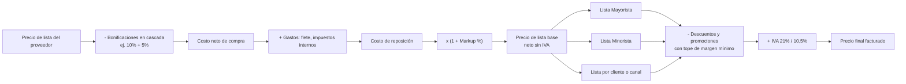

# Investigación: Precio Unitario, Costo y Margen de Ganancia en Sistemas de Distribuidoras

## 1. Diagnóstico: cómo está hoy nuestro sistema (G3)

### Lo que exponemos a G4
- `producto.precio_unitario` es **una sola columna** cargada a mano (P01/P04) y modificada por el aumento masivo (P07).
- `precio_mayorista`, `precio_minorista`, `precioMay` y `precioMin` **no son precios distintos**: en [Producto.php](../app/Modules/Productos/Models/Producto.php#L224-L247) los cinco accessors devuelven el mismo `precio_unitario`. G4 cree que tiene dos listas, pero recibe el mismo número en ambas.

### Los costos ya existen, pero están dispersos y desconectados del precio de venta

| Dónde | Campo | Qué representa en la práctica |
| :--- | :--- | :--- |
| `producto_proveedor` | `precio_acordado` | Costo pactado con cada proveedor (PV05) |
| `historial_precio_proveedor` | `precio_acordado` | Evolución del costo por proveedor (PV06) |
| `detalle_orden` | `precio_estimado` | Costo estimado al pedir (PC01) |
| `detalle_compra` | `precio_unitario` | **Costo real pagado** en la última compra (C01) |
| `sugerencia_compra` | `precio_unitario`, `costo_total` | Costo estimado de reposición (PC07) |

> [!WARNING]
> **No hay ninguna relación entre el costo y el precio de venta.** Si un proveedor aumenta un 20% y se registra la compra, `precio_unitario` no se entera. El sistema no puede responder *"¿cuánto gano con este producto?"* ni detectar que se está vendiendo **por debajo del costo**.

---

## 2. Cómo lo resuelven los sistemas de distribuidoras

Lo que sigue es lo que usan ERPs del mercado argentino (Tango Gestión, Bejerman, Flexxus, Picaso, Sinergis) y la teoría comercial estándar.

### 2.1. Cadena de formación del precio

Lo clave es que **el precio de venta no se carga a mano**: se **calcula** a partir del costo más un margen configurado. Cuando cambia el costo, el precio se recalcula solo (o queda como "precio sugerido" pendiente de aprobación).

### 2.2. Qué costo se usa

| Método | Cómo se calcula | Uso típico |
| :--- | :--- | :--- |
| **Último costo de compra** | Precio de la última factura/recepción | Simple, muy usado en pymes |
| **Costo de reposición** | Lo que cuesta *hoy* volver a comprar (lista vigente del proveedor) | **El más usado en Argentina para fijar precios**, por la inflación: evita descapitalizarse vendiendo con costos viejos |
| **Costo promedio ponderado (PPP)** | Promedio del stock según cantidades y costos de cada ingreso | Valuación contable de inventario y rentabilidad |
| **FIFO (PEPS)** | El primer ingreso es el primero en salir | Contable, productos perecederos |

Lo habitual en distribuidoras es **costo de reposición para fijar precios** y **último costo o PPP para medir rentabilidad**.

### 2.3. Markup vs. Margen (la confusión más común)

- **Markup (recargo sobre el costo):**

$$\text{Markup} = \frac{\text{Precio} - \text{Costo}}{\text{Costo}} \qquad \text{Precio} = \text{Costo} \times (1 + \text{Markup})$$

- **Margen (ganancia sobre la venta):**

$$\text{Margen} = \frac{\text{Precio} - \text{Costo}}{\text{Precio}} \qquad \text{Precio} = \frac{\text{Costo}}{1 - \text{Margen}}$$

- **Conversión:**

$$\text{Margen} = \frac{\text{Markup}}{1 + \text{Markup}}$$

| Markup sobre costo | Margen real sobre la venta |
| :---: | :---: |
| 20% | 16,7% |
| 30% | 23,1% |
| 40% | 28,6% |
| 50% | 33,3% |
| 100% | 50,0% |

**Ejemplo:** costo 1.000, markup 40% → precio 1.400. La ganancia es 400, que es el **28,6% de la venta**, no el 40%. Si el vendedor otorga un 30% de descuento creyendo que "le queda margen", termina vendiendo **por debajo del costo** (980).

> [!TIP]
> El área comercial suele **configurar markup** (es más intuitivo partir del costo) y los **reportes muestran margen** (es lo que mira el contador).

### 2.4. Funcionalidades estándar en estos sistemas

1. **Margen configurable por jerarquía**: General → Categoría (rubro) → Marca → Producto. Lo más específico tiene prioridad. Así no hay que cargar el margen de 500 productos uno por uno.
2. **Listas de precios múltiples**: una lista base y listas derivadas (ej. "Minorista = Base + 15%"). A cada cliente se le asigna una lista.
3. **Actualización en cascada**: al cambiar el costo (por una compra, un cambio de lista del proveedor o una importación desde Excel), se recalculan todas las listas.
4. **Aprobación de precios sugeridos**: el sistema propone el nuevo precio y un usuario lo confirma, para evitar subas bruscas automáticas.
5. **Redondeo comercial**: terminar en 0, 90, 99, etc. (**nosotros ya lo tenemos en P07**).
6. **Control de margen mínimo**: impide o alerta si una venta, descuento o promoción deja el precio por debajo del costo + margen mínimo.
7. **Snapshot del costo en la venta**: cada línea de venta guarda el costo de ese momento, para calcular la rentabilidad real aunque el costo cambie después.

---

## 3. Propuesta para nuestro sistema

### Principios
- **No romper el contrato con G4 ni con G1**: `precio_unitario` sigue existiendo en `GET /api/productos` con el mismo significado (precio de venta). Solo cambia **cómo se obtiene**.
- **No exponer el costo en las APIs de integración**: `GET /api/productos` alimenta el **catálogo público de G1**. El costo y el margen son datos internos y sensibles de la distribuidora y solo deben verse en las pantallas internas de G3.
- **No modificar código de otros grupos.**

### Opción A — Mínima (alcance razonable para el cuatrimestre)

| Cambio | Detalle |
| :--- | :--- |
| Nuevas columnas en `producto` | `costo` (costo de reposición/último costo) y `markup` (% sobre costo, nullable) |
| Markup por defecto en `categoria` | `markup_defecto`: si el producto no tiene markup propio, hereda el de su categoría |
| Cálculo | `precio_unitario = redondeo(costo × (1 + markup))`, reutilizando las reglas de redondeo de P07 |
| Actualización automática del costo | Al **recibir una compra** (C06/C07), `costo` toma el `precio_unitario` de `detalle_compra` y se recalcula el precio de venta (registrándolo en `historial_precio` con `origen = 'costo'`) |
| UI de Inventario | Mostrar costo, markup y **margen resultante**; alerta visual si el precio queda por debajo del costo |
| Aumento masivo (P07) | Poder aplicarlo sobre el **costo** (ej. "el proveedor aumentó 12%") además de sobre el precio |

Impacto en G4: **ninguno** (sigue leyendo `precio_unitario`, que ahora es coherente con el costo).

### Opción B — Intermedia: listas de precios reales

Todo lo de A, más:
- `precio_mayorista` y `precio_minorista` pasan a ser **valores realmente distintos** (ej. minorista = mayorista + X%).
- G4 **ya lee `precioMay` / `precioMin`** en [HttpProductoApi.php](../app/Modules/Ventas/Integraciones/HttpProductoApi.php#L79-L91), así que se beneficiaría **sin tocar su código**.

### Opción C — Completa (nivel ERP comercial)

- Tabla `lista_precio` y asignación de lista por cliente (requiere coordinar con **G1**, dueño de clientes).
- Costo promedio ponderado al registrar recepciones.
- Snapshot de `costo_unitario` en `detalle_venta` para reportes de rentabilidad (requiere coordinar con **G4**, dueño de ventas; nosotros solo podríamos ofrecer un endpoint de consulta de costo protegido).
- Margen mínimo validado en promociones de G4.

> [!IMPORTANT]
> Las opciones A y B se resuelven **solo dentro de G3**. La opción C requiere acuerdos con G1 y G4, así que conviene plantearla como mejora futura en la defensa.

---

## 4. Decisiones a validar con el profesor

1. **¿Qué costo tomamos como base?** Último costo de compra (más simple, ya tenemos el dato en `detalle_compra`) o costo de reposición (`precio_acordado` del proveedor principal).
2. **¿Markup o margen?** Recomendación: el usuario configura **markup** y el sistema muestra **margen**.
3. **¿Recálculo automático o precio sugerido con aprobación?** Recomendación: automático al recibir la compra, con registro en el historial de precios.
4. **¿Diferenciamos mayorista y minorista (opción B)?** Es poco esfuerzo y G4 ya lo soporta.
5. **¿Los precios son netos o con IVA?** Hoy no está definido en ningún lado. En distribuidoras B2B lo habitual es guardar el **neto** y que la facturación (G2) agregue el IVA.
