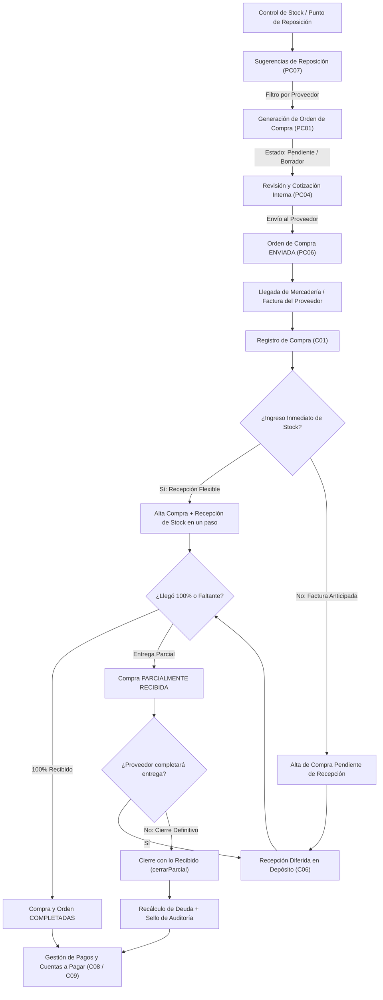

# Módulo de Compras y Pedidos de Compra (G3)

**Sistema ERP Distribuidora PyB**  
**Dominio:** Abastecimiento, Gestión de Proveedores, Recepción de Stock y Cuentas por Pagar  
**Ruta del Código:** `app/Modules/Compras`, `app/Modules/PedidosDeCompra`, `app/Modules/Proveedores`, `app/Modules/Stock`  
**Vista Principal:** `resources/views/compras/index.blade.php`  
**Fecha:** Noviembre 2026  

---

## 1. Visión General del Circuito de Abastecimiento

El subsistema de abastecimiento de **Distribuidora PyB** tiene como propósito garantizar el suministro ininterrumpido de mercadería al menor costo posible, optimizando los niveles de inventario en depósito y asegurando la coherencia entre:
1. **La demanda de reposición** (sugerencias basadas en stock mínimo).
2. **El compromiso contractual con el proveedor** (órdenes de compra).
3. **El ingreso físico de mercadería** (recepciones y movimientos de kardex).
4. **La obligación financiera y fiscal** (facturas de compra, notas de crédito y pagos).

---

## 2. Diagrama de Flujo del Proceso



---

## 3. Módulo de Pedidos de Compra (`app/Modules/PedidosDeCompra`)

El módulo de pedidos de compra gestiona la etapa de planificación, negociación y formalización de solicitudes de abastecimiento a los proveedores.

### 3.1 Sugerencias de Reposición Inteligente (`PC07`)
* **Detección automática:** Identifica aquellos productos cuyo stock actual sea igual o menor a su `stock_minimo`.
* **Cálculo de cantidad sugerida:**  
  $$\text{Cantidad a Comprar} = \text{Stock Mínimo} - \text{Stock Actual} + \text{Margen de Seguridad}$$
* **Filtro y Agrupación por Proveedor:**  
  Permite al operador filtrar por proveedor específico antes de generar la orden, evitando unir productos de distintos proveedores en una sola orden por error.
* **Proveedor Principal:** Asigna automáticamente como proveedor sugerido al proveedor principal activo vinculado al producto en el módulo de Proveedores (`PV05`).

### 3.2 Ciclo de Vida y Estados de la Orden de Compra (`ORDEN_COMPRA`)

| Estado | Significado Operativo | Acciones Permitidas |
| :--- | :--- | :--- |
| **`pendiente`** | Borrador interno de compra. El comprador está analizando precios, revisando cantidades o esperando autorización gerencial. El proveedor aún no fue notificado. | Editar orden, modificar cantidades, eliminar ítems, enviar orden, cancelar orden. **No permite registrar compras directamente.** |
| **`enviada`** | La orden fue emitida formalmente y comunicada al proveedor. El compromiso de compra quedó fijado. | Ver detalle, registrar compras vinculadas, cancelar orden (solo si no tiene compras registradas), cerrar con lo recibido. |
| **`recibida_parcialmente`** | El proveedor realizó una o más entregas parciales documentadas mediante compras/remitos, pero aún restan unidades por entregar. | Registrar nuevas compras vinculadas, cerrar / dar por completada con lo recibido. |
| **`completada`** | Se recibió el 100% de lo solicitado o se dio por finalizada de común acuerdo con lo efectivamente entregado. Saldo pendiente = 0. | Ver detalle, imprimir comprobante. |
| **`cancelada`** | La orden fue dada de baja sin compras vinculadas. | Solo consulta histórica. |

### 3.3 Reglas de Negocio Clave en Pedidos de Compra
1. **Protección de Borradores Internos:**  
   No se puede registrar una compra contra una orden en estado `pendiente`. Si el operador lo intenta, el sistema requiere confirmación explícita para pasarla a `enviada` antes de proceder.
2. **Inmutabilidad tras el Envío (`PC04`):**  
   Una vez que una orden pasa a estado `enviada`, queda bloqueada para edición de ítems y precios pactados para resguardar la validez de la cotización.
3. **Cierre de Orden con lo Recibido:**  
   Si una orden queda en `recibida_parcialmente` y el proveedor no entregará el saldo restante, se permite dar por completada la orden. Esto limpia el saldo pendiente a 0 y propaga automáticamente el recálculo a todas las compras parciales asociadas.
4. **Comprobante Oficial Imprimible:**  
   Genera una Orden de Compra en formato normalizado argentino Tipo "X" (*Documento no válido como factura*), con detalle de cantidades solicitadas, entregadas, saldos y casillas para firma autorizada y recepción del proveedor.

---

## 4. Módulo de Compras a Proveedores (`app/Modules/Compras`)

Representa la entrada formal de comprobantes fiscales y remitos emitidos por los proveedores, así como el control de la deuda financiera y el ingreso al stock.

### 4.1 Registro de Compras (`C01`, `C02`, `C03`)
* **Modalidad de Origen:**
  * **Compra Directa:** Compra por mostrador o remito espontáneo sin orden de compra previa.
  * **Compra vinculada a Orden:** Importa automáticamente los ítems, precios acordados y saldos pendientes de la orden de compra seleccionada.
* **Tipificación de Comprobantes:**
  * Soporta tipos de factura bajo normativa fiscal argentina: **Factura A**, **Factura B**, **Factura C** o **Ticket Interno (TI)**.
  * Formato validado en 3 bloques: `Tipo (A/B/C) - Punto de Venta (4 dígitos) - Número de Factura (8 dígitos)`.
* **Sincronización Automática de Costos (`PV05`):**  
  Al registrar la compra, si el proveedor es el proveedor principal del producto, el sistema actualiza de forma automática el **Costo de Reposición** en el catálogo y recalcula el precio de venta en función del margen de ganancia o recargo asignado.

### 4.2 Recepción Flexible de Stock en el Alta de Compra
Al cargar una nueva compra, el sistema incluye un conmutador de ingreso inmediato con doble columna:
* **Cant. Facturada:** Unidades que figuran en la factura emitida por el proveedor.
* **Cant. a Recibir:** Unidades efectivamente ingresadas al depósito físico hoy.

**Comportamiento según la cantidad ingresada:**
* **Ingreso Completo (100%):** La compra se genera directamente como `completada` y todo el stock ingresa al depósito.
* **Ingreso Parcial Inmediato:** Si de 100 unidades facturadas solo ingresan 70, la compra nace como `parcialmente_recibida`, el Kardex suma 70 unidades, y se calcula automáticamente el saldo de mercadería pendiente de ingreso ($24.000).
* **Ingreso Diferido (Factura anticipada):** Si se destilda la opción, la compra se registra como `pendiente` (0 recepciones) y el stock se ingresa posteriormente desde la pestaña *"Recepciones"*.

### 4.3 Recepciones en Depósito (`C06` / Módulo Stock)
* Administrado por `RecepcionController`.
* Permite múltiples entregas parciales para una misma compra.
* Cada recepción genera un encabezado (`RECEPCION`), detalles de recepción (`DETALLE_RECEPCION`) y movimientos formales de Kardex en `StockService` vinculados a la compra.
* Calcula el porcentaje de avance físico de cada compra y sincroniza el estado de la orden asociada.

### 4.4 Cierre Parcial Definitivo de Compra (`cerrarParcial`)
Cuando una compra quedó parcialmente recibida y el proveedor no entregará el remanente:
1. Se ajusta cada ítem de la compra para que `cantidad = cantidad_recibida`.
2. Se recalcula el `subtotal` de cada ítem y el `importe_total` de la compra.
3. Se recalcula el `saldo_a_pagar` deduciendo los pagos ya realizados.
4. Se asigna la marca de auditoría `cierre_parcial = true` y se registra una nota en `observaciones`.
5. Se propaga el cierre a la orden vinculada.
6. **Comprobante de compra auditado:** Al imprimir la factura, estampa el sello **`ESTADO: COMPLETADA (CIERRE PARCIAL DEFINITIVO)`** y una faja de auditoría informando que la liquidación fue ajustada a la mercadería real recibida.

### 4.5 Gestión de Pagos y Cuentas por Pagar (`C08`, `C09`)
* **Múltiples métodos de pago:** Admite cancelaciones parciales o totales combinando **Efectivo**, **Transferencia Bancaria**, **Cheque**, **E-cheq** y **Tarjeta**.
* **Control de Saldos:**
  * `importe_total`: Monto total liquidado de la factura.
  * `total_pagado`: Suma acumulada de cobros/pagos registrados en `PAGO_PROVEEDOR`.
  * `saldo_a_pagar`: Deuda real exigible:  
    $$\text{saldo\_a\_pagar} = \max(0, \text{importe\_total} - \text{total\_pagado})$$
  * `saldo_a_favor`: En caso de que se haya pagado por completo y luego cerrado parcialmente la compra:  
    $$\text{saldo\_a\_favor} = \max(0, \text{total\_pagado} - \text{importe\_total})$$
* **Tablero de Deudas:** Muestra el saldo total adeudado por proveedor, semáforo de facturas vencidas y detalle individual de comprobantes a pagar.

---

## 5. Modelo de Datos y Entidades Principales

```
+--------------------+        +---------------------+
|    ORDEN_COMPRA    | 1    N |    DETALLE_ORDEN    |
|--------------------|--------|---------------------|
| id_orden (PK)      |        | id_detalle_orden(PK)|
| numero_orden       |        | id_orden (FK)       |
| id_proveedor (FK)  |        | id_producto (FK)    |
| estado             |        | cantidad_solicitada |
| total_estimado     |        | cantidad_sugerida   |
| cierre_parcial     |        | precio_estimado     |
| observaciones      |        +---------------------+
+--------------------+
         | 1
         |
         | N
+--------------------+        +---------------------+
|       COMPRA       | 1    N |   DETALLE_COMPRA    |
|--------------------|--------|---------------------|
| id_compra (PK)     |        | id_det_compra (PK)  |
| numero_compra      |        | id_compra (FK)      |
| numero_comprobante |        | id_producto (FK)    |
| id_proveedor (FK)  |        | cantidad            |
| id_orden (FK)      |        | cantidad_recibida   |
| importe_total      |        | precio_unitario     |
| saldo_pendiente    |        | subtotal            |
| estado             |        +---------------------+
| cierre_parcial     |
| observaciones      |
+--------------------+
    | 1             | 1
    |               |
    | N             | N
+----------------+  +-------------------+
|   RECEPCION    |  |  PAGO_PROVEEDOR   |
|----------------|  |-------------------|
| id_recepcion   |  | id_pago (PK)      |
| id_compra (FK) |  | id_compra (FK)    |
| fecha_recepcion|  | metodo_pago       |
+----------------+  | importe           |
    | 1             | fecha_pago        |
    | N             +-------------------+
+---------------------+
|  DETALLE_RECEPCION  |
|---------------------|
| id_det_recep (PK)   |
| id_producto (FK)    |
| cantidad_recibida   |
+---------------------+
```

---

## 6. Catálogo de Endpoints REST API

### Pedidos de Compra (`/api/ordenes-compra`)
* `GET /api/ordenes-compra`: Listar órdenes con filtros por proveedor, estado y fechas.
* `POST /api/ordenes-compra`: Crear una nueva orden de compra (estado `pendiente`).
* `GET /api/ordenes-compra/{id}`: Consultar detalle completo, cantidades solicitadas y avance de recepción.
* `PUT /api/ordenes-compra/{id}`: Modificar ítems y precios (solo en estado `pendiente`).
* `PATCH /api/ordenes-compra/{id}/estado`: Cambiar estado (`enviada`, `recibida_parcialmente`, `completada`).
* `DELETE /api/ordenes-compra/{id}`: Cancelar orden (si no posee compras vinculadas).
* `GET /api/sugerencias-reposicion`: Listar productos con stock por debajo del mínimo agrupados para compra.

### Compras a Proveedores (`/api/compras`)
* `GET /api/compras`: Listado general de compras con saldos y estados de pago.
* `POST /api/compras`: Registrar nueva compra (soporta compra directa o vinculada, con o sin recepción inmediata).
* `GET /api/compras/{id}`: Detalle de factura, productos, pagos y recepciones realizadas.
* `PUT /api/compras/{id}`: Modificar compra (solo en estado `pendiente`).
* `DELETE /api/compras/{id}`: Anular compra (con reversión automática de stock si hubo recepciones).
* `PATCH /api/compras/{id}/cerrar-parcial`: Dar por completada la compra ajustando importes a lo recibido.
* `POST /api/compras/{id}/recepciones`: Registrar una entrega parcial o total de mercadería.
* `POST /api/compras/{id}/pagos`: Imputar un pago a la compra (efectivo, transferencia, cheque, etc.).
* `GET /api/compras/deudas`: Reporte consolidado de deuda exigible por proveedor y compras vencidas.

---

## 7. Interfaz de Usuario y Vistas Blade

Toda la interacción del operador se concentra en la vista integral [`resources/views/compras/index.blade.php`](file:///c:/Users/dario/Desktop/Proyecto/resources/views/compras/index.blade.php), dividida en pestañas temáticas:

1. **Pestaña Compras Realizadas:**  
   Grilla con número de compra, comprobante de origen, proveedor, montos, estado físico (semaforizado) y estado de pago. Botones de acción rápida: Ver detalle, Imprimir Factura, Registrar Pago, Cierre Parcial y Anular.
2. **Pestaña Órdenes de Compra:**  
   Seguimiento de pedidos emitidos, control de avance de entregas (ej: `Recibido: 60/100 u.`), botón para enviar al proveedor, botón para registrar compra desde la orden e impresión oficial.
3. **Pestaña Sugerencias de Reposición:**  
   Listado reactivo con selector de proveedor para generar órdenes automáticas en un clic.
4. **Pestaña Deudas a Proveedores:**  
   Tablero de control financiero con métricas de deuda global, total adeudado por proveedor, fechas de vencimiento y lista de compras pendientes de pago.
