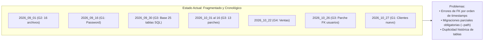
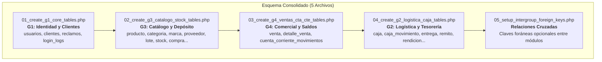

# Propuesta Técnica: Estandarización y Consolidación de Migraciones (ERP Juan23)

> **Destinatarios:** Equipos de Desarrollo G1, G2, G3 y G4  
> **Objetivo:** Unificar y estabilizar la base de datos eliminando dependencias circulares, colisiones de nombres y órdenes cronológicos fallidos.

---

## 1. Diagnóstico de la Situación Actual

Actualmente, el proyecto acumula **más de 40 archivos de migración** distribuidos entre el directorio raíz `database/migrations/` y distintas subcarpetas de módulos (`app/Modules/*/database/migrations/`).



### Principales dificultades observadas:
1. **Orden cronológico impredecible:** Laravel ejecuta migraciones por fecha del archivo. Si una migración de G2 (fechada el 01/09) o G3 (fechada el 30/09) intenta enlazar claves foráneas con tablas creadas en octubre por G1 o G4, la ejecución falla con error `1005 / errno 150 (Foreign Key Constraint Failed)`.
2. **Parches acumulativos:** Solo G3 tiene 14 archivos que aplican alteraciones sucesivas sobre tablas preexistentes (agregando columnas, cambiando tipos y modificando FKs).
3. **Comandos de instalación complejos:** En lugar de un estándar `php artisan migrate`, los desarrolladores deben recordar rutas específicas con `--path` para evitar que se rompa el entorno.

---

## 2. Propuesta: "Migration Squashing" por Grupo

La solución de ingeniería recomendada consiste en consolidar el esquema definitivo en **1 único archivo por grupo funcional** numerado de forma secuencial, más un archivo opcional de cierre de claves foráneas:



### Distribución y Propiedad de Tablas

| Archivo de Migración | Grupo Responsable | Tablas Propias Contenidas |
| :--- | :--- | :--- |
| `01_create_g1_core_tables.php` | **Grupo 1** | `usuarios`, `clientes`, `reclamos`, `login_logs`. *(Incluye campos extendidos: `zona_id`, `condicion_iva`, `localidad`).* |
| `02_create_g3_catalogo_stock_tables.php` | **Grupo 3** | `producto`, `categoria`, `marca`, `proveedor`, `unidad_medida`, `ubicacion`, `producto_ubicacion`, `lote`, `movimiento_stock`, `sesion_conteo`, `detalle_conteo`, `historial_precio`, `producto_proveedor`, `historial_precio_proveedor`, `historial_plazo_proveedor`, `orden_compra`, `detalle_orden`, `compra`, `detalle_compra`, `recepcion`, `detalle_recepcion`, `pago_proveedor`, `sugerencia_compra`, `log_auditoria`. |
| `03_create_g4_ventas_cta_cte_tables.php` | **Grupo 4** | `venta`, `detalle_venta`, `cuenta_corriente_movimientos`. |
| `04_create_g2_logistica_caja_tables.php` | **Grupo 2** | `zona`, `entrega`, `entrega_pedido`, `remito`, `detalle_remito`, `caja`, `caja_movimiento`, `rendicion`, `rendicion_cobro`, `periodo_conciliacion`, `movimiento_bancario`, `conciliacion_detalle`, `ajuste_bancario`, `cheque`. |
| `05_setup_intergroup_foreign_keys.php` | **Conjunto** | Claves foráneas entre módulos (ej. `movimiento_stock` → `venta`, `movimiento_stock` → `entrega`). |

---

## 3. Reglas de Oro para Evitar Bloqueos

> [!IMPORTANT]
> **Regla 1: Ningún archivo de grupo debe definir una Clave Foránea (`foreignKey`) hacia una tabla de otro grupo.**  
> Si G3 pone una FK hacia `venta` (de G4) dentro del archivo de G3, la migración fallará si G3 se ejecuta antes que G4. Las FKs internas del grupo (ej. `detalle_venta` → `venta`) sí van en el archivo del grupo. Las relaciones inter-grupo van únicamente en el archivo `05`.

> [!TIP]
> **Regla 2: Filosofía de Microservicios (FKs Lógicas vs Físicas).**  
> Dado que el sistema ya utiliza **Gateways y APIs HTTP** (G1 consume ventas por HTTP, G4 simula stock con Mocks, G2 consulta ventas por API), se recomienda que las referencias entre tablas de distintos grupos sean **columnas indexadas (`unsignedBigInteger`) sin constraint estricto de base de datos**. Esto permite que un módulo funcione y se pruebe de forma 100% aislada.

> [!NOTE]
> **Regla 3: Unificación Canónica de Identidad.**  
> La única tabla de usuarios válida es `usuarios` (`id`) de G1. G3 y G2 no deben crear tablas duplicadas `usuario` con `id_usuario`. Todas las autorías de carga y modificación deben apuntar a `usuarios.id`.

---

## 4. Plan de Acción y Cronograma de Trabajo

### Fase 1: Consolidación Interna (Por Grupo)
* Cada grupo toma sus migraciones actuales y redacta su único archivo de esquema final en limpio.
* Se eliminan todas las migraciones intermedias de parches de columnas o ajustes menores.
* **Entregable:** Cada equipo entrega un único archivo PHP con el método `up()` y `down()`.

### Fase 2: Integración en Rama de Prueba (`feature/squash-migrations`)
* Se crea una rama aislada para no afectar `develop`.
* Se ubican los 4 archivos en `database/migrations/` con nombres prefijados numéricamente para garantizar el orden de ejecución.
* Se retiran las carpetas de migraciones redundantes dentro de `app/Modules/*/database/migrations/`.

### Fase 3: Pruebas de Humo e Instalación Limpia
Se ejecutan los siguientes comandos de verificación en MySQL y SQLite:
```powershell
# 1. Prueba de instalación completa desde cero
php artisan migrate:fresh --seed

# 2. Comprobación de integridad con la suite de tests
php artisan test
```

### Fase 4: Despliegue en `develop` y Documentación
* Una vez verificado que `migrate:fresh` ejecuta limpiamente y los tests pasan al 100%, se hace merge a `develop`.
* Se actualiza el `README.md` con las instrucciones de instalación definitiva.

---

## 5. Beneficios para la Entrega y Defensa del Proyecto

1. **Simplicidad de Instalación:** Cualquier docente o evaluador puede clonar el repositorio y ejecutar un solo comando:  
   `php artisan migrate:fresh --seed`  
   Sin errores de claves foráneas ni necesidad de correr comandos manuales con rutas complejas.
2. **Claridad Arquitectónica:** En la defensa se puede mostrar con total nitidez qué parte de la base de datos pertenece a cada equipo y cómo se integran.
3. **Mantenibilidad:** Menos archivos en el proyecto reducen el peso del repositorio y facilitan la detección de problemas.
