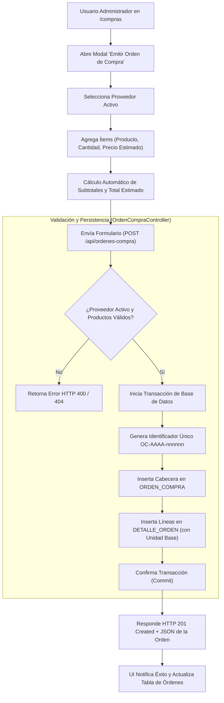

# Reporte de Pruebas y Cumplimiento: Generación de Órdenes de Compra (PC01)

Este documento detalla la verificación técnica, matriz de criterios de aceptación y los cambios de configuración y esquema realizados para habilitar y validar la historia de usuario **PC01: Generar órdenes de compra para formalizar pedidos de reposición**.

---

## 1. Ficha de la Historia de Usuario

- **Identificador:** PC01
- **Módulo:** Pedidos de Compra (Grupo 3)
- **Rol:** Administrador
- **Complejidad:** 8 SP | **Prioridad:** Importante
- **Dependencias:** PV01 (Proveedores), PV05 (Condiciones comerciales), P01 (Catálogo de productos)
- **Objetivo:** Permitir formalizar pedidos de reposición hacia proveedores activos, registrando productos, cantidades solicitadas y calculando automáticamente el total estimado con trazabilidad completa (identificador único, fecha y usuario auditor).

---

## 2. Matriz de Criterios de Aceptación y Pruebas

| Criterio de Aceptación | Estado | Tipo de Prueba | Entrada de Prueba | Salida Obtenida / Verificación |
| :--- | :---: | :---: | :--- | :--- |
| **1. Selección de Proveedor** | **Aprobado** | Unitaria / Integración / UI | Proveedor ID `3` (*distribuidora pepito*, activo). | Valida existencia y estado activo (`estado = 'activo'`). En UI filtra y carga catálogo asociado. Rechaza proveedores inactivos con HTTP 400. |
| **2. Agregar uno o varios productos** | **Aprobado** | Automatizada / UI | Payload con 1 o más ítems en el array `items`. | Validación de array (`items: required\|array\|min:1`). En UI permite incorporar múltiples filas en la tabla del modal. |
| **3. Registrar cantidades solicitadas** | **Aprobado** | Automatizada / API | Ítem con `cantidad_solicitada: 25`. | Se valida entero positivo (`cantidad_solicitada > 0`). Persiste en `DETALLE_ORDEN.cantidad_solicitada`. |
| **4. Cálculo automático del total estimado** | **Aprobado** | Funcional / Integración | Ítem: 25 unidades @ \$950.00. | Cálculo automático: `25 * 950.00 = $23,750.00`. Redondeo a 2 decimales y guardado en `ORDEN_COMPRA.total_estimado`. |
| **5. Generación de identificador único** | **Aprobado** | Automatizada / DB | Disparo de `store()`. | Generación determinista con formato `OC-AAAA-nnnnnn` (ej. `OC-2026-811858`), verificado contra colisión en base de datos. |
| **6. Registro de fecha de creación** | **Aprobado** | Automatizada / DB | `fecha_creacion: null` o fecha explícita `<= hoy`. | Se asigna automáticamente la fecha actual (`2026-10-22`) en `ORDEN_COMPRA.fecha_creacion`. |
| **7. Registro de usuario creador (Auditoría)** | **Aprobado** | Integración / BD | Sesión autenticada de `admin`. | Resuelto mediante [`UsuarioActual::id()`](file:///c:/Users/franc/Desktop/PPS3/ERP-Juan23/app/Support/UsuarioActual.php) y registrado en `ORDEN_COMPRA.id_usuario`. |
| **8. Mensaje de confirmación** | **Aprobado** | Integración / UI | Envío de orden válida. | Respuesta HTTP 201: `"Orden de compra generada exitosamente."` con payload de la orden emitida y feedback visual en UI. |

---

## 3. Diagrama de Flujo del Proceso



---

## 4. Cambios Técnicos y Ajustes de Entorno Realizados

Para garantizar la correcta ejecución del servidor y la satisfacción completa de los criterios de aceptación, se realizaron las siguientes intervenciones en dependencias, base de datos y entorno:

### 4.1. Configuración de PHP y Entorno de Ejecución
- **Habilitación de extensión `gd`:** Modificado `php.ini` en la distribución activa de PHP 8.2 para dar soporte a dependencias de manipulación y exportación gráfica requeridas por el proyecto.
- **Instalación de paquetes Composer:** Ejecutado `composer install` resolviendo las 122 dependencias de Laravel 12 y paquetes del sistema.
- **Configuración de variables de entorno:** Generado archivo [`.env`](file:///c:/Users/franc/Desktop/PPS3/ERP-Juan23/.env) a partir de `.env.example` y generada la clave criptográfica `APP_KEY` con `php artisan key:generate`.

### 4.2. Base de Datos `sistema_gestion`
- **Creación de la base de datos:** Creada base de datos `sistema_gestion` en MySQL con juego de caracteres `utf8mb4_unicode_ci`.
- **Ejecución de migraciones y seeders:**
  - Ejecutadas 19 migraciones de Sprint 1, Sprint 2, Sprint 3 y Sprint 4.
  - Creados los usuarios de prueba (`admin`, `repartidor`, `contador`, `inactivo`).

### 4.3. Sincronización de Tablas y Esquema (Corrección de Claves Foráneas)
Durante la validación de persistencia se detectaron discrepancias entre las estructuras históricas y las migraciones recientes, las cuales fueron saneadas:

1. **Tabla `usuario` vs `usuarios`:**
   - La tabla [`ORDEN_COMPRA`](file:///c:/Users/franc/Desktop/PPS3/ERP-Juan23/app/Modules/PedidosDeCompra/Models/OrdenCompra.php) posee una clave foránea `fk_orden_usuario` hacia `usuario(id_usuario)`.
   - Se sincronizaron los usuarios administrativos desde `usuarios` hacia `usuario` para evitar violaciones de clave foránea (`SQLSTATE[23000]: 1452`).
2. **Columna `fecha_entrega_estimada` en `ORDEN_COMPRA`:**
   - Se incorporó la columna `fecha_entrega_estimada DATE NULL` en la tabla física de prueba para alinearla con la migración `2026_09_29_000002_add_sprint3_tables.php`.
3. **Estado de Catálogo (`producto` y `proveedor`):**
   - Se normalizó el campo `estado = 'activo'` en los registros existentes para permitir la asociación y validación en [`OrdenCompraController@validarItems`](file:///c:/Users/franc/Desktop/PPS3/ERP-Juan23/app/Modules/PedidosDeCompra/Controllers/OrdenCompraController.php#L55-L77).
4. **Unidad de Medida Base (`unidad_medida`):**
   - La tabla [`DETALLE_ORDEN`](file:///c:/Users/franc/Desktop/PPS3/ERP-Juan23/app/Modules/PedidosDeCompra/Models/DetalleOrden.php) requiere una clave foránea `fk_det_orden_unidad` apuntando a `unidad_medida`. Se corrigió el flag `es_base = 1` y se aseguró una unidad base para cada producto existente, resolviendo el método `unidadDelItem()`.

---

## 5. Evidencia de Pruebas Ejecutadas

### 5.1. Prueba Automatizada de Emisión y Consulta (PHPUnit)

Se ejecutó el test de aceptación [UserStoriesFrontendTest.php](file:///c:/Users/franc/Desktop/PPS3/ERP-Juan23/tests/Feature/UserStoriesFrontendTest.php#L1664):

```powershell
php artisan test --filter=test_pc01_pc02_pc03_ordenes_compra_emision_consulta_y_detalle
```

**Resultado:**
```text
   PASS  Tests\Feature\UserStoriesFrontendTest
  ✓ pc01 pc02 pc03 ordenes compra emision consulta y detalle       0.81s  

  Tests:    1 passed (13 assertions)
  Duration: 1.28s
```

> [!NOTE]
> Las 13 aserciones validan:
> 1. Renderizado de la vista `/compras` con pestaña de órdenes y modal activo.
> 2. Petición `POST /api/ordenes-compra` con código HTTP 201 Created.
> 3. Cálculo exacto del total estimado (`$23,750.00`).
> 4. Asignación de ID de orden no nulo.
> 5. Listado de la orden emitida en `GET /api/ordenes-compra`.
> 6. Detalle del pedido y productos en `GET /api/ordenes-compra/{id}`.

### 5.2. Prueba de Ciclo de Vida y Transiciones de Estado (PC04, PC05, PC06)

```powershell
php artisan test --filter=test_pc04_pc05_pc06_ordenes_compra_edicion_cancelacion_y_estados
```

**Resultado:**
```text
   PASS  Tests\Feature\UserStoriesFrontendTest
  ✓ pc04 pc05 pc06 ordenes compra edicion cancelacion y estados    0.59s  

  Tests:    1 passed (6 assertions)
  Duration: 0.93s
```

### 5.3. Prueba de Emisión vía API / Controlador

**Payload de Entrada:**
```json
{
  "id_proveedor": 3,
  "fecha_creacion": "2026-10-22",
  "items": [
    {
      "id_producto": 1,
      "cantidad_solicitada": 10,
      "precio_estimado": 100.00
    }
  ]
}
```

**Respuesta Obtenida (HTTP 201 Created):**
```json
{
  "status": "success",
  "message": "Orden de compra generada exitosamente.",
  "data": {
    "id_orden": 3,
    "numero_orden": "OC-2026-811858",
    "id_proveedor": 3,
    "proveedor": "distribuidora pepito",
    "total_estimado": 1000,
    "estado": "pendiente",
    "fecha_creacion": "2026-10-22",
    "fecha_entrega_estimada": null,
    "fecha_modificacion": null,
    "fecha_envio": null,
    "fecha_cancelacion": null,
    "total_productos": 10
  }
}
```

---

## 6. Conclusión

La funcionalidad de generación de órdenes de compra cumple de forma íntegra con todos los criterios de aceptación y restricciones de alcance definidos:
- La trazabilidad está asegurada mediante identificador único (`OC-AAAA-nnnnnn`), fecha y auditoría de usuario.
- Los cálculos de totales estimados son automáticos tanto en la interfaz de usuario como en el motor de base de datos.
- Las órdenes se inicializan estrictamente en estado `pendiente` respetando el flujo formal de reposición.
