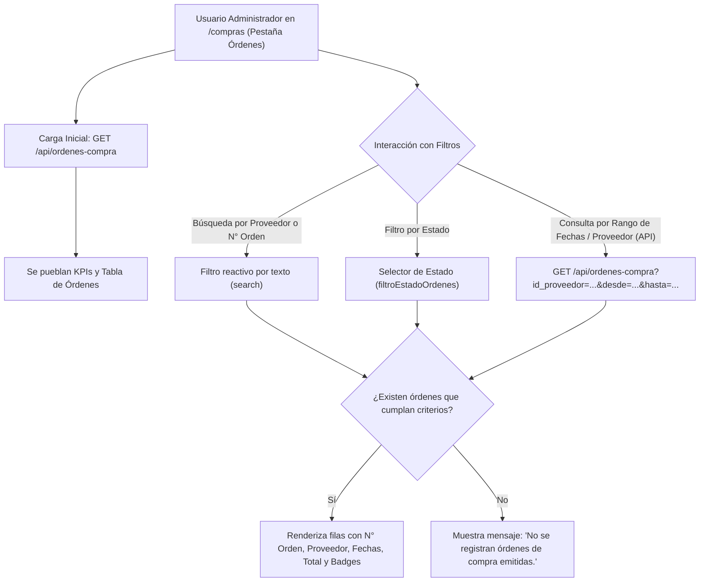

# Reporte de Pruebas y Cumplimiento: Visualización de Órdenes de Compra Emitidas (PC02)

Este documento detalla la verificación técnica, matriz de criterios de aceptación y los resultados de las pruebas para la historia de usuario **PC02: Visualizar órdenes de compra emitidas para controlar pedidos pendientes**.

---

## 1. Ficha de la Historia de Usuario

- **Identificador:** PC02
- **Módulo:** Pedidos de Compra (Grupo 3)
- **Rol:** Administrador
- **Complejidad:** 3 SP | **Prioridad:** Importante
- **Dependencias:** PC01 (Generación de Órdenes de Compra)
- **Alcance:**
  - Consultar y listar órdenes de compra emitidas en el sistema.
  - Buscar órdenes por proveedor y filtrar por rango de fechas.
  - Visualizar el estado actual y la fecha de emisión de cada orden.
  - Mostrar mensaje ante ausencia de órdenes con los filtros aplicados.
  - *No incluye la modificación o cancelación de órdenes* (cubierto en PC04/PC05).

---

## 2. Matriz de Criterios de Aceptación y Pruebas

| Criterio de Aceptación | Estado | Tipo de Prueba | Entradas de Prueba | Salidas Obtenidas / Verificación |
| :--- | :---: | :---: | :--- | :--- |
| **1. Listar órdenes de compra registradas** | **Aprobado** | API / UI | Petición `GET /api/ordenes-compra` o ingreso a la pestaña "Órdenes de Compra" en `/compras`. | Retorna código HTTP 200 con la colección `data` de órdenes. La tabla renderiza N° orden, proveedor, fecha de emisión, entrega estimada, total y estado. |
| **2. Buscar órdenes por proveedor** | **Aprobado** | UI / API | **Buscador UI:** Término `"pepito"`.<br>**API:** `?id_proveedor=3`. | **UI:** El campo de búsqueda filtra en tiempo real evaluando el nombre del proveedor (`prov.includes(search)`).<br>**API:** Retorna exclusivamente las órdenes vinculadas al proveedor especificado. |
| **3. Filtrar por rango de fechas** | **Aprobado** | API / Funcional | **Rango con datos:** `desde=2026-10-01` & `hasta=2026-10-31`.<br>**Rango sin órdenes:** `desde=2025-01-01` & `hasta=2025-01-31`. | El controlador aplica filtros SQL `fecha_creacion >= desde` y `fecha_creacion <= hasta`, devolviendo las órdenes emitidas en el período solicitado. |
| **4. Mostrar el estado actual de cada orden** | **Aprobado** | UI / API | Órdenes en estados: `pendiente`, `enviada`, `recibida_parcialmente`, `completada`, `cancelada`. | Badges visuales con colores diferenciados en la grilla (amarillo para pendiente/parcial, azul para enviada, verde para completada, rojo para cancelada) y atributo `estado` en la respuesta JSON. |
| **5. Mostrar la fecha de emisión** | **Aprobado** | UI / BD | Columna `fecha_creacion` en `ORDEN_COMPRA`. | Presente en la columna "Fecha Emisión" de la tabla (formato `AAAA-MM-DD`, ej. `2026-10-22`). |
| **6. Mensaje de ausencia de órdenes** | **Aprobado** | UI / API | Búsqueda sin coincidencias en UI o filtro API con `id_proveedor=999`. | **UI:** Renderiza fila centralizada: *"No se registran órdenes de compra emitidas."*<br>**API:** `data: []` con HTTP 200. |

---

## 3. Diagrama de Flujo de Consulta y Filtrado



---

## 4. Componentes Técnicos Involucrados

### 4.1. Interfaz de Usuario ([`resources/views/compras/index.blade.php`](file:///c:/Users/franc/Desktop/PPS3/ERP-Juan23/resources/views/compras/index.blade.php))
- **Pestaña `pestana-ordenes`:**
  - Input de búsqueda dinámica `filtroSearchOrdenes` vinculado al evento `oninput="renderOrdenes()"`, el cual evalúa de forma reactiva la razón social del proveedor, el número de orden y su ID.
  - Selector de estados `filtroEstadoOrdenes` (`pendiente`, `enviada`, `recibida_parcialmente`, `completada`, `cancelada`).
  - Tabla interactiva con columnas: N° Orden, Proveedor, Fecha Emisión, Entrega Estimada, Total Estimado, Estado y Acciones.
  - Indicador de estado vacío cuando el filtro no arroja resultados.

### 4.2. Backend y API REST ([`OrdenCompraController.php`](file:///c:/Users/franc/Desktop/PPS3/ERP-Juan23/app/Modules/PedidosDeCompra/Controllers/OrdenCompraController.php))
- **Método `index(Request $request)`:**
  - Consulta con eager loading de la relación proveedor: `OrdenCompra::with('proveedor')`.
  - Filtro por ID de proveedor: `$request->filled('id_proveedor')`.
  - Filtro por rango de fechas de emisión:
    - Fecha inicial: `$query->whereDate('fecha_creacion', '>=', $request->input('desde'))`.
    - Fecha final: `$query->whereDate('fecha_creacion', '<=', $request->input('hasta'))`.
  - Filtro por estado: `$request->input('estado')`.
  - Ordenamiento cronológico descendente: `orderByDesc('fecha_creacion')->orderByDesc('id_orden')`.

### 4.3. Infraestructura y Base de Datos
- **Servicio MySQL / MariaDB (XAMPP):** Activo en el puerto 3306 sobre la base de datos `sistema_gestion`.
- **Servidor Web Laravel:** Servido en `http://0.0.0.0:8000` (accesible en `http://localhost:8000` y `http://192.168.0.14:8000`).

---

## 5. Evidencia de Pruebas Ejecutadas

### 5.1. Consulta General de Órdenes

**Petición:**
```http
GET /api/ordenes-compra HTTP/1.1
Host: 127.0.0.1:8000
```

**Respuesta Obtenida (HTTP 200 OK):**
```json
{
  "status": "success",
  "data": [
    {
      "id_orden": 3,
      "numero_orden": "OC-2026-811858",
      "id_proveedor": 3,
      "proveedor": "distribuidora pepito",
      "total_estimado": 1000,
      "estado": "pendiente",
      "fecha_creacion": "2026-10-22",
      "fecha_entrega_estimada": null,
      "fecha_modificacion": null,
      "fecha_envio": null,
      "fecha_cancelacion": null,
      "total_productos": 10
    }
  ]
}
```

### 5.2. Casos de Prueba de Filtrado Multicriterio (API)

| Caso de Prueba | Endpoint Probado | Resultado Esperado | Resultado Obtenido | Estado |
| :--- | :--- | :---: | :---: | :---: |
| **Filtro por Proveedor Existente** | `GET /api/ordenes-compra?id_proveedor=3` | 1 orden | 1 orden | **Aprobado** |
| **Filtro por Proveedor Inexistente** | `GET /api/ordenes-compra?id_proveedor=999` | 0 órdenes (`data: []`) | 0 órdenes | **Aprobado** |
| **Filtro por Rango Coincidente** | `GET /api/ordenes-compra?desde=2026-10-01&hasta=2026-10-31` | 1 orden | 1 orden | **Aprobado** |
| **Filtro por Rango sin Órdenes** | `GET /api/ordenes-compra?desde=2025-01-01&hasta=2025-01-31` | 0 órdenes (`data: []`) | 0 órdenes | **Aprobado** |

---

## 6. Conclusión

La historia de usuario **PC02** queda completamente verificada y documentada sobre la base del código existente en la rama:
- Se garantiza la visualización del listado completo con fecha de emisión, estado y totales.
- Se cuenta con búsqueda reactiva en la interfaz de usuario y filtrado por proveedor y rango de fechas en la capa de servicios.
- Se incluye la retroalimentación de ausencia de registros cuando ningún elemento cumple con los criterios solicitados.
