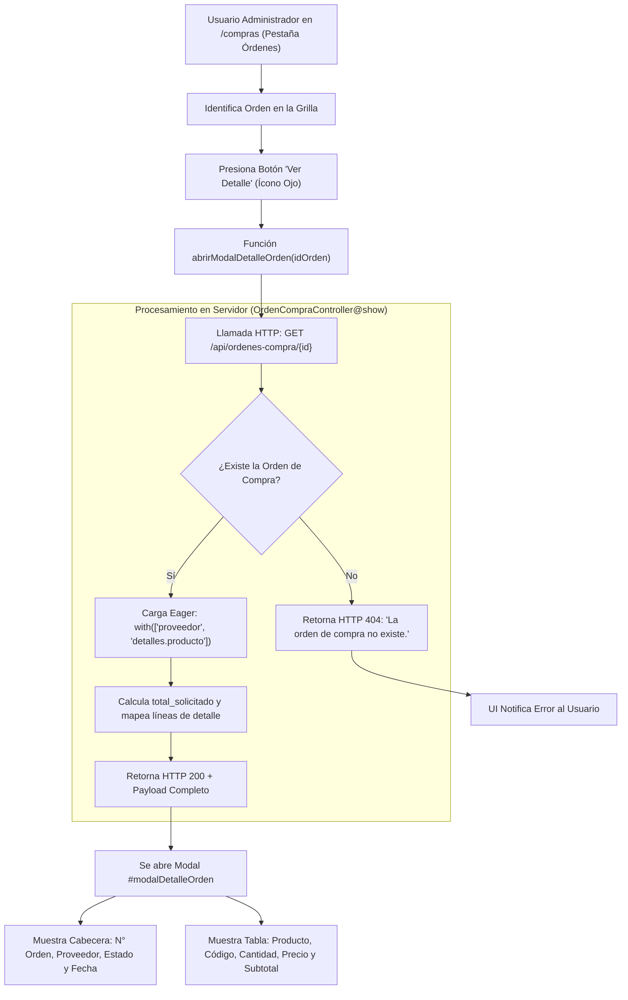

# Reporte de Pruebas y Cumplimiento: Consulta de Detalle de Orden de Compra (PC03)

Este documento detalla la verificación técnica, matriz de criterios de aceptación y la evidencia de pruebas para la historia de usuario **PC03: Consultar el detalle de una orden de compra para revisar productos, cantidades, proveedor y estado antes de enviarla**.

---

## 1. Ficha de la Historia de Usuario

- **Identificador:** PC03
- **Módulo:** Pedidos de Compra (Grupo 3)
- **Rol:** Administrador
- **Complejidad:** 3 SP | **Prioridad:** Importante
- **Dependencias:** PC01 (Generación de Órdenes de Compra)
- **Alcance:**
  - Consultar la información completa de una orden de compra registrada.
  - Visualizar el proveedor asociado, listado de productos, cantidades solicitadas, precios estimados y subtotales.
  - Visualizar el estado actual y la fecha de creación / emisión de la orden.
  - Notificar adecuadamente la ausencia de detalle o inexistencia de la orden solicitada.
  - *No incluye la modificación de órdenes* (cubierto en PC04).
  - *No incluye la eliminación o cancelación de órdenes* (cubierto en PC05).
  - *No incluye reportes estadísticos o gráficos*.

---

## 2. Matriz de Criterios de Aceptación y Pruebas

| Criterio de Aceptación | Estado | Tipo de Prueba | Entradas de Prueba | Salidas Obtenidas / Verificación |
| :--- | :---: | :---: | :--- | :--- |
| **1. Seleccionar una orden registrada** | **Aprobado** | UI / API | Clic en el botón con ícono de ojo (`eye`) en la fila de la orden (ID `3`) o petición `GET /api/ordenes-compra/3`. | Se invoca la función `abrirModalDetalleOrden(3)` en UI o se despacha el endpoint `OrdenCompraController@show`, retornando código HTTP 200 con la información de la orden. |
| **2. Mostrar el proveedor asociado** | **Aprobado** | Funcional / UI | Orden ID `3`. | Se presenta la razón social del proveedor asociado (`"distribuidora pepito"`) tanto en la grilla principal como en el objeto `data.orden.proveedor`. |
| **3. Mostrar los productos incluidos** | **Aprobado** | Funcional / UI | Colección `data.detalles[]`. | La tabla del modal lista cada ítem con su código (`"prod-2"`), nombre (`"yerba"`) y descripción. |
| **4. Mostrar las cantidades solicitadas** | **Aprobado** | Funcional / UI | Atributo `cantidad_solicitada: 10`. | Se muestra la cantidad de unidades solicitadas en la columna central (`10`) y el total general acumulado en `data.total_solicitado`. |
| **5. Mostrar el estado actual de la orden** | **Aprobado** | UI / API | Atributo `estado: "pendiente"`. | Badge informativo con estilo visual diferenciado en la tabla y campo `estado` en la cabecera de la orden. |
| **6. Mostrar la fecha de creación** | **Aprobado** | BD / UI | Atributo `fecha_creacion: "2026-10-22"`. | Formato de fecha estandarizado (`AAAA-MM-DD`) visible en la fila de la orden y en el objeto retornado. |
| **7. Mensaje ante ausencia de detalle / orden inexistente** | **Aprobado** | API / Manejo de Error | Consulta de orden inexistente (ID `99999`). | Retorna código HTTP 404 con mensaje: `{"status":"error","message":"La orden de compra no existe."}`. |

---

## 3. Diagrama de Flujo de Consulta de Detalle



---

## 4. Componentes Técnicos Involucrados

### 4.1. Interfaz Web ([`resources/views/compras/index.blade.php`](file:///c:/Users/franc/Desktop/PPS3/ERP-Juan23/resources/views/compras/index.blade.php))
- **Acción en Grilla de Órdenes (Línea ~2540):**
  - Botón interactivo con icono Lucide `eye`:
    ```html
    <button onclick="abrirModalDetalleOrden(${o.id_orden})" class="p-1.5 text-blue-600 hover:bg-blue-50 rounded-lg transition-all" title="Ver Detalle">
        <i data-lucide="eye" class="w-4 h-4"></i>
    </button>
    ```
- **Ventana Modal (`#modalDetalleOrden`, Líneas ~992-1026):**
  - Cabecera con título y subtítulo dinámico (`#detalleOrdenSubtitulo`).
  - Tabla con encabezados: Producto, Cant. Solicitada, Precio Estimado y Subtotal.
  - Cuerpo dinámico (`#detalleOrdenTablaBody`) que renderiza nombre, código y descripción del producto, junto con valores numéricos y formato monetario.
  - Botón de cierre modal (`cerrarModalDetalleOrden()`).
- **Función JavaScript `abrirModalDetalleOrden(id)` (Líneas ~2884-2910):**
  - Realiza la petición asíncrona mediante `fetch(`${API_BASE}/ordenes-compra/${id}`)`.
  - Mapea los detalles y actualiza reactivamente el contenido de la tabla modal.

### 4.2. Backend y Capa de Datos ([`OrdenCompraController.php`](file:///c:/Users/franc/Desktop/PPS3/ERP-Juan23/app/Modules/PedidosDeCompra/Controllers/OrdenCompraController.php))
- **Método `show(int $id): JsonResponse` (Líneas ~238-269):**
  - Realiza una consulta optimizada con eager loading:
    ```php
    $orden = OrdenCompra::with(['proveedor', 'detalles.producto'])->find($id);
    if (!$orden) {
        return response()->json(['status' => 'error', 'message' => 'La orden de compra no existe.'], 404);
    }
    ```
  - Proyecta los campos de cada producto (`codigo`, `nombre`, `descripcion`) y detalle (`cantidad_solicitada`, `precio_estimado`, `subtotal`).
  - Calcula la sumatoria acumulada de unidades: `$totalSolicitado = (int) $orden->detalles->sum('cantidad_solicitada')`.

---

## 5. Evidencia de Pruebas Ejecutadas

### 5.1. Consulta Exitosa de Detalle de Orden (HTTP 200 OK)

**Petición:**
```http
GET /api/ordenes-compra/3 HTTP/1.1
Host: 127.0.0.1:8000
Accept: application/json
```

**Respuesta Obtenida:**
```json
{
  "status": "success",
  "data": {
    "orden": {
      "id_orden": 3,
      "numero_orden": "OC-2026-811858",
      "id_proveedor": 3,
      "proveedor": "distribuidora pepito",
      "total_estimado": 1000,
      "estado": "pendiente",
      "fecha_creacion": "2026-10-22",
      "fecha_entrega_estimada": null,
      "fecha_modificacion": null,
      "fecha_envio": null,
      "fecha_cancelacion": null,
      "total_productos": 10
    },
    "total_solicitado": 10,
    "detalles": [
      {
        "id_detalle_orden": 2,
        "id_producto": 1,
        "codigo": "prod-2",
        "nombre": "yerba",
        "descripcion": "yerba",
        "cantidad_solicitada": 10,
        "precio_estimado": 100,
        "subtotal": 1000,
        "origen": "manual"
      }
    ]
  }
}
```

> [!NOTE]
> La salida refleja con exactitud todos los datos requeridos por la historia de usuario:
> - **Proveedor:** `distribuidora pepito`
> - **Productos incluidos:** `yerba` (Código: `prod-2`)
> - **Cantidad solicitada:** `10`
> - **Estado actual:** `pendiente`
> - **Fecha de creación:** `2026-10-22`

### 5.2. Consulta de Orden Inexistente (HTTP 404 Not Found)

**Petición:**
```http
GET /api/ordenes-compra/99999 HTTP/1.1
Host: 127.0.0.1:8000
Accept: application/json
```

**Respuesta Obtenida:**
```json
{
  "status": "error",
  "message": "La orden de compra no existe."
}
```

### 5.3. Prueba Automatizada de Integración (PHPUnit)

Verificación en [`tests/Feature/UserStoriesFrontendTest.php`](file:///c:/Users/franc/Desktop/PPS3/ERP-Juan23/tests/Feature/UserStoriesFrontendTest.php#L1702):

```php
// PC03: Detalle de orden
$showRes = $this->getJson("/api/ordenes-compra/{$ordenId}");
$showRes->assertOk();
$this->assertEquals($ordenId, $showRes->json('data.orden.id_orden'));
```

---

## 6. Conclusión

La historia de usuario **PC03** se encuentra completamente satisfecha sobre el código existente en la rama `develop-g3`:
- La interfaz modal permite al administrador auditar y revisar el pedido de reposición en su totalidad antes de proceder con el envío al proveedor.
- Se mantiene la integridad del alcance: no se permite edición o borrado desde esta vista de consulta.
- Las respuestas ante órdenes inexistentes o sin ítems garantizan robustez ante excepciones.
