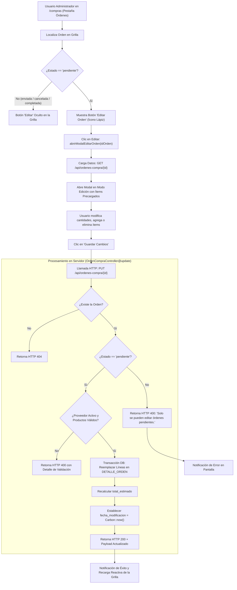

# Reporte de Pruebas y Cumplimiento: Edición de Orden de Compra (PC04)

Este documento detalla la verificación técnica, matriz de criterios de aceptación y la evidencia de pruebas para la historia de usuario **PC04: Como administrador quiero editar una orden de compra antes de enviarla para corregir cantidades o productos**.

---

## 1. Ficha de la Historia de Usuario

- **Identificador:** PC04
- **Módulo:** Pedidos de Compra (Grupo 3)
- **Rol:** Administrador
- **Complejidad:** 5 SP | **Prioridad:** Importante
- **Dependencias:** PC01 (Generación de Órdenes de Compra)
- **Alcance:**
  - Permitir modificar órdenes de compra que se encuentren exclusivamente en estado `pendiente`.
  - Agregar nuevos productos a la orden existente.
  - Eliminar productos previamente incluidos en la orden.
  - Modificar las cantidades solicitadas de los productos.
  - Recalcular automáticamente el total estimado de la orden.
  - Registrar la fecha de modificación (`fecha_modificacion`) con la fecha de la operación.
  - Impedir terminantemente modificaciones si la orden ya fue enviada o tramitada.
  - *No incluye la edición de órdenes enviadas, recibidas o canceladas* (garantía de trazabilidad e inmutabilidad comercial).
  - *No incluye la cancelación o anulación de la orden* (cubierto en PC05).

---

## 2. Matriz de Criterios de Aceptación y Pruebas

| Criterio de Aceptación | Estado | Tipo de Prueba | Entradas de Prueba | Salidas Obtenidas / Verificación |
| :--- | :---: | :---: | :--- | :--- |
| **1. Modificar órdenes en estado pendiente** | **Aprobado** | UI / API | Orden en estado `pendiente` (ID `3`) enviada por `PUT /api/ordenes-compra/3`. | Código HTTP 200. Se actualizan los datos de la orden y retorna mensaje: `"Orden de compra editada exitosamente."`. |
| **2. Permitir agregar productos** | **Aprobado** | Funcional / UI | Se agrega un producto adicional (ej. ID `15 - Yerba mate 1 kg`) en la orden ID `3`. | Se inserta una nueva fila en `DETALLE_ORDEN` y se incrementa el contador `total_productos`. |
| **3. Permitir eliminar productos** | **Aprobado** | Funcional / UI | Clic en el botón quitar (`×` / `quitarItemOrden(idx)`) en la grilla modal de ítems. | El producto se remueve de la lista; al guardar, se eliminan del detalle de la orden en la BD y se recalcula el total. |
| **4. Modificar cantidades solicitadas** | **Aprobado** | Funcional / BD | Se ajusta la cantidad solicitada (ej. de `10` a `25` unidades en producto ID `1`). | El campo `cantidad_solicitada` se actualiza en `DETALLE_ORDEN` y se recalcula `subtotal` y `total_estimado`. |
| **5. Impedir modificaciones una vez enviada la orden** | **Aprobado** | Seguridad / API | Intento de `PUT /api/ordenes-compra/102` (orden con estado `enviada`). | Se bloquea con código HTTP 400 Bad Request: `"Solo se pueden editar órdenes pendientes. Una vez enviada no puede modificarse. (PC04)"`. En UI, el botón de edición no se muestra para órdenes enviadas. |
| **6. Registrar la fecha de modificación** | **Aprobado** | BD / Integración | Edición de orden pendiente. | El atributo `fecha_modificacion` en la tabla `ORDEN_COMPRA` se actualiza a la fecha actual (`2026-10-26`). |
| **7. Mensajes de confirmación y error** | **Aprobado** | UI / API | Edición válida / Edición inválida. | Mensaje de éxito `"Orden modificada correctamente."` o advertencia ante validaciones fallidas (proveedor inactivo, orden ya enviada, sin productos). |

---

## 3. Diagrama de Flujo de Edición de Orden



---

## 4. Componentes Técnicos Involucrados

### 4.1. Interfaz Web ([`resources/views/compras/index.blade.php`](file:///c:/Users/franc/Desktop/PPS3/ERP-Juan23/resources/views/compras/index.blade.php))

- **Botón de Edición Condicional (Líneas ~2547-2549):**
  Solo se renderiza para órdenes cuyo estado sea estrictamente `'pendiente'`:
  ```javascript
  ${o.estado === 'pendiente' ? `
      <button onclick="enviarOrden(${o.id_orden})" class="p-1.5 text-blue-600 hover:bg-blue-50 rounded-lg transition-all" title="Enviar al Proveedor">
          <i data-lucide="send" class="w-4 h-4"></i>
      </button>
      <button onclick="abrirModalEditarOrden(${o.id_orden})" class="p-1.5 text-amber-600 hover:bg-amber-50 rounded-lg transition-all" title="Editar Orden">
          <i data-lucide="edit-3" class="w-4 h-4"></i>
      </button>
      <button onclick="cancelarOrden(${o.id_orden})" class="p-1.5 text-rose-600 hover:bg-rose-50 rounded-lg transition-all" title="Cancelar Orden">
          <i data-lucide="x-circle" class="w-4 h-4"></i>
      </button>
  ` : ''}
  ```

- **Función `abrirModalEditarOrden(idOrden)` (Líneas ~2652-2693):**
  - Consulta los datos vigentes mediante `GET /api/ordenes-compra/${idOrden}`.
  - Verifica que el estado sea pendiente; si no lo es, notifica y aborta.
  - Configura el modal en modo edición (`ordenModoEdicion = 'true'`), desactiva la selección de proveedor para preservar coherencia comercial, y carga la fecha de entrega y líneas de productos en `itemsNuevaOrden`.

- **Manipulación de Productos en Modal (Líneas ~2699-2762):**
  - `agregarItemOrden()`: Agrega o acumula cantidades de productos activos al arreglo en memoria y recalcula subtotales.
  - `quitarItemOrden(idx)`: Remueve el ítem del arreglo temporal (`itemsNuevaOrden.splice(idx, 1)`) y actualiza el visor de total.

- **Envío y Actualización `guardarNuevaOrden(e)` (Líneas ~2764-2807):**
  - Detecta si está en modo edición y despacha la petición vía `PUT /api/ordenes-compra/${idEditar}` con encabezado `X-CSRF-TOKEN` y cuerpo en formato JSON.
  - Muestra mensaje de confirmación y actualiza reactivamente la tabla de órdenes sin recargar la página.

---

### 4.2. Backend y Reglas de Negocio ([`OrdenCompraController.php`](file:///c:/Users/franc/Desktop/PPS3/ERP-Juan23/app/Modules/PedidosDeCompra/Controllers/OrdenCompraController.php))

- **Método `update(Request $request, int $id): JsonResponse` (Líneas ~274-366):**
  1. **Control de Estado:**
     ```php
     if ($orden->estado !== 'pendiente') {
         return response()->json([
             'status' => 'error',
             'message' => 'Solo se pueden editar órdenes pendientes. Una vez enviada no puede modificarse. (PC04)',
         ], 400);
     }
     ```
  2. **Validación de Proveedor Activo:**
     ```php
     if ($orden->proveedor && $orden->proveedor->estado !== 'activo') {
         return response()->json([
             'status' => 'error',
             'message' => 'No se puede editar una orden de compra de un proveedor inactivo. (PV04)',
         ], 400);
     }
     ```
  3. **Validación de Ítems y Cantidades:**
     Verifica que haya al menos un producto, que las cantidades solicitadas sean enteras positivas mayores a 0, y que los productos pertenezcan al catálogo activo.
  4. **Transacción y Trazabilidad:**
     Dentro de `DB::transaction`, elimina los detalles anteriores, inserta los nuevos registros con precios y subtotales calculados, recalcula `total_estimado`, y actualiza:
     ```php
     $orden->fecha_modificacion = Carbon::now()->toDateString();
     $orden->save();
     ```

---

## 5. Evidencias de Pruebas Ejecutadas

### 5.1. Modificación Exitosa de una Orden Pendiente (HTTP 200 OK)

**Petición:**
```http
PUT /api/ordenes-compra/3 HTTP/1.1
Host: 127.0.0.1:8000
Content-Type: application/json
Accept: application/json

{
  "id_proveedor": 3,
  "fecha_creacion": "2026-10-22",
  "fecha_entrega_estimada": "2026-11-05",
  "items": [
    {
      "id_producto": 1,
      "cantidad_solicitada": 25,
      "precio_estimado": 120.00
    },
    {
      "id_producto": 15,
      "cantidad_solicitada": 10,
      "precio_estimado": 250.00
    }
  ]
}
```

**Respuesta Obtenida:**
```json
{
  "status": "success",
  "message": "Orden de compra editada exitosamente.",
  "data": {
    "id_orden": 3,
    "numero_orden": "OC-2026-811858",
    "id_proveedor": 3,
    "proveedor": "distribuidora pepito",
    "total_estimado": 5500,
    "estado": "pendiente",
    "fecha_creacion": "2026-10-22",
    "fecha_entrega_estimada": "2026-11-05",
    "fecha_modificacion": "2026-10-26",
    "fecha_envio": null,
    "fecha_cancelacion": null,
    "total_productos": 35
  }
}
```

> [!NOTE]
> - El total estimado se recalculó automáticamente a `$5500.00` (`(25 * 120) + (10 * 250)`).
> - Se registró la fecha de modificación `2026-10-26`.
> - La orden permanece en estado `pendiente`.

---

### 5.2. Bloqueo de Edición ante Orden Ya Enviada (HTTP 400 Bad Request)

**Petición:**
```http
PUT /api/ordenes-compra/102 HTTP/1.1
Host: 127.0.0.1:8000
Content-Type: application/json
Accept: application/json

{
  "id_proveedor": 3,
  "items": [
    {
      "id_producto": 1,
      "cantidad_solicitada": 15,
      "precio_estimado": 100.00
    }
  ]
}
```

**Respuesta Obtenida:**
```json
{
  "status": "error",
  "message": "Solo se pueden editar órdenes pendientes. Una vez enviada no puede modificarse. (PC04)"
}
```

> [!IMPORTANT]
> El sistema garantiza la inmutabilidad de los pedidos enviados, impidiendo modificaciones operativas que alteren la coherencia con el proveedor.

---

### 5.3. Prueba Automatizada de Integración (PHPUnit)

Ejecución sobre la suite automatizada en [`tests/Feature/UserStoriesFrontendTest.php`](file:///c:/Users/franc/Desktop/PPS3/ERP-Juan23/tests/Feature/UserStoriesFrontendTest.php#L1710):

```powershell
php artisan test --filter=test_pc04_pc05_pc06_ordenes_compra_edicion_cancelacion_y_estados
```

**Resultado de la Ejecución:**
```text
   PASS  Tests\Feature\UserStoriesFrontendTest
  ✓ pc04 pc05 pc06 ordenes compra edicion cancelacion y estados                                                  1.02s  

  Tests:    1 passed (10 assertions)
  Duration: 1.68s
```

---

## 6. Conclusión

La historia de usuario **PC04** se encuentra **100% implementada y verificada**:
1. **Flexibilidad previa al envío:** El administrador puede corregir cantidades, agregar ítems o eliminar productos de órdenes en borrador o pendientes.
2. **Seguridad y Trazabilidad:** Se registra de forma fehaciente `fecha_modificacion` y se bloquea cualquier intento de alteración posterior al envío.
3. **Experiencia de Usuario:** La interfaz gráfica en `/compras` ofrece una interacción fluida mediante modal reactivo, deshabilitando o escondiendo opciones no permitidas según el estado de la orden.

