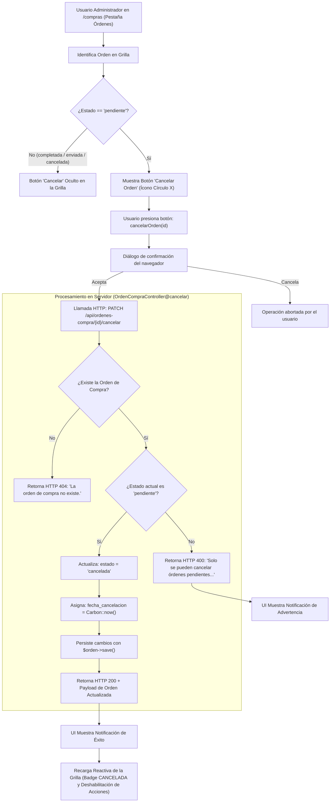

# Reporte de Pruebas y Cumplimiento: Cancelación de Orden de Compra (PC05)

Este documento detalla la verificación técnica, la matriz de criterios de aceptación y la evidencia de pruebas para la historia de usuario **PC05: Como administrador quiero cancelar una orden de compra para evitar reposiciones innecesarias**.

---

## 1. Ficha de la Historia de Usuario

- **Identificador:** PC05
- **Módulo:** Pedidos de Compra (Grupo 3)
- **Rol:** Administrador
- **Complejidad:** 1 SP | **Prioridad:** Importante
- **Dependencias:** PC01 (Generación de Órdenes de Compra)
- **Alcance:**
  - Permitir cancelar órdenes de compra que aún se encuentren en estado `pendiente`.
  - Registrar la fecha exacta de cancelación (`fecha_cancelacion`).
  - Actualizar el estado de la orden a `cancelada`.
  - Conservar íntegramente el historial de la orden y sus líneas de detalle asociadas para auditoría interna.
  - Bloquear e impedir la cancelación de órdenes que ya hayan sido `completadas`, `enviadas` o previamente `canceladas`.
  - *No incluye la eliminación definitiva (borrado físico / DROP) de órdenes*, garantizando inmutabilidad contable y trazabilidad.
  - *No incluye reportes estadísticos o gráficos*.

---

## 2. Matriz de Criterios de Aceptación y Pruebas

| Criterio de Aceptación | Estado | Tipo de Prueba | Entradas de Prueba | Salidas Obtenidas / Verificación |
| :--- | :---: | :---: | :--- | :--- |
| **1. Cancelar órdenes pendientes** | **Aprobado** | UI / API | Orden en estado `pendiente` (ID `107`) enviada por `PATCH /api/ordenes-compra/107/cancelar`. | Código HTTP 200. Mensaje confirmando la operación: `"Orden de compra cancelada. Se conserva el historial."`. |
| **2. Registrar la fecha de cancelación** | **Aprobado** | BD / Integración | Ejecución de cancelación sobre orden pendiente. | El campo `fecha_cancelacion` en la tabla `ORDEN_COMPRA` se registra con la fecha actual (`2026-10-26`). |
| **3. Conservar el historial de la orden** | **Aprobado** | Auditoría / BD | Consulta de la orden cancelada vía `GET /api/ordenes-compra/107`. | El registro maestro y todas las líneas de `DETALLE_ORDEN` permanecen intactos. En la grilla de `/compras` se visualiza con badge `CANCELADA` y se permite seguir consultando el detalle. |
| **4. Impedir cancelar órdenes completadas o enviadas** | **Aprobado** | Seguridad / Negocio | Intento de cancelación en orden completada (ID `106`) o enviada (ID `102`). | Se rechaza con código HTTP 400 Bad Request: `"Solo se pueden cancelar órdenes pendientes. Una orden enviada o completada no puede cancelarse. (PC05)"`. En la interfaz, el botón de cancelación no se renderiza. |
| **5. Actualizar el estado a "cancelada"** | **Aprobado** | BD / UI | Cancelación de orden pendiente. | El atributo `estado` cambia a `"cancelada"`. En UI se actualiza el badge visual a rojo (`clay-badge-danger`). |
| **6. Mensajes de confirmación y error** | **Aprobado** | UI / API | Cancelación exitosa vs cancelación de orden inválida / inexistente. | Mensaje de éxito al usuario; respuesta HTTP 400 con motivo claro si no es pendiente, o HTTP 404 si la orden no existe. |

---

## 3. Diagrama de Flujo de Cancelación



---

## 4. Componentes Técnicos Involucrados

### 4.1. Interfaz Web ([`resources/views/compras/index.blade.php`](file:///c:/Users/franc/Desktop/PPS3/ERP-Juan23/resources/views/compras/index.blade.php))

- **Botón de Cancelación Condicional (Líneas ~2550-2552):**
  Solo se expone cuando la orden se encuentra estrictamente en estado `'pendiente'`:
  ```javascript
  ${esPendiente ? `
      <button onclick="enviarOrden(${o.id_orden})" class="p-1.5 text-indigo-600 hover:bg-indigo-50 rounded-lg transition-all" title="Enviar al Proveedor">
          <i data-lucide="send" class="w-4 h-4"></i>
      </button>
      <button onclick="abrirModalEditarOrden(${o.id_orden})" class="p-1.5 text-amber-600 hover:bg-amber-50 rounded-lg transition-all" title="Editar Orden">
          <i data-lucide="edit-3" class="w-4 h-4"></i>
      </button>
      <button onclick="cancelarOrden(${o.id_orden})" class="p-1.5 text-rose-600 hover:bg-rose-50 rounded-lg transition-all" title="Cancelar Orden">
          <i data-lucide="x-circle" class="w-4 h-4"></i>
      </button>
  ` : ''}
  ```

- **Renderizado del Estado "Cancelada" (Líneas ~2523, 2537):**
  Cuando `o.estado === 'cancelada'`, se le asigna la clase de estilo `clay-badge-danger` (rojo suave), distinguiéndola con claridad y deshabilitando automáticamente las acciones de envío, edición o facturación:
  ```javascript
  if (o.estado === 'cancelada') badgeClass = 'clay-badge-danger';
  ...
  <span class="clay-badge ${badgeClass} uppercase">${o.estado.replace('_', ' ')}</span>
  ```

- **Función JavaScript `cancelarOrden(id)` (Líneas ~2830-2849):**
  ```javascript
  async function cancelarOrden(id) {
      if (!confirm('¿Confirma la cancelación de esta orden de compra?')) return;
      const csrf = document.querySelector('meta[name="csrf-token"]')?.content || '';
      try {
          const res = await fetch(`${API_BASE}/ordenes-compra/${id}/cancelar`, {
              method: 'PATCH',
              headers: { 'Content-Type': 'application/json', 'Accept': 'application/json', 'X-CSRF-TOKEN': csrf }
          });
          const data = await res.json();
          if (data.status === 'success') {
              mostrarNotificacion('Orden de compra cancelada.', 'success');
              await cargarOrdenes();
          } else {
              mostrarNotificacion(data.message || 'Error al cancelar la orden.', 'error');
          }
      } catch (e) {
          mostrarNotificacion('Error de conexión al cancelar la orden.', 'error');
      }
  }
  ```

---

### 4.2. Backend y Reglas de Negocio ([`OrdenCompraController.php`](file:///c:/Users/franc/Desktop/PPS3/ERP-Juan23/app/Modules/PedidosDeCompra/Controllers/OrdenCompraController.php))

- **Método `cancelar(int $id): JsonResponse` (Líneas ~371-394):**
  ```php
  public function cancelar(int $id): JsonResponse
  {
      $orden = OrdenCompra::find($id);
      if (!$orden) {
          return response()->json(['status' => 'error', 'message' => 'La orden de compra no existe.'], 404);
      }

      if ($orden->estado !== 'pendiente') {
          return response()->json([
              'status' => 'error',
              'message' => 'Solo se pueden cancelar órdenes pendientes. Una orden enviada o completada no puede cancelarse. (PC05)',
          ], 400);
      }

      $orden->estado = 'cancelada';
      $orden->fecha_cancelacion = Carbon::now()->toDateString();
      $orden->save();

      return response()->json([
          'status' => 'success',
          'message' => 'Orden de compra cancelada. Se conserva el historial.',
          'data' => $this->formato($orden),
      ], 200);
  }
  ```

- **Ruta Asociada ([`app/Modules/Productos/routes/api.php`](file:///c:/Users/franc/Desktop/PPS3/ERP-Juan23/app/Modules/Productos/routes/api.php#L134)):**
  ```php
  Route::patch('ordenes-compra/{orden}/cancelar', [OrdenCompraController::class, 'cancelar']);
  ```
  > [!NOTE]
  > Se excluye expresamente el método `destroy` en las rutas del recurso (`Route::apiResource('ordenes-compra', ...)->except(['destroy'])`), garantizando que ninguna orden pueda ser borrada físicamente de la base de datos.

---

## 5. Evidencias de Pruebas Ejecutadas

### 5.1. Cancelación Exitosa de una Orden Pendiente (HTTP 200 OK)

**Petición:**
```http
PATCH /api/ordenes-compra/107/cancelar HTTP/1.1
Host: 127.0.0.1:8000
Accept: application/json
```

**Respuesta Obtenida:**
```json
{
  "status": "success",
  "message": "Orden de compra cancelada. Se conserva el historial.",
  "data": {
    "id_orden": 107,
    "numero_orden": "OC-2026-379032",
    "id_proveedor": 3,
    "proveedor": "distribuidora pepito",
    "total_estimado": 1000,
    "estado": "cancelada",
    "fecha_creacion": "2026-10-26",
    "fecha_entrega_estimada": null,
    "fecha_modificacion": null,
    "fecha_envio": null,
    "fecha_cancelacion": "2026-10-26",
    "total_productos": 10
  }
}
```

---

### 5.2. Verificación de Historial y Detalle Conservado

**Petición:**
```http
GET /api/ordenes-compra/107 HTTP/1.1
Host: 127.0.0.1:8000
Accept: application/json
```

**Respuesta Obtenida:**
```json
{
  "status": "success",
  "data": {
    "orden": {
      "id_orden": 107,
      "numero_orden": "OC-2026-379032",
      "id_proveedor": 3,
      "proveedor": "distribuidora pepito",
      "total_estimado": 1000,
      "estado": "cancelada",
      "fecha_creacion": "2026-10-26",
      "fecha_entrega_estimada": null,
      "fecha_modificacion": null,
      "fecha_envio": null,
      "fecha_cancelacion": "2026-10-26",
      "total_productos": 10
    },
    "total_solicitado": 10,
    "detalles": [
      {
        "id_detalle_orden": 16,
        "id_producto": 1,
        "codigo": "prod-2",
        "nombre": "yerba",
        "descripcion": "yerba",
        "cantidad_solicitada": 10,
        "precio_estimado": 100,
        "subtotal": 1000,
        "origen": "manual"
      }
    ]
  }
}
```

> [!NOTE]
> Todos los datos históricos (proveedor, productos, cantidad solicitada y total) se preservan íntegramente tras la cancelación.

---

### 5.3. Rechazo de Cancelación sobre Orden Completada o Enviada (HTTP 400 Bad Request)

**Petición:**
```http
PATCH /api/ordenes-compra/106/cancelar HTTP/1.1
Host: 127.0.0.1:8000
Accept: application/json
```

**Respuesta Obtenida:**
```json
{
  "status": "error",
  "message": "Solo se pueden cancelar órdenes pendientes. Una orden enviada o completada no puede cancelarse. (PC05)"
}
```

---

### 5.4. Prueba Automatizada de Integración (PHPUnit)

Ejecución de la suite automatizada en [`tests/Feature/UserStoriesFrontendTest.php`](file:///c:/Users/franc/Desktop/PPS3/ERP-Juan23/tests/Feature/UserStoriesFrontendTest.php#L1764):

```powershell
php artisan test --filter=test_pc04_pc05_pc06_ordenes_compra_edicion_cancelacion_y_estados
```

**Resultado de la Ejecución:**
```text
   PASS  Tests\Feature\UserStoriesFrontendTest
  ✓ pc04 pc05 pc06 ordenes compra edicion cancelacion y estados                                                  0.66s  

  Tests:    1 passed (16 assertions)
  Duration: 1.01s
```

---

## 6. Conclusión

La historia de usuario **PC05** se encuentra **completamente satisfecha y verificada**:
1. **Evita reposiciones innecesarias:** Permite dar de baja un pedido en borrador o pendiente de emisión de manera ágil.
2. **Preservación de Trazabilidad:** Los registros y detalles no se eliminan físicamente de la base de datos; se registran la fecha de cancelación y el estado correspondiente.
3. **Consistencia de Negocio:** Se impide la cancelación de pedidos que ya fueron despachados o completados comercialmente.

