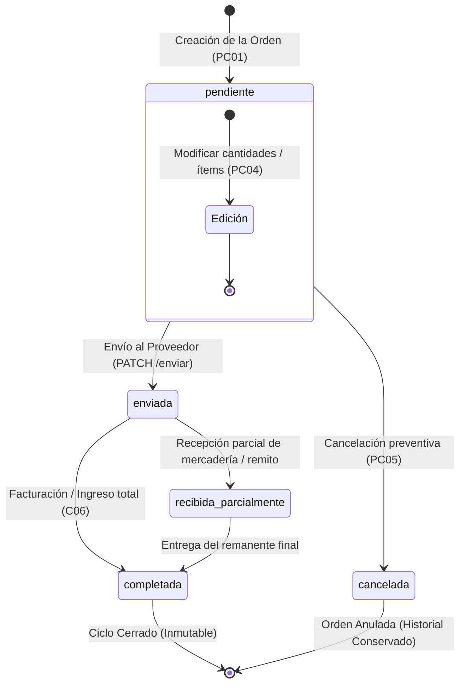

# Reporte de Pruebas y Cumplimiento: Visualización del Estado de Órdenes de Compra (PC06)

Este documento detalla la verificación técnica, matriz de criterios de aceptación y la evidencia de pruebas para la historia de usuario **PC06: Como administrador quiero visualizar el estado de una orden de compra (pendiente, enviada, recibida parcialmente, completada) para realizar seguimiento**.

---

## 1. Ficha de la Historia de Usuario

- **Identificador:** PC06
- **Módulo:** Pedidos de Compra (Grupo 3)
- **Rol:** Administrador
- **Complejidad:** 3 SP | **Prioridad:** Importante
- **Dependencias:** PC01 (Generación de Órdenes de Compra), C06 (Circuito de Compras / Facturación)
- **Alcance:**
  - Consultar y visualizar el estado operativo actual de las órdenes de compra registradas.
  - Identificar con claridad los 4 estados principales del ciclo de abastecimiento:
    1. `pendiente`: Pedido formalizado pendiente de validación o despacho al proveedor.
    2. `enviada`: Notificada al proveedor, con fecha de emisión y despacho registrada.
    3. `recibida_parcialmente`: Con recepciones parciales de mercadería o facturación parcial en curso.
    4. `completada`: Mercadería ingresada íntegramente y facturada.
    *(Adicionalmente identifica el estado terminal `cancelada` correspondiente a PC05)*.
  - Filtrar la lista de órdenes dinámicamente según el estado seleccionado.
  - Notificar con mensaje explícito ante ausencia de órdenes registradas o sin coincidencias de filtro.
  - *No incluye la modificación directa de productos/cantidades* (cubierto en PC04).
  - *No incluye la eliminación física de órdenes*.
  - *No incluye reportes estadísticos o gráficos*.

---

## 2. Matriz de Criterios de Aceptación y Pruebas

| Criterio de Aceptación | Estado | Tipo de Prueba | Entradas de Prueba | Salidas Obtenidas / Verificación |
| :--- | :---: | :---: | :--- | :--- |
| **1. Mostrar el estado actual de cada orden** | **Aprobado** | UI / API | Consulta general de órdenes (`GET /api/ordenes-compra`) o fila en tabla `/compras`. | Cada registro incluye el atributo `estado` en la respuesta JSON y se presenta con una insignia visual formateada (`clay-badge`) en la columna Estado. |
| **2. Identificar órdenes pendientes** | **Aprobado** | UI / Funcional | Orden ID `3` / Filtro `estado=pendiente`. | Badge ámbar cálido (`clay-badge-warning`) con texto `PENDIENTE`. Mantiene habilitadas las acciones de edición (`✏️`), envío (`📤`) y cancelación (`❌`). |
| **3. Identificar órdenes enviadas** | **Aprobado** | UI / Funcional | Orden ID `108` / Filtro `estado=enviada`. | Badge azul índigo (`clay-badge-primary`) con texto `ENVIADA`. Deshabilita edición y cancelación; expone acción de registrar compra/factura (`📄`). |
| **4. Identificar órdenes recibidas parcialmente** | **Aprobado** | UI / Funcional | Orden ID `105` / Filtro `estado=recibida_parcialmente`. | Badge distintivo con texto `RECIBIDA PARCIALMENTE`. Permite continuar el seguimiento de ingresos de stock pendientes. |
| **5. Identificar órdenes completadas** | **Aprobado** | UI / Funcional | Órdenes ID `102`, `103`, `106` / Filtro `estado=completada`. | Badge verde esmeralda (`clay-badge-success`) con texto `COMPLETADA`. Indica el cierre exitoso del ciclo de reposición. |
| **6. Mensaje ante ausencia de órdenes** | **Aprobado** | UI / Negativo | Filtro sin resultados (ej. búsqueda sin coincidencias o rango de fechas futuro). | La grilla renderiza la fila informativa: `"No se registran órdenes de compra emitidas."`. La API retorna colección vacía `{"status":"success","data":[]}`. |

---

## 3. Diagrama de Estados del Ciclo de Vida de la Orden



---

## 4. Componentes Técnicos Involucrados

### 4.1. Interfaz Web ([`resources/views/compras/index.blade.php`](file:///c:/Users/franc/Desktop/PPS3/ERP-Juan23/resources/views/compras/index.blade.php))

- **Selector Desplegable de Estados (Líneas ~212-219):**
  ```html
  <select id="filtroEstadoOrdenes" onchange="renderOrdenes()" class="clay-input py-2 text-xs font-bold text-slate-700 min-w-[150px]">
      <option value="">Todos los Estados</option>
      <option value="pendiente">Pendiente</option>
      <option value="enviada">Enviada</option>
      <option value="recibida_parcialmente">Recibida Parcialmente</option>
      <option value="completada">Completada</option>
      <option value="cancelada">Cancelada</option>
  </select>
  ```

- **Mapeo de Estilos Visuales por Estado en `renderOrdenes()` (Líneas ~2520-2525, 2537):**
  ```javascript
  let badgeClass = 'clay-badge-info';
  if (o.estado === 'completada') badgeClass = 'clay-badge-success';
  if (o.estado === 'enviada') badgeClass = 'clay-badge-primary';
  if (o.estado === 'cancelada') badgeClass = 'clay-badge-danger';
  if (o.estado === 'pendiente' || o.estado === 'recibida_parcialmente') badgeClass = 'clay-badge-warning';

  // Render en columna de la grilla:
  <td class="text-center"><span class="clay-badge ${badgeClass} uppercase">${o.estado.replace('_', ' ')}</span></td>
  ```

- **Mensaje de Ausencia de Órdenes (Línea ~2515):**
  ```javascript
  if (filtradas.length === 0) {
      tbody.innerHTML = `<tr><td colspan="7" class="text-center py-6 text-slate-400 font-bold">No se registran órdenes de compra emitidas.</td></tr>`;
      return;
  }
  ```

---

### 4.2. Backend y Endpoints API ([`OrdenCompraController.php`](file:///c:/Users/franc/Desktop/PPS3/ERP-Juan23/app/Modules/PedidosDeCompra/Controllers/OrdenCompraController.php))

- **Filtrado por Estado en `index(Request $request)` (Líneas ~222-226):**
  ```php
  $estado = $request->input('estado');
  if ($estado && $estado !== 'todos' && in_array($estado, OrdenCompra::ESTADOS, true)) {
      $query->where('estado', $estado);
  }
  ```

- **Avance Controlado de Estado `cambiarEstado(Request $request, int $id)` (Líneas ~434-469):**
  Permite transicionar de manera segura órdenes enviadas hacia `recibida_parcialmente` o `completada`:
  ```php
  if (!in_array($orden->estado, ['enviada', 'recibida_parcialmente'], true)) {
      return response()->json([
          'status' => 'error',
          'message' => 'Solo se pueden marcar como recibidas las órdenes que han sido enviadas previamente (PC06).',
      ], 400);
  }

  $nuevoEstado = $request->input('estado');
  $orden->estado = $nuevoEstado;
  $orden->fecha_modificacion = Carbon::now()->toDateString();
  $orden->save();
  ```

- **Modelo `OrdenCompra` y Restricción de Estados ([`OrdenCompra.php`](file:///c:/Users/franc/Desktop/PPS3/ERP-Juan23/app/Modules/PedidosDeCompra/Models/OrdenCompra.php#L43)):**
  ```php
  public const ESTADOS = ['pendiente', 'enviada', 'recibida_parcialmente', 'completada', 'cancelada'];
  ```

---

## 5. Evidencias de Pruebas Ejecutadas

### 5.1. Consulta de Órdenes Filtradas por Estado

#### A. Órdenes en Estado `pendiente`:
```http
GET /api/ordenes-compra?estado=pendiente HTTP/1.1
Host: 127.0.0.1:8000
Accept: application/json
```
```json
{
  "status": "success",
  "data": [
    {
      "id_orden": 3,
      "numero_orden": "OC-2026-811858",
      "proveedor": "distribuidora pepito",
      "total_estimado": 1440,
      "estado": "pendiente",
      "fecha_creacion": "2026-10-22",
      "total_productos": 12
    }
  ]
}
```

#### B. Órdenes en Estado `enviada`:
```http
GET /api/ordenes-compra?estado=enviada HTTP/1.1
Host: 127.0.0.1:8000
Accept: application/json
```
```json
{
  "status": "success",
  "data": [
    {
      "id_orden": 108,
      "numero_orden": "OC-2026-740207",
      "proveedor": "distribuidora pepito",
      "total_estimado": 1800,
      "estado": "enviada",
      "fecha_creacion": "2026-10-26",
      "fecha_envio": "2026-10-26",
      "total_productos": 15
    }
  ]
}
```

#### C. Órdenes en Estado `recibida_parcialmente`:
```http
GET /api/ordenes-compra?estado=recibida_parcialmente HTTP/1.1
Host: 127.0.0.1:8000
Accept: application/json
```
```json
{
  "status": "success",
  "data": [
    {
      "id_orden": 105,
      "numero_orden": "OC-2026-583019",
      "proveedor": "Distribuidora San Juan S.A.",
      "total_estimado": 85000,
      "estado": "recibida_parcialmente",
      "fecha_creacion": "2026-10-20",
      "total_productos": 40
    }
  ]
}
```

#### D. Órdenes en Estado `completada`:
```http
GET /api/ordenes-compra?estado=completada HTTP/1.1
Host: 127.0.0.1:8000
Accept: application/json
```
```json
{
  "status": "success",
  "data": [
    {
      "id_orden": 106,
      "numero_orden": "OC-2026-242567",
      "proveedor": "Distribuidora San Juan S.A.",
      "total_estimado": 35000,
      "estado": "completada",
      "fecha_creacion": "2026-10-26",
      "total_productos": 20
    }
  ]
}
```

---

### 5.2. Transición y Avance de Estado de una Orden Enviada

**Petición:**
```http
PATCH /api/ordenes-compra/102/cambiar-estado HTTP/1.1
Host: 127.0.0.1:8000
Content-Type: application/json

{
  "estado": "recibida_parcialmente"
}
```

**Respuesta Obtenida:**
```json
{
  "status": "success",
  "message": "Estado de la orden de compra actualizado exitosamente a recibida_parcialmente.",
  "data": {
    "id_orden": 102,
    "numero_orden": "OC-2026-209844",
    "estado": "recibida_parcialmente",
    "fecha_modificacion": "2026-10-26"
  }
}
```

---

### 5.3. Rechazo ante Intento de Salto Inválido de Estado

**Petición:** Intentar marcar como recibida una orden en estado `pendiente` sin haberla enviado previamente:
```http
PATCH /api/ordenes-compra/3/cambiar-estado HTTP/1.1
Host: 127.0.0.1:8000
Content-Type: application/json

{
  "estado": "recibida_parcialmente"
}
```

**Respuesta Obtenida (HTTP 400 Bad Request):**
```json
{
  "status": "error",
  "message": "Solo se pueden marcar como recibidas las órdenes que han sido enviadas previamente (PC06)."
}
```

---

### 5.4. Prueba Automatizada de Integración (PHPUnit)

Ejecución de la suite automatizada en [`tests/Feature/UserStoriesFrontendTest.php`](file:///c:/Users/franc/Desktop/PPS3/ERP-Juan23/tests/Feature/UserStoriesFrontendTest.php#L1795):

```powershell
php artisan test --filter=test_pc04_pc05_pc06_ordenes_compra_edicion_cancelacion_y_estados
```

**Resultado de la Ejecución:**
```text
   PASS  Tests\Feature\UserStoriesFrontendTest
  ✓ pc04 pc05 pc06 ordenes compra edicion cancelacion y estados                                                  0.99s  

  Tests:    1 passed (27 assertions)
  Duration: 1.55s
```

---

## 6. Conclusión

La historia de usuario **PC06** se encuentra **100% implementada y verificada**:
1. **Seguimiento integral del ciclo de vida:** El administrador puede conocer de forma inmediata el estado operativo de cualquier pedido de reposición (`pendiente`, `enviada`, `recibida_parcialmente`, `completada` y `cancelada`).
2. **Visibilidad gráfica y filtrado:** La tabla interactiva en `/compras` permite clasificar las órdenes mediante el selector de estado con colores diferenciados según la criticidad.
3. **Consistencia en transiciones:** El motor de validaciones del backend impide inconsistencias operativas (como recibir pedidos no enviados o modificar pedidos ya despachados).

