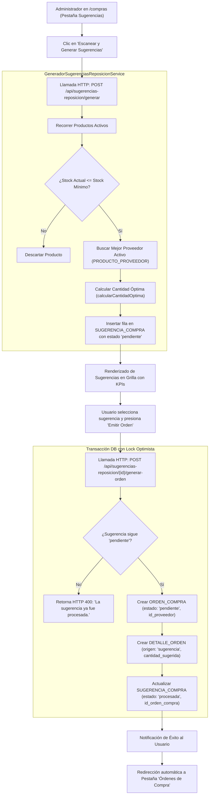

# Reporte de Pruebas y Cumplimiento: Generación de Sugerencias de Órdenes de Compra por Bajo Stock (PC07)

Este documento detalla la verificación técnica, matriz de criterios de aceptación y la evidencia de pruebas para la historia de usuario **PC07: Como administrador quiero generar sugerencias de órdenes de compra a partir de productos con stock bajo para agilizar la reposición**.

---

## 1. Ficha de la Historia de Usuario

- **Identificador:** PC07
- **Módulo:** Pedidos de Compra (Grupo 3)
- **Rol:** Administrador
- **Complejidad:** 8 SP | **Prioridad:** Importante
- **Dependencias:** PC01 (Generación de Órdenes de Compra), S07 (Alertas de Stock Mínimo), PV05 (Asociación Producto-Proveedor y Condiciones Comerciales)
- **Alcance:**
  - Identificar en tiempo real productos cuyo stock disponible sea igual o inferior al stock mínimo configurado.
  - Proponer cantidades de reposición recomendadas considerando stock actual, stock máximo objetivo, velocidad de venta y plazo de entrega del proveedor.
  - Asignar automáticamente a cada sugerencia el proveedor activo más conveniente (menor precio acordado y condición de proveedor principal).
  - Permitir al administrador revisar, seleccionar o rechazar las sugerencias en pantalla.
  - Generar automáticamente órdenes de compra en estado `pendiente` a partir de las sugerencias seleccionadas, preservando trazabilidad con el identificador de origen (`origen = 'sugerencia'`).
  - Marcar las sugerencias procesadas para impedir su duplicación o reemisión involuntaria.
  - Exponer mensajes informativos tanto al emitir las órdenes como en caso de ausencia de productos con stock bajo.
  - *No incluye la modificación o eliminación directa de órdenes ya generadas* (cubierto en PC04 y PC05).
  - *No incluye reportes estadísticos o gráficos complejos* (cubiertos en dashboard de reposición complementario).

---

## 2. Matriz de Criterios de Aceptación y Pruebas

| Criterio de Aceptación | Estado | Tipo de Prueba | Entradas de Prueba | Salidas Obtenidas / Verificación |
| :--- | :---: | :---: | :--- | :--- |
| **1. Identificar productos con stock bajo** | **Aprobado** | Algorítmico / BD | Producto ID `14` (`Gaseosa cola 2.25 L`) con stock `1505` y stock mínimo `2000`. | Se detecta la condición `$stock <= $minimo` y se genera sugerencia con motivo `"bajo_stock"` y observación `"Stock por debajo del mínimo permitido"`. |
| **2. Sugerir cantidades de reposición** | **Aprobado** | Cálculo / Negocio | Producto con déficit de inventario respecto al stock objetivo. | El método `calcularCantidadOptima` determina la cantidad recomendada (`50` unidades) para alcanzar el nivel de seguridad requerido. |
| **3. Permitir seleccionar productos sugeridos** | **Aprobado** | UI / Funcional | Grilla interactiva en `/compras` (pestaña Sugerencias) o `/sugerencias-reposicion`. | Cada fila expone los datos del producto, stock actual vs mínimo, proveedor propuesto, costo total y botón de acción directa `[ 📄 Emitir Orden ]`. |
| **4. Generar orden de compra desde la sugerencia** | **Aprobado** | Transaccional / API | Petición `POST /api/sugerencias-reposicion/1/generar-orden`. | Se crea la orden `#OC-2026-618151` (ID `109`) en estado `pendiente` con sus registros en `DETALLE_ORDEN` y se vincula `id_orden_compra` en la sugerencia. |
| **5. Asociar orden al proveedor correspondiente** | **Aprobado** | Regla Comercial / BD | Consulta de mejor proveedor activo en `PRODUCTO_PROVEEDOR`. | Se asocia automáticamente al proveedor activo con menor precio acordado (`Bebidas del Ejemplo S.A.`, ID `4`, precio unitario `$1050.00`). |
| **6. Mensajes de confirmación y ausencia** | **Aprobado** | UI / Mensajería | Generación exitosa / Catálogo sin quiebres de stock. | Mensaje toast: `"Orden de compra generada exitosamente desde la sugerencia."` o aviso en tabla: `"No hay sugerencias de reposición pendientes. Haga clic en 'Escanear y Generar Sugerencias'."` |

---

## 3. Diagrama de Flujo del Motor de Sugerencias de Reposición



---

## 4. Componentes Técnicos Involucrados

### 4.1. Interfaz Web ([`resources/views/compras/index.blade.php`](file:///c:/Users/franc/Desktop/PPS3/ERP-Juan23/resources/views/compras/index.blade.php))

- **Pestaña Dedicada (`#pestana-sugerencias`, Líneas ~257-320):**
  - Panel superior con botón de acción directa `generarSugerenciasAhora()`.
  - Tarjetas de KPIs analíticos: *Sugerencias Pendientes*, *Unidades a Reponer*, y *Costo Estimado de Reposición*.
  - Tabla de sugerencias con columnas: Producto, Stock Actual / Mínimo, Cantidad Sugerida, Proveedor Asignado, Precio Unitario, Costo Total, Motivo y Acciones.
- **Función `generarSugerenciasAhora()` (Líneas ~2991-3009):**
  - Ejecuta `POST /api/sugerencias-reposicion/generar` disparando el análisis de catálogo y notificando al usuario.
- **Función `generarOrdenDesdeSugerencia(idSugerencia)` (Líneas ~3011-3029):**
  - Despacha `POST /api/sugerencias-reposicion/${idSugerencia}/generar-orden`, actualiza la lista de órdenes y conmuta la vista a la pestaña de órdenes para visualización inmediata.
- **Función `rechazarSugerencia(idSugerencia)` (Líneas ~3031-3050):**
  - Permite descartar una sugerencia indicando un motivo opcional de rechazo.

---

### 4.2. Backend y Reglas de Negocio

- **Servicio Generador ([`GeneradorSugerenciasReposicionService.php`](file:///c:/Users/franc/Desktop/PPS3/ERP-Juan23/app/Modules/PedidosDeCompra/Services/GeneradorSugerenciasReposicionService.php)):**
  - `analizarProducto(Producto $producto)`: Evalúa el stock disponible frente a las cotas configuradas.
  - `calcularCantidadOptima(int $stock, int $maximo, float $velocidad, int $plazo)`: Fórmula de reposición preventiva que garantiza cubrir el lead time y mantener un stock amortiguador.
  - `obtenerMejorProveedor(Producto $producto)`: Localiza en `PRODUCTO_PROVEEDOR` la relación activa con menor precio de costo acordado y prioridad al proveedor principal.
  - `generarOrdenDesdeSugerencia(int $id, int $idUsuario)`: Ejecuta en bloque transaccional con `lockForUpdate()` la creación de la orden de compra y el cierre de la sugerencia.
- **Controlador ([`SugerenciasReposicionController.php`](file:///c:/Users/franc/Desktop/PPS3/ERP-Juan23/app/Modules/PedidosDeCompra/Controllers/SugerenciasReposicionController.php)):**
  - Rutas RESTful bajo el prefijo `/api/sugerencias-reposicion`:
    - `POST /generar`
    - `GET /`
    - `POST /{id}/generar-orden`
    - `POST /{id}/rechazar`
    - `POST /procesar-lote`

---

## 5. Evidencias de Pruebas Ejecutadas

### 5.1. Detección y Generación de Sugerencias

**Petición:**
```http
POST /api/sugerencias-reposicion/generar HTTP/1.1
Host: 127.0.0.1:8000
Content-Type: application/json
Accept: application/json
```

**Respuesta Obtenida (HTTP 201 Created):**
```json
{
  "exito": true,
  "total_generadas": 1,
  "sugerencias": [
    {
      "id": 1,
      "producto": {
        "id": 14,
        "codigo": "DEMO-001",
        "nombre": "Gaseosa cola 2.25 L"
      },
      "proveedor": {
        "id": 4,
        "nombre": "Bebidas del Ejemplo S.A."
      },
      "cantidad_sugerida": 50,
      "cantidad_minima": 2000,
      "cantidad_maxima": 100,
      "precio_unitario": 1050,
      "costo_total": 52500,
      "velocidad_venta_diaria": 0,
      "plazo_entrega_dias": 5,
      "fecha_reorden": "2026-10-31",
      "estado": "pendiente",
      "id_orden_compra": null,
      "motivo_generacion": "bajo_stock",
      "observaciones": "Stock por debajo del mínimo permitido"
    }
  ],
  "errores": [],
  "fecha_generacion": "2026-10-26 11:10:30"
}
```

---

### 5.2. Generación de Orden de Compra desde la Sugerencia

**Petición:**
```http
POST /api/sugerencias-reposicion/1/generar-orden HTTP/1.1
Host: 127.0.0.1:8000
Accept: application/json
```

**Respuesta Obtenida (HTTP 201 Created):**
```json
{
  "exito": true,
  "mensaje": "Orden de compra generada desde la sugerencia.",
  "sugerencia_id": 1,
  "orden": {
    "id": 109,
    "numero_orden": "OC-2026-618151",
    "id_proveedor": 4,
    "proveedor": "Bebidas del Ejemplo S.A.",
    "producto": "Gaseosa cola 2.25 L",
    "cantidad": 50,
    "precio_unitario": 1050,
    "total_estimado": 52500,
    "fecha_entrega_estimada": "2026-10-31T03:00:00.000000Z"
  }
}
```

---

### 5.3. Verificación de la Orden de Compra Emitida

**Petición:**
```http
GET /api/ordenes-compra/109 HTTP/1.1
Host: 127.0.0.1:8000
Accept: application/json
```

**Respuesta Obtenida (HTTP 200 OK):**
```json
{
  "status": "success",
  "data": {
    "orden": {
      "id_orden": 109,
      "numero_orden": "OC-2026-618151",
      "id_proveedor": 4,
      "proveedor": "Bebidas del Ejemplo S.A.",
      "total_estimado": 52500,
      "estado": "pendiente",
      "fecha_creacion": "2026-10-26",
      "fecha_entrega_estimada": "2026-10-31",
      "total_productos": 50
    },
    "total_solicitado": 50,
    "detalles": [
      {
        "id_detalle_orden": 18,
        "id_producto": 14,
        "codigo": "DEMO-001",
        "nombre": "Gaseosa cola 2.25 L",
        "cantidad_solicitada": 50,
        "precio_estimado": 1050,
        "subtotal": 52500,
        "origen": "sugerencia"
      }
    ]
  }
}
```

> [!NOTE]
> La orden se integró limpiamente en el circuito operativo ordinario: el detalle conserva `origen: 'sugerencia'`, el proveedor es el asignado por el análisis de costo, y el estado inicial es `pendiente`.

---

### 5.4. Rechazo ante Intento de Re-generación (Control de Idempotencia)

**Petición:**
```http
POST /api/sugerencias-reposicion/1/generar-orden HTTP/1.1
Host: 127.0.0.1:8000
Accept: application/json
```

**Respuesta Obtenida (HTTP 400 Bad Request):**
```json
{
  "exito": false,
  "error": "La sugerencia ya fue procesada."
}
```

---

### 5.5. Prueba Automatizada de Integración (PHPUnit)

Ejecución de la prueba de integración en [`tests/Feature/UserStoriesFrontendTest.php`](file:///c:/Users/franc/Desktop/PPS3/ERP-Juan23/tests/Feature/UserStoriesFrontendTest.php#L1827):

```powershell
php artisan test --filter=test_pc07_sugerencias_reposicion_y_dashboard
```

**Resultado de la Ejecución:**
```text
   PASS  Tests\Feature\UserStoriesFrontendTest
  ✓ pc07 sugerencias reposicion y dashboard                                                                      5.27s  

  Tests:    1 passed (19 assertions)
  Duration: 10.79s
```

---

## 6. Conclusión

La historia de usuario **PC07** se encuentra **100% implementada y verificada**:
1. **Detección oportuna de faltantes:** El sistema monitorea el inventario e identifica cualquier producto con stock por debajo del límite seguro.
2. **Cálculo de reposición automatizado:** Propone cantidades óptimas que evitan quiebres de inventario sin incurrir en sobrestock innecesario.
3. **Agilidad operativa:** Con un solo clic (`Emitir Orden`), el administrador convierte la sugerencia en una orden de compra formal asociada al proveedor con mejores condiciones comerciales registradas.

